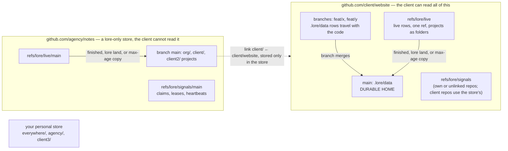

# Lore for teams — spec + plan

<DocStatus state="review" owner="khanakia" updated="2026-11-02"></DocStatus>

Make lore the one place a whole company's people and coding agents keep their shared memory and their shared work, with git as the only infrastructure: private notes stay private, internal notes never reach a client, several repos act as one product, people see a task the moment it is assigned, and many agents can work one mission without stepping on each other.

<Callout type="info" title="One-paragraph summary">

Everything lore does today stays: **every row is one JSON file in `.lore/data/`, it behaves like code on branches, and the copy on the default branch (`main`) is its durable home.** This spec adds four things. **Live rows:** any row can be shared with everyone at once on one hidden git ref per repo, `refs/lore/live`, and lands on `main` when it is finished, when someone runs `lore land`, or as a copy at its max age. **Signals:** short-lived facts (an agent's claim on a task, its heartbeat, a hold on a shared resource) sit on a second hidden ref, `refs/lore/signals`, that always holds exactly one commit, so they never create history. **Stores:** separate lore-only git repos (never code repos) hold internal and personal notes, found through links, so the same machinery gives "only me", "only our company", "this client" and "the whole company". **Orgs and agents:** one org per repo, one identity per org, a roster, and agent coordination (claims with a lease and a token, a ready queue, gates, handoffs, an inbox) built on the pieces above.

</Callout>

<Callout type="info" title="Implementation status (2026-11-02)">

Phases P1–P4 are built on branch `lore-team` (not yet on `main`): config and org resolution (lorecfg, orgresolve, identity), live rows and landing (live, rowroute, lsync merge driver), stores, links, roster, cache, render and leak checks (stores, cachedb, leakcheck, xref), and signals and agent coordination (signals, queue, mergewatch). The team scenario suite (`task lore:test:team`, tag `teame2e`) runs every flow with the real binary and real git: 136 of 136 pass, and the full gate (`task lore:check`) is green. Deltas from the original design are folded into the sections they change (coordinator answers of 2026-11-02, e.g. F10 rules 2–3 and 6, F9 trailer, F14 `--create`, D8 client row fields). Changes: [CHANGELOG.md](CHANGELOG.md). P5 is not started.

</Callout>

<Callout type="note" title="Status of this document">

Written as a design: nothing was built when this was written unless a row says **exists** and cites a file and line; every such citation was checked against `main` (commit `2310f2e`) on 2026-11-02. Several things an earlier draft called "existing" are not usable as they are; §10 lists each as a code prerequisite. The owner's decisions of 2026-11-02 (D1–D12, Q-a, Q-b) are folded in and recorded as ADRs in §11. Work is tracked in lore task `tsk_01a198535b4979cfa658b4950d23450e`; a mission for the phases in §13 is created after approval.

</Callout>

## Contents

- **0** The whole picture · Design principles · Fixed rules
- **1** Glossary — every term, command, flag, config key, env var, ref and file, one name each
- **2** Concepts in plain words — refs, branches, hidden refs, why hidden is not private, why one live ref per repo
- **3** Rows: where they live — branch, live ref, signals ref, stores; `--live` and `--to`
- **4** Flows — each with purpose, example, contract, edge cases, tests and debugging (F1–F20)
- **5** Stores and orgs — config, `stores:`, branches, staging, clones
- **6** Leak protection — every guard, and what hooks cannot stop
- **7** Many agents, one mission
- **8** Cookbook
- **9** Debug and test design
- **10** Code prerequisites
- **11** Decisions (ADRs)
- **12** Side effects and open questions
- **13** Phased plan
- **Appendix A** FAQ

## The whole picture (read this first)



1. **`.lore/data` on `main` is the durable home of every row.** On other branches rows behave like code and reach `main` when the branch merges.
2. **Any row can be made live.** Live rows are shared with everyone at once on `refs/lore/live`, whatever branch each person is on, and live wins over any branch copy. Live is temporary sharing: a row lands on `main` when it is finished, when someone runs `lore land`, or as a copy at its max age.
3. **Short-lived facts are signals, not rows.** Who is working on a task right now, until when, and who holds the shared test suite sit on `refs/lore/signals`, which is replaced in place and never grows history.
4. **Internal notes live in a store.** A store is a separate lore-only repo (for example `agency/notes`) with one folder per project (`org/`, `client/`, `client2/`). A client repo is linked to its internal project once; the link is saved only in the store.
5. **Personal notes live in your personal store**, filed by the org you were in when you wrote them.
6. **One person, many orgs.** Each org has its own identity, roster and stores in `~/.lore/config.yaml`; a repo loads exactly one org plus your personal notes, never two orgs.
7. **Agents coordinate through lore.** A claim is a compare-and-swap push on the signals ref with a unique token; tasks, dependencies, notes, gates and outcomes are ordinary rows.
8. **Everything is config.** Lore ships no built-in org, store or folder layout; one monorepo store, one store per client, or a mix are all plain config (§5).

## Design principles

These hold for every section. A design choice that breaks one is wrong, even if it is convenient.

1. **No useless commits, no lists that grow without bound.** Anything that changes often and matters only briefly (claims, leases, heartbeats, resource holds) lives on the signals ref, replaced in place, never in history and never on `main`. Only content (tasks, assignments, rules, decisions, notes, outcomes) creates history and lands. Every other growing thing (the `_purged.json` deletion list, live ref history, fetch caches, inbox markers, claim logs) is checked against this rule in §12.
2. **One source of truth: `.lore/data` on the default branch.** Live rows, signals, caches and rendered files are views or temporary copies; deleting any of them loses at most what has not landed yet, and lore says so before it happens.
3. **Live is temporary sharing, never storage.** A live row always has a way out: finished, `lore land`, or the max-age copy.
4. **Internal never reaches the client.** Privacy is decided only by which repo a row is stored in, never by hiding it inside a repo the client can read (§2). Internal rows, internal render output and internal caches are never written inside a client checkout.
5. **Lore stays flexible.** Orgs, stores, folders, defaults and adapters are config and seams, not built-in policy. A team on GitHub, GitLab or a bare server, with one store or twenty, uses the same code.
6. **Fail closed on safety and on claims.** When lore cannot tell whether a write would leak, it refuses and says why. When it cannot confirm a claim, renewal, approval or completion reached the remote, the command fails; it never reports success for a coordination write that is only queued.
7. **Show your work.** Every decision lore makes (which version won, why a row did not land, why an org was chosen) can be printed with `lore explain` or `--trace` (§9).

## Fixed rules

Settled with the owner. Where any later section and these rules disagree, these rules win.

1. **`.lore/data` on the default branch is the durable home of every row.** On every other branch, rows live in that branch's `.lore/data` and behave like code. The default branch is read from `origin/HEAD` (override: `default_branch:` in config); this spec writes it as `main`.
2. **Any row can be made live** (rule, decision, memory, task, mission, handoff, comment, note) with `--live` on `add` or `edit`. The kind of row only sets the default (`live.defaults`, per org). Live means shared with everyone at once, whatever branch they are on.
3. **One live ref per repo, projects as folders.** A code repo has exactly one live ref, `refs/lore/live`. A store has one per store branch, `refs/lore/live/<branch>`, and never a plain `refs/lore/live`. Inside the ref's tree each lore project is a folder: `_root/` for a project at the repo root, `web/` for a project in `web/`, `client/` in a store. Each project still has its own lore and reads and writes only its own folder. A store `branch:` may not contain `/`, and project folder names beginning with `_` are reserved (`_root`, `_live`); code branch names are unrestricted. There is no `.lore/live/` folder.
4. **If a row id is in live, live wins. Always.** Lore never reads `main` or another branch to decide which version of a row is true. On the default branch only, lookup may read through to its own fetched upstream (`origin/main`) for a row that exists nowhere locally (never overriding a local or live copy; rule `default-branch-read-through`, shown by `lore explain` and `--trace`). (It also reads `origin/main` to check that a landing arrived and to see whether a commit merged.)
5. **Lookup order for any command on an id:** for each loaded source in order (this repo, then each linked store project, then the org's global project, then the personal store), look in that source's live folder, then in its branch data; the first hit is edited. A tombstone stops the search ("deleted"). An id found in two sources is refused until the caller names one with `--from`. Nothing found is an error with a `lore sync peek` hint. `--live` on a row found only in branch data puts the new version into live. Details: F1.
6. **Landing writes the row to `main`; a row leaves live only when it is finished.** A live row is written to `main`'s `.lore/data` when (a) it gets a finished status, (b) someone runs `lore land` (one id, `--all`, `--kind`, `--mission`; `--dry-run` shows the plan), or (c) it reaches the max age (`live.max_age`, default 7 days) while still open, as a copy that is refreshed every max age while it differs. Finished means: task `done`/`cancelled`, decision `superseded`/`rejected`; rules, memories, notes and comments count as finished on every write, so each write lands a copy at once while the row stays live as long as it is being edited (ADR TEAM-027). It leaves live only when it is finished **and** lore sees that `main`'s file has the same content as the live file. One id is one file, so landing twice overwrites the same file and can never duplicate a row. Code branches merging, being squashed or being deleted never trigger, delay or lose a landing.
7. **Landing is automatic, with no human step and no required CI.** (a) Lore builds the landing commit on a freshly fetched `origin/main` and pushes `<sha>:refs/heads/main`, never touching local `main`. (b) If the remote refuses because `main` is protected, the rows ride on the next push of a code branch as a separate `lore: land N rows` commit, added by the `post-commit` hook with a temporary index; `pre-push` only checks, refreshes and, when needed, adds the commit and asks for one more push. (c) The opt-in `lore sync install-action --auto` workflow can land rows for quiet repos (a plain `install-action` writes a workflow that runs only when started by hand). Stores have no code branches, so a store branch must accept direct pushes (checked by `lore store doctor`).
8. **Durability caveat.** GitHub "Download ZIP", forks, plain mirrors and shallow clones do not include `refs/lore/*`. That is why live is temporary and open rows are copied to `main` at max age. `lore doctor` and `lore sync status` warn "N rows exist only in live". There is no post-clone hook: lore installs its fetch settings and fetches the refs on the first lore command in a clone.
9. **Every store is a separate lore-only repo, and a normal lore repo.** A store holds one or more lore projects as folders and has a `lore-store.yaml` marker at its root; lore refuses to use a repo listed under `stores:` that lacks the marker or holds non-lore files, and a code repo can never be a store. Each project in a store follows rules 1–8 exactly like a client repo, with the store branch its org entry names (`branch:`, default `main`) as its durable home. Each store branch is a separate lore: lore never moves rows between store branches (ADR TEAM-011). "Who sees it" (`--to repo|<org>|<org>/<folder>|me`) and "when" (with the code, or `--live`) are independent choices per row.
10. **Signals are not rows.** Claims, leases, heartbeats and resource holds live only on `refs/lore/signals` (in a store: `refs/lore/signals/<branch>`). Every signals write is one parentless commit holding the complete current state, pushed with `--force-with-lease`; the ref never has history. A signal carries `expires`; readers treat an expired signal as absent and any writer drops expired files. Signals never land, are never exported to `.lore/data` and are skipped by the merge driver. Assignment is not a signal: `assignee` is a field of the task row.
11. **Coordination writes fail closed.** A claim, renewal, release, `done` on a claimed task, gate approval or resource hold succeeds only when its push is confirmed by the remote. Offline, with autopush off, or after retries are used up, the command fails with a distinct error code; it is never queued.
12. **One org per repo; orgs never mix.** A repo resolves to at most one org entry (F10). Only that org's projects and identity load, plus the personal notes filed for that org and your everywhere notes.

## 1. Glossary

One name per thing. Real row ids are long (`tsk_01a1985b…`, UUIDv7, `saas/pkg/aicoder/ids/ids.go:18`); examples shorten them to `tsk_30`, `mis_12`, `mem_0b77`.

### Words

| Term | Meaning |
|---|---|
| **row** | one record (task, rule, memory, decision, mission, handoff, comment, actor…), stored as one canonical JSON file `.lore/data/<table>/<id>.json` |
| **project** | one lore project: a folder with `.lore/` (a repo root, a monorepo subfolder, or a folder in a store). Each has its own `project_id` in `.lore/data/_meta.json` |
| **default branch** | the code branch that holds the durable copy of every row; read from `origin/HEAD`, overridable with `default_branch:`. Written `main` in this spec |
| **branch data** | the rows in `.lore/data` on the branch you are on (in a store: on the store branch) |
| **live row** | a row whose current version is on the live ref; it wins over every branch copy |
| **land** | write a live row into `main`'s `.lore/data` (for a store: into the store branch) |
| **leave live** | remove a landed row from the live ref, only when finished and when `main` holds the same content |
| **max-age copy** | the landing of a still-open live row after `live.max_age`; the row stays live |
| **finished** | task `done`/`cancelled`, decision `superseded`/`rejected`; rules, memories, notes and comments are finished on every write (TEAM-027). This spec applies the same pattern to mission `done`/`cancelled` and handoff `accepted`/`declined` |
| **tombstone** | a live file with `_live.deleted: true`, written instead of removing a row so lookup does not fall through to an older branch copy |
| **ride-along** | the `lore: land N rows` commit added to a code branch when `main` is protected |
| **signal** | a short-lived fact (claim, lease, heartbeat, resource hold) on the signals ref; never a row, never history |
| **claim** | a signal saying "actor X, session Y, works on task T until `expires`", with a unique `claim_token` |
| **lease** | the `expires` time of a claim; renewing it is the heartbeat |
| **fencing** | the checks that stop a holder who lost its claim from writing: its `claim_token` must still be on the signals ref and the task row's `claim_epoch` must match |
| **epoch (live)** | the number in the live ref's `_live/epoch` file, raised each time live history is compacted |
| **store** | a separate lore-only git repo holding projects as folders; marked by `lore-store.yaml` at its root |
| **store branch** | the branch of a store an org entry uses; each is a separate lore |
| **org entry** | one item under `orgs:` in `~/.lore/config.yaml`: name, identity, `stores:`, `branch:`, repo patterns, defaults |
| **org folder** | the store folder holding company rules and the roster (`org_folder:`, e.g. `org`, or `.` for a dedicated company store) |
| **link** | a record in an internal project's `_meta.json` saying "client project id P at remote R belongs here"; written by `lore org link` |
| **client repo** | a code repo linked to an internal project without `--own`; the leak guards apply |
| **own repo** | a code repo of the org itself (matched by `own:` patterns, or linked with `--own`); no client guards |
| **linked project** | the internal project a client repo is linked to; a **group** is one linked project with several links; a **global project** is marked `"global": true` and loads in every repo of the org |
| **personal store** | your own store: `everywhere/` for notes that load everywhere, one folder per org for notes that load only in that org's repos |
| **source** | where a cached row came from: `repo`, `store:<org>/<folder>`, `personal:<folder>` |
| **label** | how a source is shown in lists: `[app]` (this repo's mount name), `[agency/client]`, `[me]` |
| **actor** | a person or agent on a roster (`actors` table); kinds `human`, `agent`, `hook`, `plugin`, `cron`, `system` (`dbent/schema/actor.go:16`–`22`) |
| **stable_key** | an actor's immutable unique key; for people, `human:<email in that org>` (`dbent/schema/actor.go:58`–`61`) |
| **handle** | a roster display alias, unique per roster, used as `@alice`; resolves to one actor or one team |
| **gate** | a task field that stops agents until a human approves (`gate: required → approved`) |
| **merged** | a done task whose recorded commit has been seen on the target repo's default branch; recorded once as `merged_at` |

### Refs

| Ref | Where | What |
|---|---|---|
| `refs/heads/*` | every repo | branches (code) |
| `refs/lore/live` | code repo | live rows of every project in the repo, as folders (`_root/`, `web/`) |
| `refs/lore/live/<branch>` | store | live rows of every project on that store branch (`client/`, `client2/`) |
| `refs/lore/signals` | code repo (own or unlinked) | signals, one parentless commit |
| `refs/lore/signals/<branch>` | store | signals for that store branch |
| `refs/lore-remote/origin/*` | every clone, local only | tracking copies of the remote's `refs/lore/*`, written by fetch; lore merges from them |
| `refs/remotes/origin/*` | bare store clones | tracking copies of store branches |
| `refs/lore-backup/live/<stamp>` | local only, never pushed | last 3 copies of the local live ref kept before a compaction or restore |

### Files and folders

| Path | What |
|---|---|
| `.lore/data/<table>/<id>.json` | a row (exists, `LORE_SYNC_SPEC.md` §0) |
| `.lore/data/_meta.json` | project id; in a store project also `links`, `global` |
| `.lore/data/_purged.json` | ids deleted on purpose, merged as a set union (exists, `saas/pkg/aicoder/lsync/files.go:29`, `mergedriver.go:54`) |
| `_live` block | inside a live file: `{live_since, hlc, deleted?, last_copy_at?}`; removed when the row lands |
| `_live/epoch`, `_live/meta.json` | in the live ref's tree: compaction epoch; `min_lore_version` and `features` |
| `<folder>/claims/<task-id>.json`, `<folder>/resources/<name>.json` | in the signals ref's tree |
| `lore-store.yaml` | store marker at a store's root, written by `lore store init` |
| `<org_folder>/lore-org.yaml` | org defaults shared by the team, read on every resolve |
| `.lore/org.yaml` | committed org choice, own repos only, names only |
| `~/.lore/config.yaml` | orgs, personal store, `repo_orgs` (machine-only choices) |
| `~/.lore/identity.yaml` | fallback identity when no org applies (migrated from `identity.toml`) |
| `~/.lore/clones/<host>/<owner>/<repo>.git` | one bare clone per store URL |
| `~/.lore/worktrees/<host>/<owner>/<repo>/<branch>` | optional browsing worktree (`lore store open`) |
| `~/.lore/cache/<project-id>.db` | store and personal rows for one code project, outside the checkout |
| `~/.lore/render/<project-id>.md` | rendered internal and personal context for one code project |
| `~/.lore/trace/` | `--trace` output |
| `.git/lore/` (bare clone: `<clone>/lore/`) | per-repo machine state: fetch stamp, live pending list, link-status cache, inbox marker |
| `.lore/lore.db` | the in-checkout cache: this repo's branch and live rows only |
| `.lore/LORE.md` (+ `CLAUDE.md` import) | committed render of the repo's own rows (exists, `saas/cmd/cli/render.go:102`) |
| `CLAUDE.local.md` | gitignored via `.git/info/exclude`; one line, `@~/.lore/render/<project-id>.md` |

### Commands (new unless marked exists)

| Command | What |
|---|---|
| `lore live show [id]`, `lore live diff`, `lore live log`, `lore live compact [--dry-run]`, `lore live restore`, `lore live purge <id> [--dry-run \| --confirm]` | inspect and maintain the live ref |
| `lore land <id>` / `--all` / `--kind <kind>` / `--mission <id>` / `--dry-run` | land rows now |
| `lore explain <id>`, `lore explain org` | show every copy of a row and which won; show org resolution step by step |
| `lore store init <url> [--branch <b>]`, `lore store show [--links]`, `lore store open`, `lore store forget`, `lore store doctor` | manage stores |
| `lore org link <org> --project <folder> [--own] [--default]`, `lore org unlink`, `lore org use <entry>`, `lore org set <org> --commit`, `lore org import <url>`, `lore org global <folder>` | org setup |
| `lore whoami` | the resolved org, identity, sources and the rule that decided |
| `lore move <id> --to <target>` | relocate a row, keeping its id (asks first when the target is a client repo); replaces `lore share`, which 0.1.18 removed |
| `lore actor register [--kind agent --label <l> --owner @h]`, `lore actor deactivate`, `lore team add\|list` | roster (`lore actor` inspect exists: `saas/cmd/cli/entity_commands.go:44`) |
| `lore task claim\|next\|heartbeat\|release\|revoke\|reassign\|note\|merged` | agent coordination (`lore task add\|done\|edit\|list\|show\|start\|cancel` exist) |
| `lore resource claim\|release <name>` | holds on a shared thing |
| `lore gate request\|approve <id>` | human gates |
| `lore handoff add --for <actor>`, `lore inbox [--since] [--ack]`, `lore mission status <id>`, `lore plan apply <file>`, `lore agent start` | coordination views and helpers |
| `lore check leaks [--ci] [--explain]`, `lore check pr-body <file\|->` (`-` reads stdin) | leak checks |
| `lore finding add --mission <id>` | a memory pinned to a mission, inheriting its project and liveness |
| `lore context --internal`, `lore cache prune`, `lore config check`, `lore project reid` | internal context for tools without imports; remove stale caches; validate YAML; give a copied project a new id |
| `lore actor alias` | link an old and a new identity of one person (deferred) |
| `lore sync conflicts`, `lore sync resolve` | **exist** (`saas/cmd/cli/sync_cmd.go:251`, `:301`); also list and settle live rows with conflict markers |
| `lore sync peek`, `lore sync promote`, `lore sync install-action`, `lore sync ci-merge` | **exist**: `saas/cmd/cli/sync_cmd.go:801`, `:870`, `sync_action.go:223`, `sync_ci.go:81` |

### Flags

| Flag | Meaning |
|---|---|
| `--live` / `--no-live` | put this write on the live ref, or keep it with the code |
| `--to repo\|<org>\|<org>/<folder>\|me\|me/<org>` | which project a row is written to (only ever a project, never an actor or branch) |
| `--everywhere` | with `--to me`: file the note under `everywhere/` |
| `--assign <@handle>` | the one assignment flag; a person sets `assignee`, a team sets `assigned_team` (a team is refused in linked client repos, TEAM-030) |
| `--approvers <@handle,…>` | on `mission add` (or `approvers:` at the top level of a plan file): only these humans may approve the mission's gates. There is no `--gate` flag: a gate is set with `lore gate request <id>` or `gate: required` on a task in a plan file |
| `--for <@handle>` | the actor a handoff is addressed to |
| `--ref <id>` / `--ref commit:<sha>` | on `task add`/`edit`: a pointer to another row or a commit (F15 direction rule applies) |
| `--create` | with `--to <org>/<folder>`: create a store project folder that does not exist yet (without it an unknown folder is refused, typo safety) |
| `--tasklist <id>` | on `task add`: optional (exists, today required); when left out the target project's default task list is used, created on demand. Text arguments: a positional title for `task add` and `mission add`, `--body` for `memory`, `rule` and `decision` (existing form) |
| `--from <source>` / `--not-from <source>` | pick or exclude a source on reads; pick one on an ambiguous id |
| `--after <id>[:done\|:merged][,…]` | dependencies |
| `--key <text>` | idempotency key for plan rows |
| `--owns <path>` | file ownership on `task claim` and `task next` (directory prefixes and exact files only) |
| `--commit <sha>` / `--pr <n>` | on `task done`: the code that finished it |
| `--lesson "<text>"` / `--no-lesson` | on `task done`: save a lesson or skip the reminder |
| `--mission <id>`, `--repo <name>`, `--all-repos`, `--role <role>`, `--mine`, `--claimed-by <@handle>` | filters on task commands; `--mine` = assigned to me or my team, and unclaimed or claimed by me (`--repo`, `--all-repos` exist: `saas/pkg/constants/flags.go:9`, `:14`) |
| `--timebox <dur>`, `--ttl <dur>`, `--label <name>`, `--owner <@handle>`, `--kind <kind>` | time box on a task, hold length on a resource, agent label and owner, actor or row kind |
| `--store <url>` | on `lore org link`: which store to create the folder in |
| `--strict`, `--yes` | refuse instead of warn (file ownership); confirm without a prompt |
| `--all`, `--ci`, `--explain`, `--merge`, `--refs`, `--signals` | on `land`; on `check leaks`; on `explain` (field decisions, pointers, the claim as seen now) |
| `--json`, `--trace`, `--dry-run`, `--share`, `--force-org` | machine output (`--json` exists, `saas/pkg/constants/flags.go:11`), tracing, plan only, `--share` kept with no effect (store urls and folders are always printed; only a credential inside a url is masked), override an org disagreement |

### Config keys (`~/.lore/config.yaml`; org defaults may also come from the store's `lore-org.yaml`)

| Key | Default | Meaning |
|---|---|---|
| `orgs[].name`, `.identity.key`, `.identity.name` | — | the org entry |
| `identity.key`, `identity.name` (top level) | — | the identity for repos that match no org while orgs exist (F10 rule 6); without it the legacy chain runs and skips any org identity key |
| `orgs[].stores[].url`, `.branch`, `.org_folder` | branch `main` | stores (D10) |
| `orgs[].own`, `orgs[].repos` | — | patterns for own repos and client repos |
| `orgs[].defaults.client_repos.<kind>` | task, memory: the linked project; rule, decision: `repo` (humans at a terminal only, F14) | where rows go in a client repo without `--to` |
| `orgs[].agent_details` | `internal` | `client` puts agent work notes in the client repo (D8) |
| `live.defaults.<kind>` | tasks, missions, handoffs, comments: true | which kinds are live by default |
| `live.max_age` | `7d` | max-age copy interval (TEAM-026) |
| `live.fetch_ttl` | `60s` | each lore command fetches once, unless the last fetch is younger than this; `lore sync` always fetches (TEAM-025) |
| `live.autopush` | `true` | push live writes at once |
| `live.compact_after` | `1000` | commits on a live ref before automatic compaction (written `live_compact_after` in the decision log) |
| `live.remote` | `origin` | remote for `refs/lore/*` (forks) |
| `lease.ttl`, `lease.renew_every`, `lease.grace`, `lease.push_retries` | `20m`, `5m`, `2m`, `5` | claim timing |
| `agents.max_claims_per_agent`, `agents.max_attempts` | `1`, `3` | WIP limit, poison-task limit |
| `merge_check.adapter` | `none` | `github` uses `gh` to see merged pull requests |
| `default_branch` | from `origin/HEAD` | override |
| `personal.store` | `local` | `local` (`~/.lore/personal`) or a git URL |
| `repo_orgs.<project-id>` | — | machine-only org choice (`lore org use`) |
| `link_index.max_age` | `1h` | how old a cached link index may be before it must be refreshed |
| `untrusted_hosts` | — | hostname patterns of client-owned machines; doctor warns when stores are configured there |

### Environment variables

| Variable | Meaning |
|---|---|
| `LORE_ORG` | choose the org entry for this shell (new) |
| `LORE_ACTOR` | **exists** (`saas/pkg/aicoder/identity/resolve.go:115`); in this design accepted only for agent actors on the org roster |
| `LORE_SESSION` | session id for an agent actor; set by `lore agent start` |
| `LORE_LIVE_AUTOPUSH` | `0` = never touch the network on its own (same as `live.autopush: false`) |
| `LORE_TRACE` | `1` = like `--trace` |
| `LORE_NOW` | fixed clock (RFC 3339), test builds only: one process clock, `cliClock()` (`saas/cmd/cli/cliclock.go`), which delegates to the live clock; only the `loretest` build (`live_clock_loretest.go`) reads `LORE_NOW`, frozen per process; never compiled into release builds |
| `LORE_LIVE_REMOTE` | point `refs/lore/*` at another remote, tests and forks |
| `LORE_RIDE_ACTIVE` | set by lore while it makes a ride-along commit, so its own hooks do not run again |

### Error codes (new; strings like the existing `E_*` codes in `saas/pkg/aicoder/errcodes/registry.go:30`)

| Code | Exit | When |
|---|---|---|
| `E_NO_WORK` | 10 | `task next` found nothing ready |
| `E_CONTENDED` | 11 | ready work exists but every claim attempt lost |
| `E_LOST_CLAIM` | 12 | the caller's claim token is no longer on the signals ref |
| `E_CANCELLED` / `E_REASSIGNED` | 13 / 14 | a human cancelled or reassigned the task while it was held |
| `E_OFFLINE` | 15 | a coordination write could not be confirmed |
| `E_AMBIGUOUS_ID` | 16 | the id exists in two sources |
| `E_ORG_AMBIGUOUS`, `E_ORG_DISAGREES` | 17 | two org entries match; `LORE_ORG` disagrees with the link |
| `E_LINK_UNKNOWN` | 18 | lore cannot tell whether this repo is a client repo |
| `E_NOT_A_STORE`, `E_LEAK_BLOCKED`, `E_CYCLE`, `E_OLD_LORE` | 19 | store check, leak guard, dependency cycle, binary below `min_lore_version` |
| `E_CONFIG_INVALID` | 1 | `~/.lore/config.yaml` failed validation (`lore config check` names the key) |

## 2. Concepts in plain words

### A branch is only a name pointing at a commit

Git keeps every commit in one big pile inside `.git/`. A **branch** is a tiny file holding one commit id, like a bookmark in a book. Git calls these names **refs**.

```
.git/refs/heads/main          contains a1b2…   ← the branch "main"
.git/refs/heads/feat/login    contains c3d4…   ← the branch "feat/login"
.git/refs/tags/v1.0           contains 9f8e…   ← a tag
```

A commit does not need a branch. Commits exist on their own; a branch is a label so you can find one.

### A hidden ref is a bookmark git does not list

Only names under `refs/heads/` are branches: `git branch` lists them, you can check them out, GitHub shows them. Lore adds names in its own folder:

```
.git/refs/lore/live           contains e5f6…   ← lore's live rows
.git/refs/lore/signals        contains 77aa…   ← who is working on what, right now
```

They are stored, fetched and pushed like branches, but `git branch` does not show them, nobody checks them out by mistake, and they never mix with code. GitHub stores pull requests the same way (`refs/pull/123/head`).

Think of the repo as an office. Branches are the rooms where people work, each with its own **filing cabinet** (`.lore/data`). `main`'s cabinet is the **archive**. `refs/lore/live` is a **whiteboard in the hallway**: what is written there is what everyone sees right now, from any room, and it beats any older note in a room's cabinet; finished items are filed into the archive and wiped off. `refs/lore/signals` is the **sticky-note board by the door** ("Alice's agent is in the meeting room until 3 pm"): notes are replaced, never filed, and an expired note is ignored.

### Why a ref, and not a folder

`git checkout` only swaps **tracked** files, the ones git stores in commits. That decides where live rows can go:

| Place | Changes when you switch branch? | Reaches teammates? | Fit for live rows? |
|---|---|---|---|
| a tracked folder (like `.lore/data`) | yes, every branch has its own copy | yes, with the branch | no: that is the per-branch problem |
| a gitignored folder (a would-be `.lore/live/`) | no | **no**, nothing pushes it | no: only your machine sees it |
| a ref outside `refs/heads/` (`refs/lore/live`) | no, checkout never touches it | yes, lore pushes and fetches it | **yes** |

### Why one live ref per repo, with projects as folders

Git stores ref names like file paths, so a ref cannot also be a folder of refs. If `refs/lore/live` exists, `refs/lore/live/web` cannot be created, and the reverse. Tested with git 2.50:

```console
$ git update-ref refs/lore/live HEAD
$ git update-ref refs/lore/live/web HEAD
fatal: update_ref failed for ref 'refs/lore/live/web': cannot lock ref 'refs/lore/live/web': 'refs/lore/live' exists; cannot create 'refs/lore/live/web'
```

So a monorepo cannot have one ref for its root project and another for `web/`. Lore uses **one** live ref per repo and puts each project in a folder inside it:

```filetree
refs/lore/live  (one commit; its tree:)
  _live/
    epoch                  compaction epoch (F8)
    meta.json              min_lore_version, features
  _root/                   the project at the repo root
    tasks/tsk_02.json
  web/                     the project in web/
    rules/rul_0d21.json
```

Each project still has its own lore: lore in `web/` reads and writes only `web/` in that tree, exactly as it reads only `web/.lore/data` on a branch. A store does the same per store branch (`refs/lore/live/main` holds `org/`, `client/`, `client2/`), and because a store `branch:` may not contain `/`, `refs/lore/live/main` and `refs/lore/live/release-2026` can never clash.

### Hidden is not private

<Callout type="danger" title="The rule everything else follows">

**Anyone who can clone a repo can fetch every ref in it, hidden ones included** (`git fetch origin 'refs/*:refs/*'`). Hidden refs keep things out of the way; they never keep things secret. Branches are not a barrier either: GitHub has no per-branch read access. **Privacy is decided only by which repo something lives in.** A note the client must never read cannot live anywhere in the client's repo: not in `.lore/data`, not on a hidden ref, not in a gitignored file inside the checkout that a Docker build or ZIP could pick up.

</Callout>

### Content and signals

Lore keeps two kinds of shared state apart, because they behave differently:

| | Content | Signals |
|---|---|---|
| Examples | tasks, assignments, rules, decisions, notes, outcomes (`done_by`, `merged_at`) | "agent-frontend-2 is working on tsk_31 until 14:20", heartbeats, "agent X holds the full test suite" |
| Changes | when something is decided or learned | every few minutes |
| Stored as | rows: branch data, live ref, landing on `main` | files on the signals ref, replaced in place |
| History | yes; it is the record | none: the ref is always one commit, old ones are garbage-collected |
| Lands on `main` | yes | never |

## 3. Rows: where they live

### 3.1 The four places

| Place | What sits there | Who can read it | History | Ends up on `main`? |
|---|---|---|---|---|
| **branch data** (`.lore/data` on a code branch) | rows written without `--live` | everyone with repo access | yes, like code | when the branch merges |
| **live ref** (`refs/lore/live`, in a store `refs/lore/live/<branch>`) | rows written with `--live` or live by kind default | everyone with repo access | yes, compacted (F8) | when finished, on `lore land`, or as a max-age copy |
| **signals ref** (`refs/lore/signals`, in a store `refs/lore/signals/<branch>`) | claims, leases, heartbeats, resource holds | everyone with repo access | none | never |
| **a store** (a separate lore-only repo) | internal, group, global and personal projects; each has its own branch data, live ref and signals ref | only people with access to that store | as above | onto the store branch |

### 3.2 Writing: `--live` picks *when*, `--to` picks *who*

```console
$ lore task add "fix login timeout" --assign @alice          # tasks are live by default: everyone sees it now
$ lore rule add --body "never run migrations from the app container" --live
$ lore memory add --body "staging DB is restored every Sunday"       # not live by default: travels with this branch
$ lore task add "update the README table" --no-live           # waits for the branch to merge
$ lore memory add --body "client prefers WhatsApp" --to agency   # into the linked internal project, in the store
$ lore memory add --body "I forget the staging VPN" --to me          # into your personal notes for this org
```

| | without `--to` | `--to <org>` / `--to <org>/<folder>` | `--to me` |
|---|---|---|---|
| **without `--live`** (with the code) | this branch's `.lore/data`; reaches `main` when the branch merges | the store branch, committed and pushed at once (a store has no code branches) | the personal store branch, committed and pushed at once |
| **with `--live`** | this repo's live ref, folder of this project | the store's `refs/lore/live/<branch>`, folder of that project | the personal store's live ref (rarely useful; only you read it) |

In a client repo, "without `--to`" does not mean "the client repo": guard 1 sends every kind to `defaults.client_repos` (the internal project, by default), and writing into the client repo needs `--to repo` or a default someone chose on purpose (§6).

Defaults per kind are config:

```yaml
# ~/.lore/config.yaml (the store's org/.lore/lore-org.yaml may set the same keys for the whole team)
live:
  defaults: {tasks: true, missions: true, handoffs: true, comments: true, rules: false, decisions: false, memories: false}
  max_age: 7d
  fetch_ttl: 60s
  autopush: false   # nothing pushes without the person saying so: lore sync or git push sends live writes
  compact_after: 1000
```

### 3.3 A live file

The live file is the row in the same canonical JSON as `.lore/data`, plus a small `_live` block lore removes when the row lands:

```json
{
  "id": "tsk_02", "title": "fix login timeout", "status": "todo",
  "assignee": "act_81d2", "updated_at": "2026-11-02T10:04:11Z",
  "_live": { "live_since": "2026-11-02T10:04:11Z", "hlc": "2026-11-02T10:04:11Z/0003/act_3f9c" }
}
```

`hlc` is a hybrid logical clock (wall time, a counter, the writer) used to order edits when two machines' clocks disagree (F4). After a max-age copy the block also holds `last_copy_at`. A deleted row keeps only `{"id", "_live": {"deleted": true, …}}`, never the body.

### 3.4 A signal file

```json
{
  "kind": "claim", "task": "tsk_31", "project": "client2",
  "holder": "act_c47a", "session": "s-7f2e", "claim_token": "ct_9b1e…",
  "claim_epoch": 4, "expires": "2026-11-02T14:20:00Z", "renewed_seq": 17,
  "work_branch": "agent-frontend-2/invite-route", "host": "devbox"
}
```

A resource hold has the same shape with `"kind": "resource"` and `"name": "full-suite"`. There is no history of signal files: a renewal replaces the file and the whole ref.

### 3.5 Assigned versus claimed

| Question | Answer comes from | Kind |
|---|---|---|
| Who should do it? | `assignee` (or `assigned_team`) in the task row | content: lands |
| Who is doing it right now, until when? | the claim signal | signal: never lands |
| Who did it, with what code, did it merge? | `done_by`, `done_at`, `done_commit`/`done_pr`, `merged_at` in the task row | content: lands |
| What happened along the way? | notes (comments) and the bounded `claim_log` in the task row | content: lands |

Every view combines the row and the signal:

```console
$ lore task list --mission mis_12
ID      TITLE                     ASSIGNEE     STATE
tsk_30  invite mutation + email   @backend     ✓ done · merged 11:52
tsk_31  invite landing route      @frontend    ▶ working: agent-frontend-2 (until 14:20)
tsk_32  allow /invite on proxy    @agent-infra     ▶ EXPIRED 4 min ago (agent-infra)
tsk_33  deploy to staging         —            ⏸ gate: needs approval
```

### 3.6 What lands where

| Row | Its durable home |
|---|---|
| a row of this repo (any project in it) | `main`'s `.lore/data` of that project |
| a row of a store project | the store branch's `<folder>/.lore/data` |
| a personal note | the personal store branch's `<folder>/.lore/data` |
| a signal | nowhere; it expires |

## 4. Flows

Every flow below uses the same template: **Purpose · Example · Contract · Edge cases · Test · Debug**. Each flow's decision is a pure function, `Decide(inputs) → Plan`, run by a separate executor; tests pin the plan without git, and the e2e scenarios run the real binary (§9). The seams named in "Test" are defined in §9.1.

| # | Flow | Phase |
|---|---|---|
| F1 | Row lookup | P2 |
| F2 | Write to live | P2 |
| F3 | Fetch with a tracking ref | P2 |
| F4 | Merge of a row (incl. delete versus edit) | P2 |
| F5 | Landing: triggers, `lore land`, max-age copy, leaving live | P2 |
| F6 | Protected `main`: the ride-along commit | P2 |
| F7 | Signals: claim, renew, release, expire | P4 |
| F8 | Live compaction with an epoch | P2 |
| F9 | Done → merged watching | P4 |
| F10 | Org resolution | P1 (links: P3) |
| F11 | `lore org link` and the link scan | P3 |
| F12 | Store use and the `lore-store.yaml` checks | P3 |
| F13 | Several stores per org (`stores:`, `org_folder`) | P3 |
| F14 | Write target: `--to` and defaults | P3 |
| F15 | Cross-project references | P3 |
| F16 | Leak checks | P1 (render), P3 (the rest) |
| F17 | Personal note placement | P1 |
| F18 | Roster and identity, incl. the per-session agent actor | P1 (identity), P3 (roster) |
| F19 | TOML → YAML config migration | P1 |
| F20 | Cache build and render | P1 |

### F1. Row lookup

**Purpose.** Every command that takes a row id must find exactly one copy, the right one, and say so when it cannot.

**Example.**

```console
alice (client/website, feat/login)$ lore task done tsk_50
✓ tsk_50 done   [agency/client] live → landing on agency/notes main
alice$ lore task show tsk_99
error E_AMBIGUOUS_ID: tsk_99 exists in [app] and [agency/client]; pass --from app or --from agency/client
```

**Contract.**

```text
in:   id, cwd → loaded sources (F20) in order: repo, linked store projects (default link first), global, personal (org folder, then everywhere)
      for each source: its live folder (from the merged local live ref, F3) and its branch data
step: 1. refresh live and branch tracking refs if older than live.fetch_ttl (F3); offline → use what is cached and say "(cached 4 min)"
      2. for each source, live first, then branch data:
           tombstone → stop: "tsk_02 was deleted (live, 2026-11-01)"
           hit       → record (source, place, path)
      3. no hit in any source and HEAD is the default branch → read through to the fetched origin/<default>
           .lore/data of that source (rule default-branch-read-through; only rows absent locally and in live)
      4. still no hit → also read origin/main's _purged.json of each source: purged → "deleted on purpose"
out:  exactly one hit → that copy is read or edited
      hits in two sources → E_AMBIGUOUS_ID unless --from names one
      none → E_NOT_FOUND with hint "lore sync peek <branch> tasks"; exit 1
```

`--live` on a row found only in branch data writes the edited version to that source's live folder; from then on live wins.

| The id is… | `lore task edit tsk_02 …` | `… --live` |
|---|---|---|
| in live | edits the live row | same |
| only in branch data | edits the branch file; reaches `main` at merge | writes the new version into live |
| in both | edits the live row | same |
| tombstoned in live | refused: "deleted" | refused |
| in two sources | `E_AMBIGUOUS_ID` | `E_AMBIGUOUS_ID` |
| nowhere | error and peek hint | error and peek hint |

**Edge cases handled.** Detached HEAD (branch data = the commit's tree). A row that landed on `main` while you stand on a not-yet-pulled `main`: found through the read-through rule (step 3). A row that landed on `main` while your feature branch is older: not found, the hint says "it may have landed on main: `lore sync peek origin/main tasks`". Store offline: the last fetched store data is used and marked. Same id copied by a fork (F11 refuses the link). A row whose live copy has conflict markers is shown with a warning and cannot land (F4).

**Test.** Seams `Git`, `Clock`, `StoreIndex`. Pure `Lookup(id, sources)` table test over: id in live / branch / both / neither / tombstoned / purged × source repo / store / global / personal × one source vs two × cache fresh / stale / offline × detached HEAD. E2E: cookbook 12, `lore task done tsk_50` from the client repo edits the store's live row and nothing in `client/website` changes.

**Debug.** `lore explain tsk_50` lists every place the id exists, the rule step that chose the winner and the age of each fetch. `lore doctor` row: "ids present in two sources".

### F2. Write to live

**Purpose.** Share a row with everyone at once without touching any branch, working folder or staging area.

**Example.**

```console
bob (feat/payments)$ lore task add "fix login timeout" --assign @alice
✓ tsk_02 fix login timeout → @alice   (live, pushed)
alice (feat/login)$ lore task list --mine
[app] live  tsk_02  fix login timeout  todo  from bob  1 min ago
```

**Contract.**

```text
in:   row (new or edited), project folder, live ref name (refs/lore/live or refs/lore/live/<branch>)
step: 1. fetch the live ref into its tracking ref and merge it into the local ref (F3)
      2. build the new tree with a private index (GIT_INDEX_FILE): read the local live tree, replace <folder>/<table>/<id>.json
      3. if the new tree equals the parent's tree → stop, nothing to do (no commit, no push)
      4. commit-tree -p <local live> (no parent on the very first write); fixed message "lore: live N rows (<folder>)"; author = the org identity
      5. update-ref <ref> <new> <old>   (compare-and-swap: fails if anything moved it)
      6. push <new>:<ref> (non-forced); rejected → back to 1, merge with F4, up to live.push_retries with jittered backoff
out:  pushed → "(live, pushed)"
      not pushed (offline, autopush off, retries used up) → the commit stays on the local ref, ahead of the tracking ref,
      and its file is recorded in the pending list; "(live, not pushed yet: N waiting)"; exit 0
      (coordination writes are different: they fail with E_OFFLINE, rule 11)
```

The "queue" is nothing more than the local live ref being ahead of its tracking ref, plus a small pending list (`.git/lore/live-pending.json`: id and blob hash per waiting write, cleared when the push is confirmed) that F8 needs after a compaction.

**Edge cases handled.** First write ever (no ref: a parentless commit, which is code prerequisite C2). The same write twice: step 3 makes it a no-op, provided the retry keeps the row's `updated_at` and `hlc` (lore re-uses them on retry). Two writers at once: one push wins, the other merges and retries. A binary below `_live/meta.json` `min_lore_version` refuses to write (`E_OLD_LORE`) and stays read-only. A secret in the row: refused before step 2 (existing scanner, `saas/cmd/cli/sync_wire.go:193`). A write to a client repo's live ref runs the leak check first (F16).

**Test.** Seams `Remote` with `FaultRemote` (reject the nth push, offline, a concurrent writer between fetch and push), `Clock`, a jitter seed. Matrix: new / edit / delete × first write × rejected 0–5 times × same row changed on both sides × offline × same write twice. E2E: two clones write the same task at once; both edits survive (F4) and the two writes add exactly two commits to `refs/lore/live` (the retried writer rebuilds on the merged state; no merge commit).

**Debug.** `lore live diff` (local, tracking, remote, pending), `lore live log`, `--trace` prints each git command and each retry.

### F3. Fetch with a tracking ref

**Purpose.** Bring in teammates' live rows and signals without ever overwriting the local live ref, which may hold writes that are not pushed yet.

**Example.**

```console
$ git config --get-all remote.origin.fetch
+refs/heads/*:refs/remotes/origin/*
+refs/lore/*:refs/lore-remote/origin/*        ← added by lore on the first command in a clone
```

**Contract.**

```text
in:   repo or bare store clone, remote (live.remote, default origin), last fetch stamp, live.fetch_ttl, command kind
step: 1. ShouldFetch(now, stamp, ttl, kind): once per lore command, skipped when the stamp is younger than
         live.fetch_ttl (60 s); `lore sync` always fetches; a write whose push is rejected fetches again (its
         compare-and-swap never acts on stale data)
      2. ONE git fetch of refs/lore/* and the default branch (store: the store branch) into tracking refs,
         so live, signals and main are seen at the same moment
      3. for the live ref: tracking ahead of local → fast-forward local; both moved → merge (F4) and CAS the local ref;
         tracking epoch higher than local epoch → F8 re-apply path
      4. signals are read straight from the tracking ref (lore keeps no local signal state)
      5. write the stamp (.git/lore/fetch-stamp; shared by all worktrees of the repo)
out:  merged local refs; nothing is ever force-written into a local refs/lore/* ref
```

Git hooks `post-checkout` and `post-merge` (installed today, `saas/cmd/cli/sync_wire.go:448`–`449`) start the fetch in the background with a hard timeout and never block the hook.

**Edge cases handled.** Offline: reads use the last fetched state and say how old it is. A remote that refuses `refs/lore/*` (some hosts allow only heads and tags): `lore doctor` probes with a throwaway ref and says so. A fork: `live.remote` points `refs/lore/*` at the upstream. A remote live ref that is not a descendant of what we had and has no higher epoch (someone ran `git push --mirror` or deleted it): lore does not merge it blindly; it stops writing, keeps the local copy in `refs/lore-backup/live/<stamp>` and tells the user to run `lore live restore` (§6.6). A `blob:none` partial clone or a depth-1 checkout: doctor warns that lookups may need the network. CI workflows that run lore (`lore sync install-action`, `lore check leaks --ci`) fetch `refs/lore/*` and the full default-branch history, because merged checks need ancestry.

**Test.** Pure `ShouldFetch` over stamp age 0/59/61 s × kind × autopush 0/1 × ref missing on remote. E2E: offline write on clone A, teammate write on clone B, A comes online and runs any command: both rows exist and A's write was not lost (the old forced refspec lost it).

**Debug.** `lore doctor` rows: refspec present and not forced into `refs/lore/*`; last fetch age; ahead or behind counts. `--trace` prints the fetch and its timing.

### F4. Merge of a row

**Purpose.** Settle two versions of the same row (two live writers, a branch merging into `main`, a ride-along meeting an edited row) without losing either side and without inventing a half-row.

**Example.**

```console
$ lore live log tsk_02
merged tsk_02: status "done" (alice, hlc …0007) over "in_progress" (bob, hlc …0005); title kept both edits → conflict, see lore sync conflicts
```

**Contract.**

```text
in:   base, ours, theirs file (any may be absent)
step: 1. file level first:
           added on one side only            → take it
           added on both, same content       → take it
           added on both, different content  → merge3 with an empty base
           deleted (tombstone) on one side, unchanged on the other → deleted
           deleted on one side, MODIFIED on the other → modify wins: the row stays (live), the tombstone is dropped,
             and the row will land again; lore prints "tsk_02 was deleted by bob but edited by alice; kept"
      2. field level (existing merge3, saas/pkg/aicoder/merge3/merge3.go:106, via saas/pkg/aicoder/lsync/mergedriver.go:57):
           status, priority, dates, numbers → the side with the higher hlc wins (not wall-clock updated_at)
           text fields → both edits kept with conflict markers inside the value
           list fields that are sets (_meta.json links, labels) → set union
out:  merged file, or a file with markers → marked conflict: true; it is shown with a warning, is not landed
      and is listed by `lore sync conflicts` until `lore sync resolve` (both exist, saas/cmd/cli/sync_cmd.go:251, :301)
```

Claims are never merged: a lost claim is decided again from scratch (F7).

**Edge cases handled.** Clock skew: `hlc` orders edits even when a laptop clock is minutes off; `lore doctor` warns when the local clock differs from the remote's commit dates by more than `lease.grace / 2`. Two concurrent `lore org link` runs: `links` merges as a union, never as markers. A row with markers in live: kept and visible, never landed. A text clash in a field an agent writes often (notes): notes are separate comment rows, so clashes are rare.

**Test.** Pure table test over base × ours × theirs ∈ {absent, same, edited, tombstone} × field type (scalar, text, set) × hlc order (ours newer, theirs newer, equal). Must include add/add and delete/edit. E2E: delete on clone A, edit on clone B, both push; the row survives and lands.

**Debug.** `lore explain tsk_02 --merge` prints each field decision and the hlc values; `--trace` prints merge3 decisions.

### F5. Landing

**Purpose.** Get every live row into its durable home with no human step, never lose a reopened row, and never create a duplicate.

**Example.**

```console
alice$ lore task done tsk_02
✓ tsk_02 done → landed on main (a7c1e09), leaves live once main is fetched
$ lore land --mission mis_12 --dry-run
would land 4 rows to agency/notes main (client2/):
  tsk_30 done → land, then leave live
  tsk_31 open → copy (stays live; claimed by agent-frontend-2)
  mem_44 memory, finished on write → land, then leave live
  tsk_33 open, gate requested → copy (stays live)
$ lore land --all --kind rule
```

**Contract: when.**

```text
ShouldLand(row, kind, now, lastCopy, max_age, mainBlob) →
  finished (rule 6a)                                  → Land
  `lore land` named it (6b)                           → Land, or Copy if the row is open
  open and now − (last_copy_at or live_since) ≥ max_age and live differs from main (6c) → Copy
  otherwise → Stay, with the reason
```

Rules, memories, notes and comments are finished on every write, so each live write of one of them lands a copy at once (rule 6, TEAM-027); a later edit while it is still live lands again.

**Contract: how (direct landing).**

```text
step: 1. fetch origin/main (F3)
      2. on a private index read origin/main's tree; for each row: write <folder>/.lore/data/<table>/<id>.json
         (the row without its _live block); a tombstone deletes the file and adds the id to _purged.json
      3. same tree as origin/main → nothing to commit (landing twice is a no-op)
      4. commit-tree -p origin/main, fixed message "lore: land N rows (<folder>)" with ids only, author = org identity
      5. push <sha>:refs/heads/main (never --force; local main is never read or moved)
         accepted                         → done
         non-fast-forward (main moved)    → back to 1, up to push_retries
         protection refusal (GH006, "protected branch", pre-receive declined) → F6
out:  "landed on main (<sha>)" or "main is protected: rides on your next push"
```

For a store project the same steps run on the bare clone and the store branch. A store branch must accept direct pushes; if it refuses, the rows wait in live and `lore store doctor` reports it (a store has no code branch to ride on).

**Contract: leaving live.**

```text
Confirm(liveRow, mainBlobOnFreshOriginMain) →
  finished AND main's file == live file without _live
      → remove from live with compare-and-swap on that live blob (if the live blob changed meanwhile, do nothing)
  otherwise → stay; open rows stay live after a copy, reopened rows stay live and land again
Any lore that writes live, or runs lore sync, performs this check for the rows it sees.
```

**Edge cases handled.** A row reopened after it landed: its live blob differs from `main`'s, so it stays live and lands again. A pull request carrying a ride-along is closed unmerged: `main` never gets the content, the row stays live and rides again. Two people land the same row: one file per id, the second landing finds the same content and commits nothing. A user standing on `main` with unpushed commits: landing never touches local `main`, so their commits are not pushed. A tombstoned row: lands as a file delete plus an `_purged.json` id; the tombstone stays in live for at least `live.max_age` after landing so an old branch copy cannot come back (lookup also reads `_purged.json`, F1). A claimed task at max age: copied, stays live, the claim is untouched (signals never land).

**Test.** Pure `ShouldLand` and `Confirm` table tests: every kind × finished / open / finished-on-write × age under / over × main equal / older / newer / absent × tombstone. `FaultRemote` that refuses with a protection message versus a non-fast-forward. E2E: unprotected repo, `task done`, the row is on `origin/main` and leaves live; local `main` with an unpushed commit is not pushed.

**Debug.** `lore land --dry-run [--all]` prints the plan with reasons; `lore explain <id>` shows "land: waits (main protected; rides on next push)"; `lore sync status` lists rows only in live with their ages.

### F6. Protected `main`: the ride-along commit

**Purpose.** When `main` refuses direct pushes, carry landed rows in the next pull request without disturbing the developer's work.

**Example.**

```console
alice (feat/login)$ git commit -m "fix login timeout"
[feat/login 4e1d2aa] fix login timeout
lore: added "lore: land 1 row" to feat/login (tsk_02)
alice$ git push
```

**Contract.**

```text
post-commit hook:
  skip when: LORE_RIDE_ACTIVE is set; a rebase, cherry-pick, revert, merge or bisect is in progress;
             HEAD is detached; the current branch is the default branch; no rows are waiting
  "waiting rows" = rows whose landing was refused for protection and whose content is not yet on origin/main
  1. build a tree = HEAD's tree + the waiting rows' files, with a TEMPORARY index (never the user's index)
  2. commit-tree -p HEAD, message "lore: land N rows (<folder>)"; update-ref HEAD <new> <old>
  3. update only those paths in the real index and working folder; if any of them has uncommitted changes, skip
     (rows keep waiting) and print why
pre-push hook (checks only):
  if waiting rows are missing from the pushed branch, or the ride commit holds an older version than live now:
     add a fresh ride commit as above and stop this push: "lore added 'lore: land 1 row'; run git push again"
```

Ride snapshots are always the current live content, so two pull requests carrying the same row carry the same file and do not conflict in the host's merge button (which never runs lore's merge driver). If they still differ (the row changed between the two pushes), the second pull request shows a conflict on that one file; `lore sync ci-merge` (opt-in) or a local merge settles it.

**Edge cases handled.** Amend or reset drops the ride commit: `pre-push` adds it again. `--no-verify` skips `pre-push`: the rows keep waiting and ride on a later push. A monorepo with several projects waiting: one ride commit per push containing all of them. Signed commits required: the ride commit is signed with the user's configured key when `commit.gpgsign` is on. Linear-history rules: the ride commit is a normal child of HEAD, so rebase merges keep it.

**Test.** Hook entry points called in-process. Matrix: normal commit × rebase in progress × detached HEAD × on `main` × dirty landed path × amend after ride × `--no-verify`. E2E: protected-main fake remote (pre-receive refuses `refs/heads/main`); the ride commit appears on the pushed branch, the index has no staged deletions, `git status` is clean.

**Debug.** `lore explain <id>` says "waiting to ride"; `lore doctor` checks the `post-commit` and `pre-push` blocks are installed.

### F7. Signals: claim, renew, release, expire

**Purpose.** Let exactly one agent hold a task at a time, keep "alive" separate from "progress", and do it without a single commit of history.

**Example.**

```console
agent-frontend-2$ lore task claim tsk_31 --owns "src/routes/invite/"
✓ claimed tsk_31 (lease 20m, token ct_9b1e…) on agency/notes signals/main
agent-frontend-2$ lore task heartbeat --daemon tsk_31 &
agent-frontend (zombie, woke up)$ lore task done tsk_31
error E_LOST_CLAIM: tsk_31 is held by agent-frontend-2 since 13:58 (your token ct_51aa… expired 13:54); exit 12
```

**Contract: every signals write.**

```text
1. fetch refs/lore/signals[/<branch>] (F3); old = its commit
2. build the complete new state: copy every file of the old tree, drop every expired file, apply the change
3. commit-tree with NO parent (the ref never has history); fixed message "lore: signals"
4. git push --force-with-lease=<ref>:<old> origin <new>:<ref>
   rejected (someone else wrote) → re-run the DECISION from step 1 (never merge), jittered backoff
   offline / autopush off / retries used up → E_OFFLINE, exit 15 (rule 11)
```

**Contract: the operations.**

| Operation | Decision | Writes (one push; `--atomic` across both refs where shown) |
|---|---|---|
| claim | task ready (§7.3), no unexpired claim, caller holds fewer than `max_claims_per_agent` | signals: new claim with fresh `claim_token`, `claim_epoch = row.claim_epoch + 1`, `expires = now + lease.ttl`. Atomic with live: task row `claim_epoch++`, `status = in_progress` on first claim, `attempts = 1` on the first claim and `attempts++` on each reclaim (a claim after a voluntary release keeps the count), one `claim_log` entry |
| renew (heartbeat) | caller's token is on the ref and not expired | signals only: `expires`, `renewed_seq++`. Never touches the row or its status |
| release | caller's token on the ref | signals: remove the claim. Atomic with live: one `claim_log` entry |
| done / note / gate request by the holder | token on the ref, not expired, and row `claim_epoch` equals the claim's | atomic: signals (drop or keep the claim) + live (the row change) |
| revoke / cancel / reassign by a human | human actor from the identity file | atomic: signals (remove the claim) + live (`claim_epoch++`, status or assignee) |
| expire | `now > expires + lease.grace` on the reader's clock **and** the reader has seen the same `renewed_seq` for at least `lease.renew_every` | readers treat it as absent; the next writer drops the file |

`git push --atomic` makes the signals lease and the live change succeed or fail together, so a holder who lost its claim cannot complete a task: the lease check fails and nothing is written. On a remote without atomic push (doctor probes for it), lore writes signals first, then live, and documents the narrow window. Atomic push is expected on GitHub and GitLab and verified per host by the test suite (TEAM-036).

A holder whose renewals keep failing stops work at `expires − lease.grace` and exits `E_LOST_CLAIM` from the daemon. Heartbeats come from `lore task heartbeat --daemon` (started by `lore agent start`) or from an agent-tool hook calling `lore task heartbeat` (rate-limited to `lease.renew_every`); progress is recorded separately as notes.

**Edge cases handled.** Two sessions with the same actor: the claim records `session` (`LORE_SESSION` for agents, `<stable_key>@<hostname>` for humans); a second session gets "held by agent:agent-frontend in another session (devbox); set a different LORE_ACTOR". A human cancels while an agent works: the agent's next renew or done gets `E_CANCELLED` (13). Reassign: `E_REASSIGNED` (14). A claim race on a task that sits only in the store branch (not live yet): add/add is never merged; the loser re-decides. A rejected push caused by an unrelated signal (another agent's renewal): retry, never counted as a lost claim. A poison task: past `max_attempts` reclaims it becomes `blocked` with the reason "failed 3 times" and goes to the owner's inbox. Clock skew: expiry needs both the time check and an unchanged `renewed_seq`, so a skewed reader cannot steal a live lease; doctor warns on skew.

**Test.** `FaultRemote` injecting a racing writer between fetch and push, `Clock` per agent with skew. Matrix: free / held-valid / held-expired-within-grace / expired × rejection by own task / unrelated file × offline × renew after reclaim × cancel while held × same actor two sessions × atomic push supported or not. E2E: four agents race `task next`, exactly one wins each task, total pushes stay under 4 × tasks; kill one agent, the task is reclaimed after `ttl + grace`; the zombie's `done` fails with exit 12.

**Debug.** `lore task show tsk_31 --signals` (holder, token prefix, expires, renewed_seq, as seen now); `lore explain tsk_31`; doctor rows: clock skew, atomic push support, signals ref size.

### F8. Live compaction with an epoch

**Purpose.** Keep the live ref's history small (principle 1) without losing anyone's unpushed live writes.

**Example.**

```console
$ lore live compact --dry-run
refs/lore/live has 1,214 commits (threshold 1000); compacting would keep 37 files, epoch 3 → 4
$ lore live compact
✓ compacted refs/lore/live to 1 commit (epoch 4); backup kept locally as refs/lore-backup/live/20261102T1012
```

**Contract.**

```text
compact (manual, or automatic when the ref has more than live.compact_after commits and the last compaction
         in _live/epoch is older than a day; never on main or any code branch):
  1. fetch; old = remote live commit
  2. one parentless commit with old's exact tree, _live/epoch incremented and compacted_at set
  3. keep the local copy as refs/lore-backup/live/<stamp> (local only; the last 3 are kept)
  4. git push --force-with-lease=<ref>:<old>; rejected → someone wrote meanwhile → start again
reader with remote epoch > local epoch (F3 step 3):
  1. back up the local ref
  2. local ref := the remote commit (discard local live history)
  3. re-apply only this clone's pending writes (.git/lore/live-pending.json) as one normal commit; merge with F4
  4. push normally
```

**Edge cases handled.** A writer pushing at the moment of compaction: either the compaction's lease fails (it retries) or the writer's push is rejected and it takes the reader path. A clone that was offline across two compactions: same path, the epoch only grows. Teammates on an old lore binary: `_live/meta.json` `min_lore_version` makes them read-only before compaction ships.

**Test.** Pure re-apply planner over pending × remote epoch equal / higher × pending file also changed remotely. E2E: clone A offline with a pending write, clone B compacts, A comes online: A's write is on the remote and B's rows are intact.

**Debug.** `lore live log` shows epoch and compaction time; `lore live diff` shows pending writes; doctor reports commits since the last compaction.

### F9. Done → merged watching

**Purpose.** Tell "the agent says it is finished" apart from "the code is on `main`", without a daemon and without writing on every check.

**Example.**

```console
agent-backend$ lore task done tsk_30 --pr 412
✓ tsk_30 done (pr #412); waiting for merge
agent-frontend$ lore task next --mission mis_12 --repo frontend
nothing ready: tsk_31 waits for tsk_30 to be MERGED (done, pr #412 open); exit 10
… later, in any api checkout …
$ lore task list
✓ tsk_30 merged 11:52 (found by: Lore-Task trailer on origin/main 9c3e1f0)
```

**Contract.**

```text
record:  lore task done <id> [--commit <sha> | --pr <n>] → done_commit / done_pr in the row (content, lands)
  a holder's done on its work branch without --commit records the branch HEAD, only when that commit is not on the
  fetched default branch yet (otherwise, or with no fetched default branch, nothing is recorded: merge unknown)
  merged_at is written onto the live ref (one field; it lands like any live row), so checkouts stay clean and two clones
  that find the same merge write the same bytes
trailer: while an actor holds a claim, lore's commit-msg hook adds "Lore-Task: <id>" to that actor's commits in the task's repo,
  only when the held task row lives in the repo being committed to, or is that repo's linked client task row (§7.6;
  then the CLIENT row's id). A store-only task gets no trailer (fail closed: the F16 id rule would block it and is
  never exempted); its merge is found by ancestry and the host adapter
check (lazy; on task next, task list, mission status, inbox; after the normal fetch; only for done tasks without merged_at
       whose repo is THIS checkout's repo, or any task when merge_check.adapter is set):
  1. git merge-base --is-ancestor <done_commit> origin/main
  2. git log origin/main --grep "Lore-Task: <id>" (covers squash and rebase merges)
  3. merge_check.adapter (github: gh pr view <n> --json mergedAt,mergeCommit)
  found → set merged_at = the merge commit's committer date (deterministic, so two finders write the same value)
          through the normal landing path (the row is finished, so it lands at once); written once, never changed
  not found → no write; the view says "done, not merged yet"
undetectable (no sha, no trailer, no adapter): shown as "done (merge unknown)"; `lore task merged <id>` marks it by hand
```

`--after` waits for **merged** when the dependency's repo differs from the dependent's, and for **done** within the same repo; `--after tsk_30:done` or `:merged` overrides per edge.

**Edge cases handled.** Squash merge: the trailer survives in the squash commit message on GitHub's default squash template; if a team's template drops it, the adapter or the manual mark covers it. A reverted merge: `merged_at` stays (it happened); a follow-up task is the honest record. A task done in a repo nobody on this machine has: checked only by someone working in that repo, or by the adapter. Checking writes nothing (principle 1).

**Store unreachable.** When this repo is linked to a store project and the store cannot be opened or its task rows cannot be read (offline, auth failure, missing clone), the lazy check is skipped and the host command still succeeds, exactly as before; it is not silent, though: lore prints one line on stderr, `lore: warning: merge state not checked: <reason>; done tasks may show as not merged yet (the next lore command retries)`, so a reader knows a "done, not merged yet" view may be stale. A repo with no team coordination or no links prints nothing, since there is nothing to check.

**Test.** Pure `NextReady` with edges `:done`/`:merged` × same / cross repo. Git fixture with merge commit, squash with trailer, squash without trailer, rebase. E2E: done with `--pr`, merge on the fake remote, `task next` in the dependent repo becomes ready after the next check in the source repo.

**Debug.** `lore explain tsk_30` shows each check and its result; `--trace` prints the git commands.

### F10. Org resolution

**Purpose.** Decide which single org entry (if any) applies to the repo you are in, and say exactly why.

**Example.**

```console
~/work/website$ lore whoami
org        agency            (matched by: link in agency/notes client/, project id + remote)
identity   Alice Doe <human:alice@agency.example>   act_3f9c
repo       client repo            (guards on)
internal   agency/notes client/ on branch main (default link)
global     agency/notes org/
personal   alice/lore-me: agency/, everywhere/
```

**Contract.**

```text
in:   LORE_ORG, repo_orgs (config), committed .lore/org.yaml, the repo's remotes, the link index of every store (F11),
      orgs[] (own, repos, stores, branch)
order (first rule that answers wins):
  1. LORE_ORG=<entry>                         (the only way, with rule 2, to select a non-default-branch entry)
  2. repo_orgs[<project-id>] (lore org use)   also checked against the remote; a remote mismatch (a fork with the
                                               upstream's id) skips rule 2 with a warning, no prompt
  3. .lore/org.yaml committed in the repo      only accepted when the remote matches the entry's own: patterns
                                               (so it needs a remote: no remote → rule 3 never matches)
                                               and no store links this repo as a client; names only, never URLs
  4. a link to this project id AND remote in one entry's stores   (staging entries are skipped, Q-a)
  5. the remote matches an entry's own: or repos: patterns        (staging entries are skipped)
  6. none → no org: fallback identity, personal everywhere/ notes only. Fallback identity (fail closed, no
     cross-org bleed): config.yaml without orgs → the legacy chain unchanged (identity file, git email, OS user,
     machine id); orgs exist but none matched → the top-level identity: of config.yaml; if it is absent, the
     legacy chain SKIPPING any value equal to an org identity key, with a one-line hint to set a top-level identity
conflicts:
  two entries at the same step                 → E_ORG_AMBIGUOUS; "choose with lore org use <entry>"
  LORE_ORG or repo_orgs disagrees with a link  → E_ORG_DISAGREES for org-scoped writes unless --force-org
  .lore/org.yaml names an org whose store links this repo as a client → refused (a client cannot steer guards)
  a step-5 match whose store cannot be read and has no cached link index → link status unknown → E_LINK_UNKNOWN
    for writes without an explicit --to and for rendering internal context (fail closed); reads still work
role: an org chosen by rule 1 or 2 with no link and no own:/repos: match → client (fail closed)
staging: an entry whose store branch is not the store's default branch; the default branch is read from the
  bare clone's HEAD, `main` until a clone exists (lorecfg.DefaultStoreBranch, orgresolve Inputs.StoreDefaultBranch)
out:  {entry, matched_by, repo_role: client | own | none}
```

`.lore/org.yaml` (Q-b) looks like this and may live only in the org's own repos:

```yaml
# .lore/org.yaml — committed; names only
org: agency
project: lore-tools   # the internal project folder, optional
```

**Edge cases handled.** ssh versus https remotes and `.git` suffixes: URLs are normalised to `host/owner/repo` (lowercase host, no scheme, no user, no `.git`). Patterns use `*` for one path segment and `**` for any depth. Several remotes: all are tried; two different orgs from two remotes is ambiguous. A repo with no remote: only rules 1–2 can match (rule 3 needs a remote to check against `own:`). Remotes are read from the raw `remote.<name>.url` config, never through `git remote get-url`, which applies `url.insteadOf`. Entries that share one store URL are one org: `LORE_ORG=agency-stag` in a repo linked by `agency` is not a disagreement. `repo_orgs` accepts the short form `prj_…: agency`; `lore org use` writes `{org, remotes}`. Because `repo_orgs` is keyed by project id, `lore org use` in a fork overwrites the choice for the upstream clone on the same machine (accepted limitation). An ambiguous repo cannot `lore init` (its identity is refused), so the hint is `LORE_ORG=<entry> lore init`, then `lore org use <entry>`. A changed resolution between commands: the cache is rebuilt (F20).

**Test.** Pure `ResolveOrg(Env, Config, CommittedOrg, Remotes, LinkIndex)` over the matrix in §9.2. E2E: a two-org `HOME` with client, client3, a fork and a staging entry; `lore whoami` in each (cookbook 11 and 13).

**Debug.** `lore explain org` prints every rule with hit or miss and the reason; `lore whoami` always prints `matched by:`.

### F11. `lore org link` and the link scan

**Purpose.** Tie a client repo to its internal project once, for the whole team, without writing anything into the client repo.

**Example.**

```console
~/work/website$ lore org link agency --project client
This marks client/website as a CLIENT repo of agency: internal notes default to agency/notes client/,
and the leak guards turn on for everyone in agency. Continue? [y/N] y
✓ client/website (prj_01a1…, github.com/client/website) linked to agency/notes client/ (created; pushed)
  nothing was written to this repo
```

**Contract.**

```text
link:
  in:   cwd's project id (.lore/data/_meta.json) and normalised remote; org entry; --project <folder>; --own; --default
  1. pick the store: the one already holding <folder>, else the first store of the entry (or --store <url>);
     the entry's store branch must exist: a missing branch is refused with the hint
     `lore store init <url> --branch <branch>` (a typo must never create a new lore silently)
  2. F12 store check; create <folder> as a lore project if missing (refuse if it exists but is not one)
  3. add {project_id, remote, own?, default?} to <folder>/.lore/data/_meta.json "links" (set union, F4)
  4. --own only when the remote matches the entry's own: patterns; both --own and plain links ask for confirmation
  5. commit on the store branch and push (retry with merge on rejection)
scan (the link index):
  for every store of every non-staging entry: read each <folder>/.lore/data/_meta.json at the store branch's commit
  index = {(project_id, remote) → [(entry, store, folder, own, default)]}, cached in ~/.lore/cache/links-<entry>.json
  keyed by the store commits it was built from; rebuilt when any of them changes; older than link_index.max_age and
  not refreshable → link status unknown (F10 fail-closed rule)
out:  link written and pushed; every teammate's next command finds it
```

**Edge cases handled.** A fork or template copy carrying the same project id but another remote: the scan matches on id **and** remote, so the fork is not treated as linked (no write is routed to the folder), but a fork of a client repo keeps the client's leak guards, fail closed, since lore cannot tell it from a client repo that moved (StepMovedLink; owner decision 2026-11-10); lore warns "this repo shares a project id with client/website; run `lore project reid` if it is a different project". A repo linked from two folders (`client/` and `client2/`): `--to agency` uses the link marked default (`lore org link … --default`); with no default lore refuses and lists the candidates (TEAM-032). `lore org unlink` asks for confirmation, like link. Links exist per store branch; a staging entry needs its own link (ADR TEAM-011).

**Test.** Pure `ScanLinks(trees)`; matrix: 0/1/2 links × `--own` × `--default` × duplicate link × folder missing / not a project × concurrent link by two people × fork with same id. E2E: link from clone A; clone B's `whoami` shows the internal project; unlink; relink.

**Debug.** `lore store show --links` prints the index and the store commits it was built from.

### F12. Store use and the `lore-store.yaml` checks

**Purpose.** Make sure a repo listed under `stores:` really is a lore-only notebook, so lore never commits into a code repo, never bare-clones one, and never mixes store access with code access.

**Example.**

```console
$ lore store init git@github.com:agency/notes
✓ wrote lore-store.yaml to agency/notes (branch main) and pushed
$ lore whoami
error E_NOT_A_STORE: github.com/agency/docs is listed under stores: but is not a lore store
  (no lore-store.yaml; it holds non-lore files such as src/, package.json)
  create one with `lore store init <url>` in a new empty repo
```

**Contract.**

```text
init:  refuse if the target branch has any file outside the allowed list; write lore-store.yaml:
         { lore_store: 1, created: 2026-11-02, org_folder: org }
use (every time a store from stores: is read or written, after its fetch):
  git ls-tree -r --name-only <store branch> (no checkout)
  no lore-store.yaml                 → E_NOT_A_STORE "not a lore store; create one with lore store init in a new empty repo"
  any path outside the allowed list  → E_NOT_A_STORE "store contains non-lore files: <first 3>"
  allowed: lore-store.yaml, README*, LICENSE*, .gitattributes, .github/workflows/lore-*.yml, <folder>/.lore/**
out:  ok, cached per store commit (a new commit is checked again)
```

A code repo's own `.lore/` is unaffected: these checks apply only to repos listed under `stores:`.

**Edge cases handled.** A store branch that does not exist yet: only `lore store init <url> [--branch <b>]` creates it, with a parentless commit (code prerequisite C2); `lore org link` and every other command refuse with that hint. A missing bare clone: cloned again on the next command. A clone with unpushed live writes or landings: `lore store forget` refuses. Lore never writes a ref that is checked out in any worktree, linked ones included (`ErrCheckedOut` names the worktree), so `lore store open` checks out a detached HEAD. Several org entries on one URL share one clone.

**Test.** Pure `CheckStoreTree(paths)`; matrix: marker present / missing × allowed only / one code file / workflow file / README × empty repo for init. E2E: list a code repo under `stores:`; every command refuses with `E_NOT_A_STORE`.

**Debug.** `lore store doctor`: reachability, behind/ahead, last fetch, unpushed work, rows only in live, marker check, direct-push permission on the store branch, which entries use the clone.

### F13. Several stores per org (`stores:`, `org_folder`)

**Purpose.** Let one org keep everything in one monorepo store, or one store per client, or a mix, with no change to how anything else works.

**Example.**

```yaml
orgs:
  - name: agency
    identity: {key: "human:alice@agency.example", name: "Alice Doe"}
    stores:
      - url: git@github.com:agency/notes       # company rules and roster
        org_folder: .
      - url: git@github.com:agency/notes-client      # one client, NDA
      - url: git@github.com:agency/notes           # everything else, one folder per client
    own:   [github.com/agency/*]
    repos: [github.com/client/*, github.com/client2/*]
```

**Contract.**

```text
in:   entry.stores[] (url, branch default main, org_folder optional), the link index (F11)
rules: exactly one store per entry may set org_folder; the roster, teams, the global project and lore-org.yaml
       live in that folder ("." = the store root's project; a folder name = that folder)
       folder names are unique across an entry's stores (doctor and link refuse a duplicate)
lookup of the linked project: search every store's link index for (project id, remote); where it is found changes
       nothing else (same rows, same live ref naming refs/lore/live/<branch>, same landing)
--to <org>/<folder>: the store holding <folder>
out:  sources for F20, targets for F14
```

**Edge cases handled.** A contractor's config lists only the company store and their client's store; they never clone the others. No store with `org_folder`: no roster or global rules for that entry; `lore whoami` says so. A store unreachable: its projects are missing and marked; if that could hide a link, F10's fail-closed rule applies.

**Test.** Pure resolver over one store / three stores / duplicate folder / two `org_folder`s / none. E2E: cookbook "one store per client".

**Debug.** `lore whoami` lists every store and where the org folder is; `lore store show --links`.

### F14. Write target: `--to` and defaults

**Purpose.** Decide which project a new row is written to, safely by default.

**Example.**

```console
~/work/website$ lore memory add --body "client is slow to pay"
✓ mem_0b77 → agency/notes client/ (default for memories in client repos)
~/work/website$ LORE_ACTOR=agent:agent-backend lore rule add --body "require prepayment from this client"
error: agents writing a rule in a client repo must pass --to (repo or agency); nothing written
```

**Contract.**

```text
in:   --to (repo | <org> | <org>/<folder> | me | me/<org>), kind, repo_role (F10), defaults.client_repos (read from the
      store's lore-org.yaml on every resolve; personal config may only make a default stricter), actor kind
--to given:
  repo           → this repo (client repos: allowed, it is a deliberate choice)
  <org>          → the linked project marked default; two links and no default → refuse, list candidates (TEAM-032);
                   <org> must be the RESOLVED org (another org is refused)
  (any target in a linked client repo: --assign @team is refused, TEAM-030)
  <org>/<folder> → that folder in the resolved org's stores; a folder that exists in no listed store is REFUSED with
                   the existing folders and a hint (typo safety); `--create` makes it (org_folder store for ".", else the
                   first store)
  me             → personal store, folder by F17; me/<org> only for the resolved org
no --to:
  client repo    → defaults.client_repos[kind]; a kind not listed → the linked project; never "repo" by accident
                   rule or decision written by an agent actor or without a TTY → refused unless --to is given
  own repo / no org → this repo
  link status unknown → E_LINK_UNKNOWN (fail closed)
out:  (source, folder, live?) for F2 or the branch write
```

**Edge cases handled.** A personal default `memory: repo` while the store says `memory: agency`: the store wins (stricter); doctor shows the difference. `--to otherorg` from an agency repo: refused. `--to repo` in a client repo by an agent: allowed but the leak check (F16) still runs.

**Test.** Pure `ResolveTarget` over every `--to` form × kind × repo role × actor kind × TTY × store default vs personal default × link unknown. E2E: cookbook 3.

**Debug.** `--dry-run` on any `add` prints the target and the rule that chose it.

### F15. Cross-project references

**Purpose.** Let rows in different projects point at each other without copying, and never let a pointer reveal a hidden row.

**Example.**

```console
agency dev (client/website)$ lore task show tsk_01
tsk_01  migrate checkout to the new API              [app]
  cmt_10  bob   staging is ready for you             [app]
  cmt_88  alice   client is slow to test, push them    [agency/client]
client dev (client/website)$ lore task show tsk_01
tsk_01  migrate checkout to the new API              [app]
  cmt_10  bob   staging is ready for you             [app]
```

**Contract.**

```text
a reference = (project id, row id); written for people as client/website:tsk_01
existing pieces: comments point with entity_table + entity_id (dbent/schema/comment.go:33, :35); knowledge refs
  src_table/src_id → dst_table/dst_id + relation (dbent/schema/knowledge_ref.go:23–28); commit links
  entity_table/entity_id/sha (dbent/schema/commit_link.go:27–29)
new: optional entity_project_id on comments and dst_project_id on knowledge refs; empty = same project, so every
  existing row stays valid (schema change + merge driver + export, phase P3)
direction:  internal → client yes · personal → anything yes · internal → internal yes
            client → internal NO · anything → personal NO (the pointer alone reveals the hidden row)
resolve: only among loaded sources (F20); anything else prints "→ client/website:tsk_01 (not available here)", never an error
```

**Edge cases handled.** A client row pointing at an internal id: refused by F16 at commit, live write and landing. Agent work notes for a client task (D8) are internal rows pointing at the client task, which is the allowed direction.

**As built in 0.1.18.** The direction rule is checked by the engine at write time on every reference field of every table definition (`engine/relations.go` `checkDirection`, through `logic/direction`), not only on comments and knowledge refs, and on `lore reminder add --on-id` (`ops/reminder`, `TestReminderOnIDDirection`); a refusal is `E_LEAK_BLOCKED` naming the field and the target. Kinds, metadata keys and tags are rows too, so a repo row cannot name a kind, meta key or tag defined only in an internal or personal store when the repo is client-class. The repo store's class follows the org-store link (`Attached.Client`, set by wire): a repo the org-store link marks as the org's own (internal) repo is internal-class and may point at the org store's rows, kinds, meta keys and tags; a client repo is client-class and may not; when the link cannot be read, the repo counts as a client repo (fail closed). Actor and team rows are exempt: a client row may name a person through the F18 client projection.

**Test.** `StoreIndex` fake; matrix: target in repo / live / store / personal / unloaded × each direction. E2E: the two `task show` runs above.

**Debug.** `lore explain tsk_01 --refs` lists every pointer and where it lives.

### F16. Leak checks

**Purpose.** Stop internal or personal content from reaching anything the client can read, and be honest about what cannot be stopped.

**Example.**

```console
$ git commit -m "fix checkout"
lore: blocked, this commit would share internal content with the client repo:
  .lore/data/memories/mem_0b77….json   id belongs to agency/client
  src/checkout.ts:42                    matches internal note mem_0b77 (14 words)
  commit message                        matches internal note mem_0c12 (9 words)
Move it:  lore move mem_0b77 --to agency
Move it on purpose: lore move mem_0c12 --to repo
```

**Contract.**

```text
CheckLeaks(staged files + commit message | live write | landing commit | PR body, internalIndex) → allow | block + findings
  1. id rule: a row whose id belongs to another project, or that refers to an internal or personal row (F15)
     exception: actor files that a client row references, copied as the allow-listed projection {id, display name, kind}
  2. text rule: normalise (lowercase, Unicode NFKC, collapse whitespace, strip punctuation), then any run of ≥ 8
     consecutive words that also appears in an internal or personal row loaded for this repo → block
  3. secret rule: the extended secret patterns (§6.5)
  runs at: every row write routed to the client repo (refused before anything is written), pre-commit (all staged
           files, not only .lore/), commit-msg, pre-push (every file version and commit message the push sends that the
           remote lacks), every write to the client's live ref,
           every landing commit, `lore check pr-body` (agents run it before opening a PR or posting a comment)
  cannot decide (store unreadable, no cached index) → block with "cannot check: store unreachable"
      (the hook fails closed; bypassing it is the user's deliberate --no-verify)
CI mode (`lore check leaks --ci`, in the client's CI): no store access, ids and structure only (an id prefix or
  project id that is not this repo's, a reference field pointing outside), output names no internal id, store or org
out:  findings; with --explain the rule, the source and the matched words
```

**Edge cases handled.** Promoting on purpose goes through `lore move`, which makes the target the row's one home (same id, a tombstone where it was), so the id rule does not fire on the moved row. Redacted output when not a TTY or when any common CI marker is set (named constant list: `CI`, `GITHUB_ACTIONS`, `GITLAB_CI`, `BUILDKITE`, `CIRCLECI`, `JENKINS_URL`, `TF_BUILD`, `BITBUCKET_BUILD_NUMBER`); guard errors on a developer's own terminal or log keep internal ids and paths so the fix is clear (`--share` shows full detail on a terminal). A commit with nothing staged passes the leak hook without reading the store (nothing could match); anything staged needs the store (fail closed). An unreachable store of an org entry whose patterns and links do not match this repo is reported by doctor and whoami, never fatal. What this cannot stop is listed in §6.6.

**Test.** Pure `CheckLeaks` over: id elsewhere / reference to internal / text match at 7 and 8 words / allowed actor projection / secret / store offline / CI mode. E2E: cookbook 3 plus a hand-pasted internal sentence in `src/` is blocked; the same in CI mode prints no internal names.

**Debug.** `lore check leaks --explain`; doctor checks the `pre-commit` and `commit-msg` blocks.

### F17. Personal note placement

**Purpose.** File a personal note by where you are, not by guessing from its text, so a note about one company never shows up in another company's repos.

**Example.**

```console
~/work/website$ lore memory add --body "ask Bob for the staging password" --to me
✓ mem_77 → personal agency/ (loads only in agency repos)
~/scratch$ lore memory add --body "I prefer tabs" --to me
✓ mem_78 → personal everywhere/
~/work/website$ lore memory add --body "client3 invoices go to finance@" --to me --everywhere
note mentions client3, a known org. Save it under everywhere/ anyway? [y/N]
```

**Contract.**

```text
in:   resolved org (F10), --everywhere, the note text
place: org resolved → personal folder <org name>/ ; no org → everywhere/ ; --everywhere → everywhere/
warn:  only for --everywhere notes: if the text names a known org, a linked project folder, or a repo owner/name
       from any entry → confirm (refuse without a TTY unless --yes)
load:  in a repo of org X: personal X/ and everywhere/; never another org's folder
```

**Edge cases handled.** A personal store that is `local` (`~/.lore/personal`): same folders. The same person in two orgs: two folders, never mixed. Old notes in the root project of an existing personal store: `lore doctor` offers to move them into `everywhere/`.

**Test.** Pure `PlacePersonal(org, flags, text, knownNames)`. E2E: write in a client repo, run `lore memory list` in a client3 repo, the note is absent.

**Debug.** `lore explain mem_77` shows the folder and why.

### F18. Roster and identity, incl. the per-session agent actor

**Purpose.** Know who wrote what in each org, the same way on every machine, and let each agent session be its own actor.

**Example.**

```console
$ lore identity set --org agency --key human:alice@agency.example --name "Alice Doe" --handle alice
$ lore actor register
✓ act_3f9c Alice Doe (@alice) registered in agency org/ (pushed)
$ lore agent start --label agent-frontend-2 --owner @alice
✓ act_c912 agent agent-frontend-2 (owner @alice) registered; LORE_ACTOR=agent:agent-frontend-2 LORE_SESSION=s-7f2e
```

**Contract.**

```text
identity chain today (exists, saas/pkg/aicoder/identity/resolve.go:8–18): --actor flag, LORE_ACTOR, identity file,
  git config user.email, $USER+host, machine id, persisted salt, session salt
when an org resolves: the org entry's identity is REQUIRED and the fallback chain (git email, OS user…) is skipped;
  LORE_ACTOR is accepted only for kind agent and only if that agent is on the org's roster; a human key in
  LORE_ACTOR is ignored with a warning
when no org resolves: the fallback identity of F10 rule 6 (legacy chain only when config.yaml has no orgs;
  otherwise the top-level identity:, else the chain skipping any org identity key)
roster: <org_folder>/actors/<id>.json; id derived from stable_key (exists, saas/cmd/cli/natural_ids.go:37),
  so registering on two machines gives one file; teams in <org_folder>/teams/
handle: unique per roster; @x resolves to one actor or one team, else error; with no org, handles resolve
  against the repo's own actors table (written by lore actor register)
agent: kind agent, owner_actor_id = the human, label; one actor per session label; claims also record LORE_SESSION
human claims: session = <actor stable_key>@<hostname>, so two people on one shared machine are never one holder
  and one person at one machine is one holder
no org: lore actor register writes the actor row LIVE (pushed to refs/lore/live; it lands like a finished row),
  with a default handle (the email's local part), so @handles resolve on every clone after the next fetch
client copy: a client row that names an actor gets the projection {id, display name, kind} in the client repo's
  .lore/data/actors/, never stable_key or owner_actor_id; an agent is projected as its owning human (or the org
  display name if it has no owner) unless the org sets agent_details: client; an agent label in a client repo is a leak
deactivate: active=false, left_at; never deleted
whoami: shows the identity and the step that decided it
```

**Edge cases handled.** Email change: a new actor; `lore actor alias` links old and new on the roster (deferred). An agent that inherited `LORE_ACTOR=human:…`: ignored for approvals and writes as the org identity of the machine, with a warning. Two agents with the same label in two sessions: the second gets `E_LOST_CLAIM`-style refusal on claims (F7) and a hint to use a different label.

**As built in 0.1.18.** The client copy above applies to a repo of client class only, and the repo's class follows the org-store link (F15 as built): an org's own internal repo keeps full actor rows like the org store, a client repo gets the projection, and a repo whose link cannot be read is treated as a client repo (fail closed).

**Test.** `IdentitySource` and `Env` seams. Matrix: org resolved / none × LORE_ACTOR human / agent registered / agent unknown × same person on two machines × handle clash. E2E: two clones register the same person, one file results.

**Debug.** `lore whoami`, `lore explain org`.

### F19. TOML → YAML config migration

**Purpose.** Move lore's existing TOML config to YAML automatically, once, without losing anything.

**Example.**

```console
$ lore whoami
lore: migrated /home/alice/.lore/identity.toml → identity.yaml (old file kept as identity.toml.migrated)
```

**Contract.** Being built on branch `feat/yaml-config` (worktree `lore_go-yaml-config` on devbox, not merged yet) as package `saas/pkg/aicoder/lorecfg`, loading through `github.com/ubgo/cfgkit` with a `gopkg.in/yaml.v3` parse (`lorecfg.go:19`–`23`):

```text
per base name (identity, lore):
  base.yaml only   → read it
  base.toml only   → write base.yaml atomically with the same permissions, rename the TOML to base.toml.migrated,
                     print one line, read the YAML; if writing fails (read-only folder, full disk) read the TOML and warn
  both             → YAML wins; warn that the TOML is ignored
  neither          → absent; the caller decides
values like "op://vault/item/field" or "gopass://path" go through a RefResolver seam (lorecfg.go:88–95), so 1Password
and gopass can be added later without changing callers
```

The team config adds `~/.lore/config.yaml` (orgs, personal store, `repo_orgs`), born YAML. The fallback identity stays in `~/.lore/identity.yaml`; per-org identities live in the org entries. Mode B's `.lore/lore.toml` (`saas/cmd/cli/project_shared.go:4`) becomes `.lore/lore.yaml`.

**Edge cases handled.** A tracked `.lore/lore.toml`: the rename shows up in `git status`; doctor tells the user to commit the change. Two lore processes at once (hooks): both write identical YAML atomically; the test suite must prove the second process ends reading the YAML (to verify, §12). Malformed TOML: not migrated, the error names the line.

**Test.** `ConfigSource` on a temp folder: only TOML / only YAML / both / malformed / read-only folder / two processes. Existing scenario `tests/scenarios/SC-7.sh` is being updated on the branch. Tested for both files (identity and Mode B), not "both directions": the migration is one-way.

**Debug.** `lore doctor` lists migrated and leftover files; `lore config check` validates YAML with line numbers.

### F20. Cache build and render

**Purpose.** Build what commands read, and the agent context file, without ever putting internal rows inside the client checkout.

**Example.**

```console
~/work/website$ cat CLAUDE.local.md
@~/.lore/render/prj_01a1….md
~/work/website$ head -3 ~/.lore/render/prj_01a1….md
<!-- generated by lore; internal: never quote this content in client files, commits, PRs or chat -->
# Internal context for client/website (agency)
```

**Contract.**

```text
.lore/lore.db (in the checkout) = this branch's .lore/data + this repo's live folder(s); nothing else, ever
~/.lore/cache/<project-id>.db  = for the resolved entry only: linked projects, global project, personal folders,
                                 each as store branch data + its live folder; meta key {entry, store commits}
                                 → rebuilt when the entry or a store commit changes (org change drops old rows)
                                 attached read-only; schema version bumped so older binaries refuse it
rows carry source (repo | store:<org>/<folder> | personal:<folder>) and live (bool); never written to files
render:
  .lore/LORE.md (committed; exists, saas/cmd/cli/render.go:102) = this repo's own rows only
  ~/.lore/render/<project-id>.md = internal, global ("company rule" for enforce: true), personal rows; first line is
    the fixed "never quote" header; client and live rows are marked untrusted input
  CLAUDE.local.md in the checkout = one import line; excluded through .git/info/exclude (never the client's .gitignore);
    lore refuses to write it if git would track it, and refuses if it is a symlink
labels: [<mount name>] for this repo, [<org>/<folder>] for store projects, [me] for personal; order closest first:
  me → linked → repo → global
```

**Edge cases handled.** Tools that cannot follow an import (`.cursorrules`, agents that read only `AGENTS.md`): lore never writes internal content into a tracked path for them; they get context through `lore context --internal` or an MCP tool, and `lore doctor` warns until `.dockerignore` and similar exclude any in-checkout internal file. Two repos linked to one project each have their own cache file; writes go to the store first, so the other repo sees them on its next command.

**Test.** Existing lsync engine plus a meta-key test: `lore org use` to another entry, then `lore search` shows no old-entry rows. Render test: the checkout contains no internal string anywhere after `lore render` (scan every file).

**Debug.** `lore doctor`: `CLAUDE.local.md` excluded and one line; cache entry and store commits; render target outside the checkout.

## 5. Stores and orgs

### 5.1 A store is a notebook, never a code repo

A **store** is a git repo that holds only lore projects, like a shared notebook kept apart from the code. Each project is a folder with its own `.lore/`; each follows every fixed rule (its store branch is its `main`, it has a live ref and a signals ref). Lore already supports several projects in one repo: each gets its own hook block (`saas/cmd/cli/sync_wire.go:488`) and its own merge workflow file (`saas/cmd/cli/sync_action.go:60`).

```filetree
github.com/agency/notes              the agency's store (the client cannot read it)
  lore-store.yaml                       marker: this repo is a lore store
  org/.lore/data/                       company rules, roster, teams (org_folder: org)
  org/.lore/lore-org.yaml               team defaults, read on every resolve
  client/.lore/data/                      internal project for the client, linked from client/website
  client2/.lore/data/                      group project, linked from every client 2 repo
  refs/lore/live/main                   live rows: folders org/, client/, client2/
  refs/lore/signals/main                claims and leases: folders client/, client2/
```

Why a code repo may never be a store (ADR TEAM-014):

- Store writes commit straight to the store branch. In a code repo that would put `lore:` commits into code history, trigger CI and deploys, and fail on a protected `main`.
- Lore keeps a bare clone of every store. For a code repo that means downloading the whole code history to every teammate's `~/.lore/clones`.
- Store access must be separate from code access: who may read internal notes is not who may read the code.

A notebook getting many small commits is fine: nothing builds or deploys from it, and nobody reviews its history.

### 5.2 Config

```yaml
# ~/.lore/config.yaml

identity:                                     # repos that match no org (F10 rule 6)
  key: human:alice@example.com
  name: Alice Doe

personal:
  store: git@github.com:alice/lore-me      # or: local (~/.lore/personal)

orgs:
  - name: agency
    identity:
      key: human:alice@agency.example
      name: Alice Doe
      handle: alice
    stores:
      - url: git@github.com:agency/notes
        branch: main                          # default main; may not contain "/"
        org_folder: org                       # where the roster, teams and company rules live
    own:   [github.com/agency/*]          # our own code repos: no client guards
    repos: [github.com/client/*, github.com/client2/*]   # client repos we work in
    defaults:
      client_repos: {task: agency, memory: agency, rule: repo, decision: repo}   # TEAM-035: agents must still pass --to for rules
    agent_details: internal                   # D8; "client" keeps agent notes in the client repo
    live: {defaults: {tasks: true}, max_age: 7d}

  - name: agency-stag                     # staging lore: same store, other branch (Q-a)
    identity: {key: "human:alice@agency.example", name: "Alice Doe"}
    stores:
      - url: git@github.com:agency/notes
        branch: staging
        org_folder: org

  - name: client3
    identity: {key: "human:alice@client3.example", name: "Alice Doe"}
    stores:
      - url: git@github.com:client3/notes
        org_folder: org
    own: [github.com/client3/*]

repo_orgs:                                    # written by `lore org use` (machine-only)
  prj_01a1…: agency
```

| Field | Meaning |
|---|---|
| `name` | the entry's name; also the `--to` target for its default linked project |
| `identity` | your key, display name and handle inside this org; required whenever the entry resolves |
| `stores[]` | the org's stores: `url`, `branch` (default `main`, no `/`), `org_folder` on exactly one |
| `own` | patterns of the org's own code repos; `lore org link --own` and `.lore/org.yaml` are allowed only there |
| `repos` | patterns of client repos; they choose the org, a link still decides the internal project |
| `defaults.client_repos` | per kind: `repo`, `<org>` or `<org>/<folder>`; the store's `lore-org.yaml` wins over a looser personal value |
| `agent_details` | `internal` (default) or `client` (§7.6) |
| `live`, `lease`, `agents`, `merge_check` | per-entry overrides of the top-level blocks (§1 config keys) |

A team commits a suggested entry to its store (`org/.lore/lore-org.yaml`: stores, patterns, defaults, no identity). `lore org import <url>` shows a diff, refuses a name that is already used, pins the store URLs, asks before accepting any `repo` default or a wildcard owner, asks for your identity, and registers you on the roster in the same step (`lore actor register`, TEAM-031).

### 5.3 Clones

```filetree
~/.lore/
  config.yaml
  identity.yaml                          fallback identity (no org)
  clones/github.com/
    agency/notes.git                  ONE bare clone per URL, shared by agency and agency-stag
    client3/notes.git
    alice/lore-me.git                 personal store (when it is a git repo)
  personal/                              personal store (when it is local)
  cache/                                 per-project caches and link indexes (F11, F20)
  render/                                internal render per code project (F20)
  worktrees/github.com/agency/notes/main/   optional, `lore store open`, never needed by lore
```

Bare clones fetch `+refs/heads/*:refs/remotes/origin/*` and `+refs/lore/*:refs/lore-remote/origin/*` (F3). Lore reads and writes them without a checkout, which needs bare-safe tree helpers (code prerequisite C3). Deleting a clone is safe: it is cloned again on the next command, unless it holds unpushed live writes or landings; `lore store doctor` lists those and `lore store forget` refuses while any exist.

### 5.4 Store branches and staging

Each org entry names one store branch. A store branch is a **separate lore**: lore never lands, merges, promotes or copies rows between store branches (ADR TEAM-011). A person who wants to move rows does their own `git merge` of the store branches, and lore's merge driver settles the row files.

A staging entry (any entry whose store branch is not the store's default branch) gets **no automatic matching**: its `repos:` and `own:` patterns and its links are ignored by F10 steps 4 and 5. It is selected only on purpose:

```console
~/work/website$ lore org use agency-stag          # machine-only, this repo
~/work/website$ LORE_ORG=agency-stag lore task list   # this shell
```

Normal work always resolves to the default-branch entry. Links, the roster and the global project exist per branch, so a staging entry needs its own `lore org link` and registrations.

### 5.5 Choosing a layout

All three layouts are plain config; nothing else changes.

| Layout | Config | Good for | Watch out |
|---|---|---|---|
| **one monorepo store** | one `stores:` item; one folder per client | a small team where everyone may see every client | every member's clone holds every client's notes |
| **one store per client** | one company store with `org_folder: .` plus one store per client | agencies with contractors or NDAs | more repos to create; recommended when contractors exist |
| **mixed** | a monorepo store for most clients plus separate stores for NDA or contractor clients | the common middle | folder names must be unique across stores |

GitHub cannot restrict read access to folders inside a repo, so the only way to keep one client's notes from a contractor is a separate store. A contractor lists only the company store and their client's store.

### 5.6 Many orgs, one person

| Situation | What lore does |
|---|---|
| a repo linked in one entry's store, or matching one entry's patterns | that entry's identity, global project, linked projects and your personal notes for that org |
| nothing matches | no org: fallback identity, your `everywhere/` notes only; `lore whoami` says so |
| two entries match at the same step | refuses org-scoped commands until `lore org use` (never guesses) |
| the same person in two orgs | two identities, two actors, two rosters; never linked automatically |

## 6. Leak protection

A **leak** is internal or personal content reaching something the client can read: the client repo's `.lore/data`, its live or signals ref, any committed file, a commit message, a pull request body or comment, or a file in the client checkout that a build, ZIP or upload may carry.

### 6.1 Guard 1: safe default

In a client repo every kind follows `defaults.client_repos`, read from the store on every resolve (personal config may only make it stricter), and a kind not listed goes to the linked project. Rules and decisions written by an agent or without a TTY need an explicit `--to` (F14). If lore cannot tell whether the repo is a client repo, it refuses writes without `--to` (`E_LINK_UNKNOWN`). Forgetting a flag lands a note in the safe place.

### 6.2 Guard 2: nothing internal inside the checkout

The committed `.lore/LORE.md` holds only the repo's own rows. Internal, global and personal context is rendered to `~/.lore/render/<project-id>.md`, and the checkout's `CLAUDE.local.md` holds only the import line (F20). The cache with internal rows is `~/.lore/cache/<project-id>.db`; the in-checkout `.lore/lore.db` holds client rows only, so neither an older binary nor the export pass can write an internal row into the client's `.lore/data`. Company rules marked `enforce: true` appear only in the internal render.

### 6.3 Guard 3: checks at commit, live write, landing and PR

F16: the id rule, the text rule (normaliser plus 8-word threshold) and the secret rule, run on all staged files and the commit message, on every write to the client's live ref, on every landing commit, and through `lore check pr-body` for agents. It fails closed when it cannot decide. The client's CI can run `lore check leaks --ci`, which needs no store and prints no internal names. This guard is a **copy-paste catch**, not a wall; see 6.6.

### 6.4 Guard 4: sharing is one deliberate step

```console
$ lore move mem_0c12 --to repo
This becomes visible to everyone with access to client/website:
  "Checkout must support INR and USD"
Move it? [y/N] y
```

`lore move` always shows the text and asks. The row keeps its id and has one home: it is written in the client repo with an `_o` trimmed to what the client may see, and the store keeps a tombstone where it was. A row whose text holds `${secret:…}` references is refused for a client repo. (`lore share`, which copied the row under a new id, was removed in 0.1.18; `lore share` now answers unknown command.)

### 6.5 Other rules

- **Barrier between orgs:** exactly one org loads per repo (rule 12), in the cache itself, so another company's rows cannot be searched, rendered or shared there.
- **Barrier between store branches:** a repo resolves to one entry, which names one store branch.
- **Secrets:** the existing scanner (`saas/cmd/cli/sync_wire.go:193`) gains connection strings with passwords, `Authorization: Bearer` values, `password=` pairs, npm and Twilio tokens and an entropy check, and runs on notes, handoffs, comments, `_live` blocks and signals. Removing a pushed secret means rotating it.
- **Commit metadata:** live, signals and landing commits use fixed messages with counts and ids only, authored by the org identity, never a personal email.
- **Redacted output:** `whoami`, `doctor` and `explain` print no store URL, internal folder, org or internal id when not on a TTY or when a CI marker is set (F16 lists them); guard errors hide them only under a CI marker; `--share` prints everything on a terminal.
- **Prompt injection:** rows from the client repo and from live refs anyone can push are marked untrusted in the render; agents take tasks only from projects the org writes.
- **Live is as visible as data:** everything on the client repo's live and signals refs is readable by anyone who can clone it. That is why agent claims for client tasks sit on the store's signals ref (§7.6).

### 6.6 What the guards cannot stop

Hooks are local and optional, so a determined or careless person can always leak. Honest list:

| Path | Why hooks miss it | What remains |
|---|---|---|
| `git commit --no-verify` | the commit hooks never run | the pre-push leak check (same rules, fails closed) |
| `git push --no-verify`, a changed `core.hooksPath`, a teammate without lore | no hook runs | the client CI check (ids and structure only); the leak is caught late or not at all for plain text |
| edits in the GitHub web UI | no local hook | the client CI check |
| an agent writing internal text into a PR body, issue comment, chat or a screenshot | not a commit | the fixed "never quote" header in the render, `lore check pr-body`, and the agent's own instructions |
| text paraphrased rather than copied | the text rule matches runs of words | nothing technical; this is a people problem |
| a client-owned dev environment (client VM, Codespace, client CI runner) | `~/.lore/clones` and `config.yaml` sit on the client's machine | do not configure agency stores on client-owned machines; doctor warns when the hostname matches a configured `untrusted_hosts` pattern |
| an agent with file access reading another org's clone directly (`git -C ~/.lore/clones/…`) | the org barrier is in lore's loader, not on disk | run agents for different orgs as different OS users or containers |
| backups of `~/.lore` and checkouts (Time Machine, iCloud) | outside lore | the offboarding checklist (§8, recipe 9) |

**Leak cleanup runbook.** If an internal row reached a client repo's live ref: (1) `lore live purge <id> --confirm` (`--dry-run` first to see what goes) writes the id to `_live/purged.json` on the live ref, so every clone drops it on its next fetch and never pushes it back (entries expire after 30 days; a clone that has not run since then could push it again, which doctor detects as a re-added purged id); (2) `lore live compact` removes it from the ref's history; (3) if it landed on `main`, it is a normal git history problem (revert plus, if needed, a history rewrite); (4) rotate anything secret. `lore live restore` never re-pushes a purged id or a row already on `origin/main`.

**End of engagement.** A client asking for its data to be removed from the agency's store needs a purge or history rewrite of that store's folder; with one store per client it is deleting one repo.

## 7. Many agents, one mission

### 7.1 The goal

Several agents (agent sessions on a laptop, tmux sessions on a dev server, other tools) work one mission across several repos with a human owner. Today they coordinate through chat briefs and luck: two agents pick the same work, an agent waits on a dead process, a crashed agent's progress is lost, and nobody sees the whole mission. Lore already holds missions, tasks, actors and handoffs; with live rows, signals and stores it becomes the shared coordination layer, with git as the only infrastructure.

### 7.2 Building blocks

| Block | What it is | Content or signal |
|---|---|---|
| **Agent actor** | one actor of kind `agent` per session label, with `owner_actor_id` and a label, on the org roster (F18); `LORE_ACTOR` + `LORE_SESSION` set by `lore agent start` | content (roster) |
| **Assignment** | `--assign @frontend` sets `assigned_team`; `--assign @alice` sets `assignee`. In a linked client repo `--assign @team` is refused (team names are internal; TEAM-030): assign a person, or keep the task internal with `--to <org>` | content |
| **Claim** | `lore task claim` / `lore task next`: a claim signal with `claim_token`, fenced by `claim_epoch` (F7) | signal (+ one `claim_log` entry) |
| **Heartbeat** | `lore task heartbeat --daemon` or a tool hook renews the lease; alive only, never progress | signal |
| **Reclaim** | an expired claim (time and unchanged `renewed_seq`) is free; `attempts` counts holders (first claim 1, each reclaim +1); past `max_attempts` the task is `blocked` | signal + content |
| **Dependencies** | `--after tsk_30[:done\|:merged]`; cycles refused at add and edit, re-checked after merges | content (`blocked_by`) |
| **Ready queue** | `lore task next` (§7.3) | view |
| **Notes** | `lore task note tsk_31 "route + loader done"`: progress checkpoints (comments) | content |
| **Handoffs** | `lore handoff add --for @agent-frontend-2 --task tsk_31 "…"` over the existing table (`dbent/schema/handoffs.go:19`–`22`) | content |
| **Findings** | `lore finding add --mission mis_12 "…"`: a memory that inherits the mission's project and liveness | content |
| **Gates** | fields `gate: required → requested → approved`, `approved_by`, `approved_at`, `approved_hash`; `lore gate request` mid-task, `lore gate approve` by a human | content |
| **Time boxes** | `--timebox 60m`: active lease time summed across holders | content (field) + view |
| **Resource holds** | `lore resource claim full-suite --ttl 30m`: same lease, token and renew as a claim; `scope: project` (on the project's signals ref) or `scope: machine` (defers to the machine's `testlock`) | signal |
| **Outcome** | `done_by`, `done_at`, `done_commit`/`done_pr`, `merged_at`, lesson | content |
| **Inbox** | `lore inbox`: assigned to me or my team, handoffs for me, gate requests I can approve, expired claims and overdue time boxes of missions I own, findings; grouped by mission; `--since`, `--ack`; marker local per (actor, checkout) in `.git/lore/` | view |
| **Mission status** | `lore mission status mis_12 [--json]` with columns ready / waiting / gated / claimed / expired / blocked / done | view |

### 7.3 `lore task next`

```text
in:   caller (agent actor + session), --mission, --repo, --role, --owns, clock
1. the per-command fetch (F3, cached 60 s) brings live, signals and the default branch of each involved source in one git fetch;
   a stale view only costs a lost claim race, never a wrong claim; lazy merged check (F9)
2. the caller already holds a claim → return it ("you hold tsk_31; resume, or lore task release")
3. ready = open, not gated, no unexpired claim, every --after satisfied (done or merged as the edge says),
          attempts below max_attempts, and matching the filter:
          --repo X: the task's repo is X (X resolves through the group's links to a repo mount name; unknown → error)
          a task with no repo is offered only to callers with no --repo, or a matching --role
4. order by effective priority = max(own priority, priority of any open task waiting on it), then age;
   tasks older than a day gain one priority step
5. try to claim the first (F7); on a lost race pick at random among the top 3 and back off with jitter;
   lost races do not count against push_retries
out:  claimed → the task, its notes, its handoffs, its work_branch to fetch
      E_NO_WORK (exit 10) with the reason per blocked task ("waits for tsk_30 to be merged", "gate needs approval",
        "cycle: tsk_31 → tsk_33 → tsk_31") · E_CONTENDED (exit 11)
```

### 7.4 Rules that make it safe

- **Identity:** claim, next, heartbeat and `done` on a claimed task require an agent actor on the roster; humans can claim too, from the identity file.
- **Fencing:** every holder write needs its `claim_token` on the signals ref and a matching `claim_epoch`, pushed atomically with the row change (F7). A zombie holder fails with `E_LOST_CLAIM`.
- **Human overrides:** `lore task revoke` (drop a claim), `lore task reassign` and `lore task cancel` bump `claim_epoch`, so the agent's next write fails with `E_REASSIGNED` or `E_CANCELLED`.
- **Fail closed:** claim, renew, release, done-on-claimed, gate approve and resource holds fail with `E_OFFLINE` unless confirmed (rule 11).
- **No prompts:** `lore task done` never prompts without a TTY or for an agent; `--lesson "…"` saves one, `--no-lesson` skips the printed reminder.
- **Idempotent plans:** `--key invite/backend-mutation` on `mission add` and `task add` makes a re-run a no-op; `lore plan apply plan.yaml` creates every row and edge in one write; `task add --json` prints the id. A coordinator takes a claim on the mission itself, so a second coordinator gets "mis_12 is coordinated by coord-1".
- **Work branch:** a claim records `work_branch`; `lore task note` and the heartbeat daemon push it (`git push origin <work_branch>`) so a replacement agent can fetch it; `mission status` says "work lost: never pushed" otherwise.
- **Gates:** approval requires a **human** actor on the roster, resolved from the identity file or config (never from env); an agent actor can never approve (TEAM-028). A mission may name specific approvers (`approvers: [@alice]` in the plan, `--approvers @alice` on `mission add`); then only they can approve its gates. `approved_hash` covers title and body, so editing them voids the approval.
- **File ownership:** `--owns` takes directory prefixes and exact files, keyed by (repo, path), so overlap is decidable; ownership ends with the claim and moves with a handoff. A second claim on an overlapping path is warned (`--strict` refuses).
- **Claim log:** each task keeps its last 20 claim events (claim, reclaim with previous holder, release, revoke, approve) in `claim_log`, which lands with the task; bounded by design (principle 1).
- **Version floor:** `_live/meta.json` and `_meta.json` carry `min_lore_version` and `features: [live, signals]`; older binaries go read-only. The gate is a set of fields, not a new status, so an old binary reading the row does not crash on an unknown enum value (`TaskStatus` today: `dbent/schema/enums.go:51`–`55`).

### 7.5 Worked example: four agents on one client 2 mission

**Setup.** Alice (human owner) and a coordinator agent on the Mac; workers in tmux on devbox: `agent-backend` in `api`, `agent-frontend` in `app`, `agent-infra` in `infra`. All three repos are linked to `agency/notes client2/` (an internal group project, so all coordination data is in the agency's store; the client 2 repos gain nothing but landed code). Tasks are live by default, so plan rows sit on `refs/lore/live/main` (folder `client2/`) and land when finished; claims sit on `refs/lore/signals/main`.

```console
# 1. the coordinator writes the plan once (a re-run is a no-op thanks to the keys)
agent-coord$ lore agent start --label agent-coord --owner @alice
agent-coord$ lore plan apply invite.yaml
✓ mis_12 Invite landing page → agency/notes client2/ (live, pushed)
  tsk_30 invite mutation + email       repo backend   timebox 60m
  tsk_31 invite landing route          repo frontend  after tsk_30 (merged, other repo)  timebox 60m
  tsk_32 allow /invite on the proxy    repo proxy
  tsk_33 deploy to staging             role coordinator  after tsk_31,tsk_32  gate required
agent-coord$ lore task claim mis_12          # coordinator lease on the mission
```

```yaml
# invite.yaml
mission: {key: invite, title: "Invite landing page", to: agency/client2}
tasks:
  - {key: backend,  title: "invite mutation + email",    repo: backend,  timebox: 60m}
  - {key: frontend, title: "invite landing route",       repo: frontend, after: [backend], timebox: 60m}
  - {key: proxy,    title: "allow /invite on the proxy", repo: proxy}
  - {key: deploy,   title: "deploy to staging",          role: coordinator, after: [frontend, proxy], gate: required}
```

```console
# 2. each worker starts the same way
agent-backend$  lore agent start --label agent-backend --owner @alice && lore inbox && lore task next --mission mis_12 --repo backend
✓ claimed tsk_30 invite mutation + email (lease 20m); heartbeat running
agent-frontend$ lore task next --mission mis_12 --repo frontend
nothing ready: tsk_31 waits for tsk_30 to be merged (claimed by agent-backend, 3 min ago); exit 10
agent-infra$    lore task next --mission mis_12 --repo proxy --owns nginx/sites/invite.conf
✓ claimed tsk_32 allow /invite on the proxy
```

```console
# 3. a finding one agent learns, every agent sees (it inherits mis_12's project and liveness)
agent-infra$ lore finding add --mission mis_12 "the proxy strips X-Forwarded-Host; links must use the public base URL"
✓ mem_51 → agency/notes client2/ (live, pushed)
agent-backend$ lore inbox
mis_12  finding  agent-infra  the proxy strips X-Forwarded-Host; links must use the public base URL
```

```console
# 4. backend finishes; frontend becomes ready once the code is on main
agent-backend$ lore task note tsk_30 "mutation inviteUser(email) returns token; email template invite.html"
agent-backend$ lore task done tsk_30 --pr 412 --lesson "invite tokens expire in 48h, documented in README"
✓ tsk_30 done (pr #412); lesson → agency/notes client2/ mem_52
… Alice merges PR #412; tsk_30 is a store task, so its commits carry no Lore-Task trailer (F9, Q13); the next lore command finds the recorded commit on origin/main by ancestry, or the PR through the GitHub adapter …
agent-frontend$ lore task next --mission mis_12 --repo frontend
✓ claimed tsk_31 invite landing route (lease 20m); work branch agent-frontend/invite-route
```

```console
# 5. an agent dies; its work is picked up, not lost
(agent-frontend's session crashes after `lore task note tsk_31 "route + loader done, form next"`, which pushed its work branch)
agent-coord$ lore inbox
mis_12  EXPIRED  tsk_31 claimed by agent-frontend, lease expired 4 min ago; work branch pushed (agent-frontend/invite-route)
agent-coord$ (starts a replacement session in tmux on devbox)
agent-frontend-2$ lore agent start --label agent-frontend-2 --owner @alice && lore task next --mission mis_12 --repo frontend
✓ claimed tsk_31 (reclaim, attempt 2; previous holder agent-frontend timed out)
  read its notes: lore task show tsk_31 · fetch its work: git fetch origin agent-frontend/invite-route
```

```console
# 6. the gate stops agents until a human says go
agent-coord$ lore task next --mission mis_12 --role coordinator
nothing ready: tsk_33 deploy to staging: gate needs approval (lore gate approve tsk_33); exit 10
alice$  lore gate approve tsk_33
✓ tsk_33 approved by Alice Doe (identity file), hash 3f1a…
agent-coord$ lore task next --mission mis_12 --role coordinator
✓ claimed tsk_33 deploy to staging
```

```console
# 7. the whole mission at a glance, from any client 2 repo
$ lore mission status mis_12
mis_12 Invite landing page   4 tasks · 3 done · 1 claimed · 0 waiting · 0 gated · 0 blocked
  ✓ tsk_30  backend   agent-backend   41m (timebox 60m)   merged 11:52
  ✓ tsk_31  frontend  agent-frontend-2  55m (timebox 60m; agent-frontend 18m + agent-frontend-2 37m)   merged 13:40
  ✓ tsk_32  proxy     agent-infra     18m   merged 12:05
  ▶ tsk_33  -         agent-coord       working (until 14:20) · approved by Alice 13:44
findings 1 · handoffs 0 · lessons 2 (agency/notes client2/)
```

Walk-through against the rules: plan rows are content on the store's live ref (rule 2); claims and heartbeats are signals (rule 10) and never land; `tsk_31` waits for **merged** because its dependency is in another repo (F9); agent-frontend-2 is a new agent actor, registered by `lore agent start` (F18); the zombie agent-frontend, if it woke up, would fail with `E_LOST_CLAIM` (F7); the approval comes from Alice's identity file, not from an env var (§7.4); every finished task lands on `agency/notes` `main` in `client2/.lore/data` with its outcome and claim log (F5).

In a single-repo mission in the org's **own** repo, the same commands work with the repo's own `refs/lore/live` and `refs/lore/signals`.

### 7.6 Agents working in a client repo (D8)

When the task belongs to a linked client repo, the client sees only what a client should:

| Data | Default home | Why |
|---|---|---|
| the task row: title, status, assignee, `done_*`, `merged_at`, and `claim_epoch` (a bare number for fencing; side effect 41) | the client repo (live, then `main`) | the client tracks the work |
| claims, leases, heartbeats, time box | the **store's** signals ref, folder of the linked project, keyed `client/website:tsk_01` | how the agency runs agents is internal |
| agent and human work notes, handoffs, claim log, `attempts`, `work_branch`, time box | a linked internal row in the store project, pointing at the client task (internal → client, allowed by F15) | same |
| the assignee's actor file | a human: the projection `{id, display name, kind}` in the client repo. An agent: the projection of its owning human (or the org display name when it has no owner); the agent's label and actor never appear | the client can see who is on it, nothing more; how many agents run is internal (fail closed) |

Sharing is always deliberate: `lore task note tsk_01 "…" --to repo` writes one note into the client repo; `lore move <note-id> --to repo` moves an existing note (shows the text, asks first); `agent_details: client` in the org entry puts agent details on the client side for that org. In own repos (`--own`) everything stays in the repo.

### 7.7 In / defer / skip

| Item | Proposal | Why |
|---|---|---|
| agent actors per session, owner, label, `lore agent start` | **In** | everything needs to name who did what |
| claims as signals with token, epoch, atomic push, distinct exit codes | **In** | the core fix for "two agents on one task" and for zombies |
| heartbeat daemon / tool hook, alive separate from progress | **In** | long test runs must not expire a working agent |
| reclaim with attempts and `max_attempts` | **In** | crashed agents must not block, poison tasks must not loop |
| `--after` with done/merged, cycle checks, cancelled or missing dependencies → `blocked` with a reason | **In** | plans written once must run in order and never wait forever |
| ready queue with resume-first, WIP limit, randomised pick, effective priority | **In** | N workers must spread out, not stampede |
| notes, handoffs CLI, findings inheriting the mission's project, inbox with events | **In** | replacement agents resume instead of restarting |
| gates as fields, mid-task `gate request`, approval hash | **In** | destructive steps wait for a person |
| idempotency keys, `plan apply`, mission coordinator claim | **In** | re-running a coordinator must not duplicate a mission |
| done → merged watching (F9) | **In** | dependents must start against merged code |
| resource holds, project or machine scope | **In** | one heavy run at a time; machine scope defers to `testlock` |
| claim log (bounded) | **In** | "why did two agents work on tsk_31?" must be answerable later |
| file ownership warnings | **In** (warn, prefixes only) / **Defer** (enforce in pre-commit) | warning is cheap; enforcement needs path tracking |
| time boxes | **In** (flag) / **Defer** (stop the agent) | stopping an agent is the runner's job |
| live TUI dashboard | **Defer** | `mission status` answers "where are we" |
| live event stream or push notifications | **Defer** to P5 (hub) | polling with a 60 s cache is enough for minutes-long tasks |
| cost and token tracking per agent | **Defer** | belongs with run telemetry, which stays local |
| syncing run logs and sessions | **Skip** | telemetry stays local by design (`saas/pkg/aicoder/lsync/registry.go:115`, `:117`) |
| lore spawning or killing agents | **Skip** | devbox's and the agent tool's job; lore puts expired claims in the coordinator's inbox |
| free-form agent chat | **Skip** | notes, handoffs and the inbox give it structure |

### 7.8 Limits to be honest about

- **Speed:** a claim is a git round trip (about one to two seconds); others see changes on their next fetch (each command fetches, cached 60 s). Good for minutes-long tasks; not a real-time lock.
- **Scale:** every renewal is a push of the signals ref. Ten to twenty agents per store branch are fine; beyond that, retries grow and the hub (P5) is the answer.
- **Trust:** anyone who can push to a repo can write its live and signals refs. Gates stop honest agents and record approvals; a gate that must be enforced belongs in the system being changed (deploy permissions).
- **Webhooks and billed Actions:** some hosts fire `push` webhooks for every ref, so heartbeats may fire integrations; check per host before heartbeats ship (§12).

## 8. Cookbook

Each recipe: situation → config → commands → result. All use the rules above; nothing here is a special case.

<Details summary="1. Solo developer, one repo">

**Situation:** one person, one repo, wants lore exactly as today.

**Config:** none.

```console
$ lore init && lore rule add --body "use pnpm"
```

**Result:** no orgs, no stores. Tasks are live by default, but with no remote nothing is pushed and the live ref stays local; a finished task stays in the local live ref and `lore land` says "no remote". Set `live.defaults.tasks: false` to behave exactly as today.

</Details>

<Details summary="2. Small team, one repo">

**Situation:** three developers on branches; tasks must reach people at once.

**Config:** none beyond the defaults (tasks are live).

```console
alice$ lore actor register        # each developer once; with no org the actor row is live, so @alice resolves on every clone
bob$ lore task add "review the retry logic" --assign @carol      # live, pushed
carol$ lore task list --mine                                       # sees it on the next command, any branch
carol$ lore task done tsk_05 --commit 4e1d2aa                      # finished → lands on main (direct, or rides carol's next push)
```

**Result:** open tasks are shared at once; finished tasks are in `main`'s `.lore/data` and leave live once `main` holds the same content; rules and decisions travel with the code unless someone adds `--live`.

</Details>

<Details summary="3. Client project with internal notes">

**Situation:** The agency builds `client/website`; the client can read the repo. The agency wants notes like "send the estimate before the call" that the client never sees.

**Config:** the `agency` entry (§5.2) and one link, made once by anyone at the agency:

```console
~/work/website$ lore org link agency --project client
~/work/website$ lore memory add --body "they approve faster on WhatsApp"     # → agency/notes client/ (default)
~/work/website$ lore rule add --body "Run the tests before you push" --to repo
~/work/website$ lore render                                           # .lore/LORE.md: repo rows; ~/.lore/render/…: the rest
```

**Result:** the agent sees everything (through the `CLAUDE.local.md` import line); `client/website` contains only the rule, and the checkout holds no internal text, so a Docker build or ZIP carries none. The commit check (F16) backs it up.

</Details>

<Details summary="4. Contractor scoped to one client">

**Situation:** a contractor works only on the client and must not see other clients.

**Config:** The agency uses one store per client (recipe 14). The contractor gets access to the company store and the client's store only:

```yaml
orgs:
  - name: agency
    identity: {key: "human:contractor@agency.example", name: "Contractor Name", handle: bob}
    stores:
      - {url: "git@github.com:agency/notes", org_folder: "."}
      - {url: "git@github.com:agency/notes-client"}
    repos: [github.com/client/website]
```

**Result:** their lore shows company rules, the roster and the client's internal notes, and nothing else; GitHub permissions are the access control. Offboarding them is removing two repo permissions (recipe 9).

</Details>

<Details summary="5. Personal notes synced between the Mac and devbox">

**Situation:** Alice works on both machines and wants the same private notes on each.

**Config:**

```yaml
personal:
  store: git@github.com:alice/lore-me
```

**Result:** notes written on the Mac appear on devbox on the next command there. A note written in an agency repo is filed under `agency/` and loads only in agency repos; `--everywhere` files it under `everywhere/` (F17).

</Details>

<Details summary="6. Client 2 feature across backend, frontend, proxy">

**Situation:** one feature, three repos.

**Config:** the `client2/` project in the agency's store, linked from every client 2 repo:

```console
api$  lore org link agency --project client2
app$ lore org link agency --project client2
infra$       lore org link agency --project client2
$ lore mission add "Invite landing page" --to agency/client2 --key invite
$ lore task add "invite mutation" --to agency/client2 --mission mis_12 --repo backend --key invite/backend
$ lore task add "landing route" --to agency/client2 --mission mis_12 --repo frontend --after tsk_30 --key invite/frontend
$ lore task list --from agency/client2 --all-repos
```

**Result:** the mission and tasks are live on `refs/lore/live/main` (folder `client2/`) and land in `client2/.lore/data` when finished; each repo shows its part; the frontend task waits until the backend task is merged (F9).

</Details>

<Details summary="7. Urgent rule onto main from a feature branch">

**Situation:** while on `feat/x` you learn a rule everyone needs now.

```console
$ lore rule add --body "never run migrations from the app container" --live   # everyone sees it at once
```

**Result:** the rule reaches everyone at once and, because a rule is finished on every write (TEAM-027), a copy lands on `main` at once without waiting for `feat/x`; it leaves live once `main` holds the same content.

</Details>

<Details summary="8. The client's own developers also use lore">

**Situation:** The client's developers install lore in `client/website`.

**Config:** theirs is empty, or lists the client's own org.

**Result:** they see the client repo's rows and live rows, including tasks agency agents finish (status, assignee, outcome). They cannot clone `agency/notes`, so its projects, the link and the agent claims do not exist for them, and nothing in `client/website` names them.

</Details>

<Details summary="9. Offboarding a developer">

**Situation:** someone leaves.

**Steps:**

1. Stop their running agents and revoke their claims: `lore task list --claimed-by @them --all-repos`, then `lore task revoke <id>` for each.
2. Reassign open work: `lore task reassign --from @them --assign @someone`.
3. Remove their GitHub access to code repos and store repos; remove their deploy keys.
4. `lore actor deactivate @them` (the row stays; old rows point at it).
5. Ask them to delete `~/.lore/clones`, `~/.lore/cache`, `~/.lore/render` and any backups of them, and their personal notes about clients.

**Result:** they can no longer fetch any store. Copies they already fetched remain on their machines, exactly like code; that is a property of git, not something lore can undo.

</Details>

<Details summary="10. A note grows from private to team to company">

**Situation:** a personal lesson turns out to matter for everyone.

```console
$ lore memory add --body "prune the pnpm store before the Docker build or the image doubles" --to me
$ lore move mem_1a2b --to agency        # the linked internal project (asks first), same id
$ lore move mem_1a2b --to agency/org    # every agency repo (asks first), same id
```

**Result:** the row has one home at a time and keeps its id; each move leaves a tombstone where it was and records `moved_from` / `moved_to`. Nothing points from a wider audience back to a narrower one. (0.1.17 had `lore share`, which copied under a new id; 0.1.18 removed it.)

</Details>

<Details summary="11. One person, two companies">

**Situation:** Alice works for the agency and client 3 on the same laptop, with a different email in each.

**Config:** the three-entry `config.yaml` from §5.2.

```console
$ cd ~/work/website && lore whoami
org        agency   (matched by: link in agency/notes client/, project id + remote)
identity   Alice Doe <human:alice@agency.example>   act_3f9c
$ cd ~/work/client3-api && lore whoami
org        client3     (matched by: own pattern github.com/client3/*)
identity   Alice Doe <human:alice@client3.example>     act_5d10
$ cd ~/work/forked-tool && lore whoami
org        none         (no rule matched)   hint: lore org use client3
```

**Result:** each repo loads one company's stores and identity, never both. Personal notes follow the same split (F17).

</Details>

<Details summary="12. Internal tasks the client never sees">

**Situation:** Alice is in `client/website` on any branch and needs bob to send an invoice reminder before the demo. The client must never see that task.

**Config:** the `agency` entry and the `client` link from recipe 3.

```console
alice (client/website, feat/checkout)$ lore task add "send invoice reminder before demo" --to agency --assign @bob --ref tsk_12 --ref commit:a1b2c3
✓ tsk_50 → agency/notes client/ (live, pushed)
bob (client/website, feat/login)$ lore task list
FROM               ID      TITLE                                 STATE   WHO
[app]              tsk_12  checkout redesign                     in progress  alice
[agency/client]  tsk_50  send invoice reminder before demo     todo    bob
bob$ lore task done tsk_50          # F1 finds it in the store's live folder; it lands on the store's main
```

**Result:** the task, its references to `tsk_12` and commit `a1b2c3`, and its outcome live only in the store. `client/website` gains nothing.

</Details>

<Details summary="13. Same store, separate staging lore">

**Situation:** The agency wants a staging lore (test notes, staging-only tasks) that never mixes with the real one, without a second store repo.

**Config:** the `agency-stag` entry from §5.2 (same URL, `branch: staging`). It has no automatic matching (Q-a).

```console
~/work/website$ lore store init git@github.com:agency/notes --branch staging   # once: creates the branch
~/work/website$ lore org use agency-stag            # machine-only, this repo
~/work/website$ lore org link agency-stag --project client   # links exist per store branch
~/work/website$ lore task add "seed staging with demo data" --to agency-stag
✓ tsk_61 → agency/notes client/ on branch staging (live on refs/lore/live/staging, pushed)
~/work/website$ lore org use agency                 # back to normal work
```

**Result:** the row lives on the store's `staging` branch and its live ref; nobody on the `main` entry sees it, and lore never moves it to `main`.

</Details>

<Details summary="14. Store layouts: one monorepo, one per client, or mixed">

**Situation:** an agency decides how to split its stores.

**Config, monorepo:**

```yaml
stores:
  - {url: "git@github.com:agency/notes", org_folder: org}     # org/, client/, client2/, betaclient/
```

**Config, one per client:**

```yaml
stores:
  - {url: "git@github.com:agency/notes", org_folder: "."}
  - {url: "git@github.com:agency/notes-client"}
  - {url: "git@github.com:agency/notes-client2"}
```

**Config, mixed:**

```yaml
stores:
  - {url: "git@github.com:agency/notes", org_folder: org}     # most clients
  - {url: "git@github.com:agency/notes-client"}                 # NDA client with a contractor
```

```console
$ lore store init git@github.com:agency/notes-client       # new, empty repo; writes lore-store.yaml
$ cd ~/work/website && lore org link agency --project client --store git@github.com:agency/notes-client
```

**Result:** the same commands work in every layout; lore finds the linked project in whichever store holds the link (F13). Folder names must be unique across stores. Recommended for agencies with contractors or NDAs: one store per client.

</Details>

<Details summary="15. Agents working on a client's task">

**Situation:** An agency agent fixes a bug tracked in `client/website`; the client should see the task's progress, not how the agency runs agents.

```console
agent-backend (client/website)$ lore task claim tsk_14                     # claim on agency/notes signals/main, folder client/
agent-backend$ lore task note tsk_14 "reproduced; root cause in rounding"   # internal row in agency/notes client/, points at client/website:tsk_14
agent-backend$ lore task done tsk_14 --pr 88
agent-backend$ lore task note tsk_14 "fixed rounding; see PR #88" --to repo  # one note the client should see
```

**Result:** `client/website` holds the task with status, assignee projection, `done_pr` and later `merged_at`, plus the one shared note. Claims, heartbeats, the time box and the working notes are in the agency's store (§7.6).

</Details>

<Details summary="16. A client monorepo with several lore projects">

**Situation:** `client/website` has a root project and a project in `web/`.

```console
~/work/website$ lore task add "fix header" --live          # root project
~/work/website/web$ lore rule add --body "use the design tokens" --live
$ git ls-tree -r --name-only refs/lore/live
_live/epoch
_live/meta.json
_root/tasks/tsk_70.json
web/rules/rul_71.json
```

**Result:** one `refs/lore/live` with a folder per project (§2). Each project reads only its own folder.

</Details>

## 9. Debug and test design

### 9.1 Shared seams

Every flow is written as `Decide(inputs) → Plan` plus an executor. The inputs come through these seams, so the decision can be tested with no git and no network:

| Seam | What it wraps | Default in tests |
|---|---|---|
| `Git` | the existing runner in `saas/pkg/aicoder/gitsetup` | the real git on a temp repo |
| `Remote` | fetch, push (incl. `--force-with-lease`, `--atomic`), ls-remote | a real bare repo in `t.TempDir()` |
| `FaultRemote` | wraps `Remote`: reject the nth push, protection refusal (GH006 text), non-fast-forward, offline, ref deleted, a concurrent writer injected between fetch and push, no atomic support | — |
| `Clock` | every `time.Now()` in lease, max age, fetch cache, hlc | a settable clock; `LORE_NOW` in test builds |
| `Rand` | retry jitter, top-k pick, claim tokens | a seeded source |
| `IDGen` | new row ids | a sequence |
| `Env` | environment variables | a map |
| `ConfigSource` | YAML bytes (F19) | in-memory |
| `IdentitySource` | identity file → git config → OS user | a fixed list |
| `StoreIndex` | link index and global scan, by store commit | a fake |

Reused, not reinvented: the e2e harness `saas/cmd/cli/sync_e2e_test.go:86` (`newWorld`) and `:120` (`newClone`), which builds the real binary, a bare origin in a temp folder and an isolated `HOME`; the bash suites `tests/scenarios/SC-*.sh` and `tests/chaos/CH-*.sh` (run by `tests/run-all.sh`); and the `execer` interface (`saas/pkg/aicoder/lsync/infra.go:273`).

### 9.2 Test matrices (input spaces, not single cases)

| Flow | Dimensions (every combination that can occur is a table row) |
|---|---|
| F1 lookup | id place (live, branch, both, neither, tombstone, purged) × source (repo, store project, global, personal) × one or two sources × cache fresh / stale / offline × detached HEAD |
| F2 write | new / edit / delete × first write × rejects 0–5 × both sides changed × offline × same write twice × old binary |
| F3 fetch | stamp age × command kind × autopush × remote ref missing / rewritten / higher epoch × local ahead |
| F4 merge | base/ours/theirs ∈ {absent, same, edited, tombstone} × field type (scalar, text, set) × hlc order |
| F5 landing | kind × finished / open / finished-on-write × age × main equal / older / newer / absent × protected / not × main moved during push × user on main with unpushed commits |
| F6 ride-along | normal commit / amend / rebase / cherry-pick / merge in progress × detached × on default branch × dirty landed path × `--no-verify` × two PRs |
| F7 signals | free / held / expired within grace / expired × rejection by own or unrelated file × offline × renew after reclaim × cancel / reassign while held × same actor two sessions × clock skew ±5 min × atomic push supported or not |
| F8 compaction | pending writes 0 / some / conflicting × remote epoch equal / higher by 1 / by 2 × writer racing the compaction |
| F9 merged | merge commit / squash with trailer / squash without trailer / rebase / unmerged / reverted × same or other repo × adapter on / off |
| F10 org | `LORE_ORG` set / unknown / disagreeing × `repo_orgs` hit / miss × `.lore/org.yaml` in own / client repo × remotes 0 / 1 / many (ssh, https, `.git`) × pattern `*` / `**` × matches 0 / 1 / 2 × link 0 / 1 / 2 stores × store reachable / offline / never indexed × staging entry |
| F11 link | links 0 / 1 / 2 × `--own` × `--default` × duplicate × folder missing / not a project × concurrent link × fork with the same id |
| F12 store | marker present / missing × allowed / code file / workflow / README × init on empty / non-empty |
| F14 target | every `--to` form × kind × repo role × actor kind × TTY × store vs personal defaults × link unknown |
| F16 leaks | id elsewhere / reference / text at 7 and 8 words / allowed actor projection / secret / store offline / CI mode × place (staged file, commit message, live write, landing, PR body) |
| F17 personal | org / none × `--everywhere` × text naming a known org / repo / nothing × TTY |
| F18 identity | org / none × `LORE_ACTOR` human / registered agent / unknown agent × two machines × handle clash |
| F19 migration | TOML only / YAML only / both / malformed / read-only / two processes × identity / Mode B |
| §7.3 next | dependency done / merged / open / cancelled / missing / cyclic × gate × time box over × priority ties × `--repo` / `--role` / none × caller already holding a claim |

### 9.3 End-to-end scenarios

| # | Scenario | Flows |
|---|---|---|
| E1 | two clones write the same live task at once; both edits survive | F2, F3, F4 |
| E2 | offline write on A, write on B, A online: nothing lost | F3 |
| E3 | unprotected repo: `task done` → row on `origin/main`, leaves live; local `main` with an unpushed commit is not pushed | F5 |
| E4 | protected-main fake remote: ride commit appears on the branch; index clean; PR closed unmerged → row still live | F5, F6 |
| E5 | four agents race `task next`; one winner per task; kill one; reclaim after ttl + grace; zombie `done` exits 12 | F7, §7.3 |
| E6 | compaction while A holds a pending write | F8 |
| E7 | squash-merge with trailer → dependent becomes ready | F9 |
| E8 | two-org `HOME` with client, client3, fork, staging: `whoami` in each | F10 |
| E9 | link on A, B sees the internal project; fork with same id does not | F11 |
| E10 | a code repo listed under `stores:` is refused | F12 |
| E11 | cookbook 3 plus a pasted internal sentence in `src/`: blocked; CI mode prints no internal names; the checkout contains no internal text after `lore render` | F16, F20 |
| E12 | personal note in client repo absent in client3 repo | F17 |
| E13 | upgrade the binary over old TOML files | F19 |

### 9.4 Debug tools

| Tool | Shows |
|---|---|
| `lore explain <id>` | every place the id exists (each source's live folder and branch data, store branch, personal), which copy won and by which rule step, the `_live` block, the land decision and its reason, merged checks; `--merge` field decisions; `--refs` pointers; `--signals` the claim as seen now |
| `lore explain org` | each F10 rule in order with hit or miss and why |
| `--trace` / `LORE_TRACE=1` | every git command with timing, fetch-cache hits, pushes and retries, merge3 decisions; to stderr or `~/.lore/trace/`; secrets redacted |
| `lore land --dry-run [--all]` | the landing plan |
| `lore live show`, `diff`, `log` | live rows; local vs tracking vs remote plus pending writes; history with epochs |
| `lore check leaks --explain` | the rule, the source and the matched words |
| `lore store show --links`, `lore store doctor` | the link index and its store commits; clone health |
| `lore doctor` | one row per flow: refspec installed and not forced; hooks (`pre-commit`, `commit-msg`, `post-commit`, `pre-push`, `post-checkout`, `post-merge`); rows only in live and their ages; rows waiting to land and why; live rows older than `live.max_age` not yet landed; store clones with unpushed work; org ambiguous; `CLAUDE.local.md` excluded and one line; leftover `.toml`; clock skew vs the remote; atomic push support; `refs/lore/*` accepted by the host; shallow or partial clone; commits since the last compaction; old binaries in the team (from `min_lore_version`) |

## 10. Code prerequisites

Each item is checked against `main` at `2310f2e`. "C" items must land before the phase that needs them, each with its own tests.

| # | Today (verified) | Change | Phase |
|---|---|---|---|
| C1 | `CommitFiles` hard-codes `refs/heads/` (`saas/pkg/aicoder/gitsetup/tree.go:101`) | new ref-generic `CommitTree(ref, adds, deletes, parent, allowOrphan)` for `refs/lore/*`, store branches and ride commits | P2 |
| C2 | `CommitFiles` needs the ref to exist (`tree.go:102`) | parentless first commit; create a missing store branch | P2 |
| C3 | `CommitFiles` calls `rev-parse --show-toplevel` (`tree.go:106`); `ReadTree` uses `ref:./path` (`tree.go:48`); both fail in a bare repo | bare-safe versions using root-relative `ref:path` | P2 (P3 uses it) |
| C4 | `CommitFiles` never pushes (`tree.go:94`–`147`) | push with non-fast-forward vs protection detection, retry with jitter, merge on rejection, `--force-with-lease`, `--atomic` | P2 |
| C5 | `CommitFiles` only adds (`update-index --add`, `tree.go:135`) | path deletion, for tombstones landing as deletes | P2 |
| C6 | `CommitFiles` refuses the checked-out branch (`ErrCurrentBranch`, `tree.go:20`, `:99`) | direct landing builds on `origin/main` and pushes `<sha>:refs/heads/main`, never touching local branches | P2 |
| C7 | no tracking ref for `refs/lore/*` | fetch refspec `+refs/lore/*:refs/lore-remote/origin/*` (bare clones also `+refs/heads/*:refs/remotes/origin/*`), merge into local, CAS | P2 |
| C8 | hooks installed are `pre-commit`, `post-checkout`, `post-merge` (`saas/cmd/cli/sync_wire.go:447`–`449`) | add `post-commit` (ride-along with a temporary index, re-entry guard `LORE_RIDE_ACTIVE`, skip during rebase etc.), `pre-push`, `commit-msg` (`Lore-Task:` trailer first, only for a task row that lives in this repo or is its linked client row, then the leak check on the final message); background fetch with timeout in the existing two | P2, P3, P4 |
| C9 | `CommitFiles` always commits, even with an unchanged tree | compare the new tree with the parent's; no-op when equal | P2 |
| C10 | `lsync` has `liveColumns` (`saas/pkg/aicoder/lsync/infra.go:168`) and `liveVolatile` (`engine.go:921`) meaning "columns present in the DB" | rename them (for example `presentColumns`, `presentVolatile`) before the live feature lands | P1 |
| C11 | the engine calls `time.Now()` directly (`saas/pkg/aicoder/lsync/ops.go:211`, `:341`; `hygiene.go:208`, `:233`) | inject `Clock`, `Rand`, `IDGen` | P1 |
| C12 | merge3 merges key by key (`saas/pkg/aicoder/merge3/merge3.go:106`); the driver handles files present on all sides (`saas/pkg/aicoder/lsync/mergedriver.go:57`) | file-level add / delete / modify before merge3 (modify beats delete); hlc ordering instead of `updated_at` for scalars; set union for `_meta.json` `links` | P2 |
| C13 | the registry has two classes, synced (`registry.go:51`) and local (`registry.go:91`) | a third class, ephemeral, for signals: never exported, skipped by the merge driver | P4 |
| C14 | `TaskStatus` is todo, in_progress, done, cancelled, blocked (`dbent/schema/enums.go:51`–`55`) | keep the enum; add task fields `blocked_by`, `assigned_team`, `claim_epoch`, `attempts`, `claim_log`, `timebox`, `gate`, `approved_by`, `approved_at`, `approved_hash`, `done_by`, `done_at`, `done_commit`, `done_pr`, `merged_at`, `work_branch`, `idempotency_key`, `role`; mission fields `approvers` and `idempotency_key` (for `mission add --key` and plan files). Handoff fields `task_id` and `mission_id` (plain ids, so a handoff groups under its task and mission in `task show`, `mission status` and the inbox). **Landed early on `lore-team` (9c030c4)** with three naming decisions: `done_at` is the existing `completed_at`, `assignee` is the existing `assigned_to_actor_id`, and `timebox` is stored as `timebox_seconds`; `blocked_by` and `claim_log` are typed JSON (`dbent/schema/team_types.go`); `idempotency_key` uniqueness is checked by the writer, not by a DB index | P4 (schema done) |
| C15 | actors have kind and `stable_key` (`dbent/schema/actor.go:41`, `:58`–`61`) | `owner_actor_id`, `label`, `handle`, `active`, `left_at`; new `teams` table. **Schema landed early on `lore-team` (9c030c4)**: `teams` is synced, id prefix `tem`, id derived from `project_id` + `handle` | P3 (schema done) |
| C16 | comments and knowledge refs point within one project (`dbent/schema/comment.go:33`, `:35`; `dbent/schema/knowledge_ref.go:23`–`28`) | `entity_project_id`, `dst_project_id` (schema, export, merge driver). **Schema and export landed early on `lore-team` (9c030c4)**; merge-driver handling stays with P3 | P3 |
| C17 | the identity chain lets `LORE_ACTOR` win over the identity file (`saas/pkg/aicoder/identity/resolve.go:115`) | per-org identity required when an org resolves; `LORE_ACTOR` only for registered agents; approvals read the identity file only | P1, P4 |
| C18 | the cache is one in-checkout `lore.db` | second cache `~/.lore/cache/<project-id>.db` attached read-only, with a schema bump and an `{entry, store commits}` meta key | P1 |
| C19 | render writes `.lore/LORE.md` and an import into `CLAUDE.md` (`saas/cmd/cli/render.go:102`–`103`) | second target `~/.lore/render/<project-id>.md`; `CLAUDE.local.md` import line; `.git/info/exclude` | P1 |
| C20 | the secret scanner runs on export (`saas/cmd/cli/sync_wire.go:193`) | extended patterns and entropy; run on live writes, signals, landing commits, commit messages | P3 |
| C21 | YAML config work is uncommitted on `feat/yaml-config` (`saas/pkg/aicoder/lorecfg/lorecfg.go`, worktree `lore_go-yaml-config`) | finish, test, merge; then add `config.yaml` with orgs | P1 |
| C22 | `lore actor` only inspects (`saas/cmd/cli/entity_commands.go:44`); no `handoff`, `inbox`, `whoami`, `land`, `live`, `store`, `org` commands | new commands per §1 | P1–P4 |
| C23 | `task list` and `task show` take `--json` (`saas/cmd/cli/task.go:485`, `:790`); `task add` does not | `task add --json` prints the new id | P4 |

## 11. Decisions

Sorted by id. `accepted` = settled by the owner (2026-11-02 decisions D1–D12, Q-a, Q-b, the remaining questions as TEAM-025 to TEAM-036, or earlier); `proposed` = adopted from the reviews, awaiting the owner's read of this spec. TEAM-005, TEAM-006 and TEAM-012 (formerly "008a") are folded into TEAM-007, the one list of rejected models.

<ADR status="accepted" id="TEAM-001" date="2026-11-02" title="Data on main is the durable home; live is temporary sharing">

### Context

Tasks assigned on one branch did not reach people on other branches until a merge. The owner wants one durable home for every row, rows that behave like code, and a way to share any row at once.

### Decision

`.lore/data` on the default branch is the durable home; on branches rows behave like code. Any row can be made live (`--live`; kind sets the default). If an id is in live, live wins. Live rows land per TEAM-015.

### Consequences

- One durable home; live is a short-lived second place with clear rules.
- Until a row lands it is missing from ZIPs, forks and mirrors; the max-age copy bounds that (fixed rule 8).

</ADR>

<ADR status="accepted" id="TEAM-002" date="2026-11-02" title="Privacy is decided by which repo a row lives in, never by hiding">

### Context

Hidden refs, branches, gitignored folders inside a client repo and "private" flags can all be read by anyone with repo access, or leak with a build or the next commit.

### Decision

Anything not meant for everyone with access to a repo lives in another repo (a store), whose access is that repo's own permissions. Nothing internal is written inside a client checkout: not rows, not render output, not caches (TEAM-019).

### Consequences

- Access control is exactly the git host's, which teams already manage.
- Branches are separation, never privacy.

</ADR>

<ADR status="accepted" id="TEAM-003" date="2026-11-02" title="Stores are normal lore repos; internal projects are found by link">

### Context

Teams draw the lines differently: one internal repo or one per client, client-visible groups or internal ones, synced personal notes or local ones.

### Decision

A store is a lore-only repo holding ordinary lore projects as folders, each following every fixed rule. A client repo is tied to its internal project by `lore org link`, saved as `{project_id, remote}` in the internal project's `_meta.json`. A group is one project with several links; a global project is marked `"global": true`.

### Consequences

- No per-person project config; rename-safe; forks are not mistaken for the original (id and remote must both match).
- `lore whoami` and `lore store doctor` must make the setup obvious, because nothing in the client repo shows it.

</ADR>

<ADR status="accepted" id="TEAM-004" date="2026-11-02" title="Agent claims are signals with a token, fenced, decided by compare-and-swap">

### Context

Agents on different machines need an atomic "I take this task" without a server, and the reviews showed that a claim stored in the task row lets a late renewal or a woken zombie overwrite a reclaim.

### Decision

A claim is a signal (TEAM-016) with a unique `claim_token`, a `claim_epoch` mirrored in the task row, and an `expires` time, written with `--force-with-lease` on the signals ref. Holder writes are pushed atomically with the signals lease and fail with `E_LOST_CLAIM`, `E_CANCELLED` or `E_REASSIGNED` when fenced out. Claims are never merged; a lost race is decided again.

### Consequences

- No new infrastructure; works with any git host that supports `--force-with-lease` (all do) and, ideally, `--atomic`.
- Second-scale latency; tens of agents per store branch; beyond that the hub (P5).

</ADR>

<ADR status="rejected" id="TEAM-007" date="2026-11-02" title="Rejected models (the one list)">

### Context

Every alternative considered while designing this, with the reason it lost.

### Decision

| Model | Why rejected |
|---|---|
| the hidden ref as the only storage for work rows, with a `.lore/team/` mirror and `--scope branch\|team` (first draft, ref then called `refs/lore/team`) | a second durable store beside `.lore/data`; rows would never behave like code. The ref was renamed to `refs/lore/live` when the model changed |
| notification lane plus copy-on-touch (second draft) | the same task existed as several disagreeing copies on several branches, and copies spread into unrelated branches |
| reading `main` as an overlay to decide which version is true | what you see would depend on how fresh your fetch of `main` is |
| a `.lore/live/` folder | gitignored: never pushed; tracked: changes with every checkout |
| no live rows, rely on `sync peek` and `sync promote` (was TEAM-005) | everyone must know which branch to peek; assignments arrive late; agents cannot claim atomically |
| a central lore server from day one (was TEAM-006) | hosting, accounts, backups and a second source of truth; kept as optional P5 |
| keep TOML, or support TOML and YAML (was TEAM-008a / TEAM-012) | nested org entries read badly in TOML; two formats means two parsers and doubt about which wins |
| one live ref per project (`refs/lore/live/<folder>`) or per branch and project (`refs/lore/live/<branch>/<folder>`) | git cannot have `refs/lore/live` and `refs/lore/live/web` at once; slashes and prefixes in branch names make the names unparsable |
| "created on `main` lands at once" | landed agent claims and fast-changing store rows instantly and hid default-live tasks from people on branches |
| landing when "the branch it was created on merges" | not detectable on squash or rebase merges done on the server; branch names are reused |
| landing an open row at max age and removing it from live | the row vanished for every branch cut earlier, and a claimed row looped (land, renew, land) |
| claims, leases and heartbeats as task-row fields on the live ref | thousands of commits a day, forever; late renewals overwrote reclaims |
| a separate status per stage (`merged`, `released`) | more status words for one fact; `merged_at` on a `done` task says it |
| a code repo acting as a store | `lore:` commits in code history, CI and deploy triggers, protected `main` refusals, whole code repos cloned into `~/.lore/clones`, store access tied to code access |
| internal render (`CLAUDE.local.md` with content) inside the checkout | carried by Docker build contexts, deploy uploads, ZIPs, Live Share and indexers |
| the internal cache inside the checkout's `lore.db` | an older binary or the export pass could write internal rows into the client's `.lore/data` |
| one store per org, always | every member's clone holds every client; contractors and NDAs cannot be honoured |
| guessing a personal note's org from its text | unreliable; placement by where you are is exact |
| automatic matching for staging entries | the staging and main entries would both match every repo and lore would refuse until the user chose |
| `.lore/org` in client repos, or naming store URLs in it | a client-controlled file could switch the agency's guards off and would reveal internal names |
| a bot account with a protection bypass, or lore opening its own landing PRs | admin setup per repo, or a person must still merge |
| automatic promotion between store branches | staging must never leak into main |

### Consequences

None; kept for the record.

</ADR>

<ADR status="accepted" id="TEAM-008" date="2026-11-02" title="All lore config is YAML, migrated automatically">

### Context

Lore's config today is TOML: `~/.lore/identity.toml` (`saas/pkg/aicoder/identity/resolve.go:179`) and Mode B's `.lore/lore.toml` (`saas/cmd/cli/project_shared.go:4`). Org entries are nested, which reads badly in TOML.

### Decision

Every lore config file is YAML. The migration is being built on branch `feat/yaml-config` with `github.com/ubgo/cfgkit` (package `lorecfg`): an old `base.toml` is migrated to `base.yaml` atomically on first read and kept as `base.toml.migrated`; a `RefResolver` seam leaves room for 1Password and gopass values. The team config adds `~/.lore/config.yaml` (F19).

### Consequences

- One format; nested entries read naturally.
- One-way migration, tested for both files (identity and Mode B); `lore config check` validates with line numbers.

</ADR>

<ADR status="accepted" id="TEAM-009" date="2026-11-02" title="One org per repo; orgs never mix">

### Context

One person works for several companies on one machine. Loading every company's stores everywhere would let one company's notes appear in another's repos.

### Decision

Each repo resolves to at most one org entry, in this order: `LORE_ORG` → `lore org use` → committed `.lore/org.yaml` (own repos only) → a link (project id and remote) → `own:` / `repos:` patterns → none (F10). Two matches at the same step is an error the user settles. When a link might exist but cannot be checked, writes without `--to` are refused.

### Consequences

- A hard barrier between companies, in the cache itself.
- Personal notes follow the same split (TEAM-021).

</ADR>

<ADR status="accepted" id="TEAM-010" date="2026-11-02" title="Landing is automatic: direct push on origin/main, else ride on the next push">

### Context

A live row must reach `main` without anyone remembering, on repos where `main` may be protected, with no required CI.

### Decision

Lore builds the landing commit on a fresh `origin/main` and pushes `<sha>:refs/heads/main`, never touching local branches. A protection refusal (told apart from a non-fast-forward) makes the rows ride on the next code push as a `lore: land N rows` commit made in `post-commit` with a temporary index; `pre-push` checks and refreshes. A row leaves live only when finished and `main`'s content equals live's (TEAM-015).

### Consequences

- No human step on unprotected repos; on protected repos rows travel with ordinary pull requests, as a separate, clearly named commit.
- Store branches must accept direct pushes; nothing rides there.

</ADR>

<ADR status="accepted" id="TEAM-011" date="2026-11-02" title="A store branch is a separate lore; nothing crosses branches automatically">

### Context

One store can serve several environments through `branch:` (`main`, `staging`).

### Decision

Lore never lands, merges, promotes or copies rows between store branches. Moving rows is a person's own `git merge` of the store branches. Each store branch has its own live and signals refs (`refs/lore/live/<branch>`, `refs/lore/signals/<branch>`).

### Consequences

- Staging can never leak into main.
- Links, the roster and global projects exist per branch.

</ADR>

<ADR status="accepted" id="TEAM-013" date="2026-11-02" title="One live ref per repo, projects as folders (D1)">

### Context

Git refuses `refs/lore/live/web` while `refs/lore/live` exists, and branch names with slashes make per-branch, per-folder ref names unparsable.

### Decision

A code repo has one `refs/lore/live`; a store has one `refs/lore/live/<branch>` per store branch and no plain `refs/lore/live`. Projects are folders in the ref's tree (`_root/`, `web/`, `client/`). A store `branch:` may not contain `/`; folder names beginning with `_` are reserved (`_root`, `_live`). Code branch names are unrestricted. The signals ref follows the same layout.

### Consequences

- No ref-name clash is possible; every project keeps its own lore.
- One push carries every project's live changes in a repo, so contention is per repo, not per project.

</ADR>

<ADR status="accepted" id="TEAM-014" date="2026-11-02" title="A code repo can never be a store (D12)">

### Context

An earlier draft put a group project inside a code repo (`docs`).

### Decision

A store is always a separate lore-only repo with a `lore-store.yaml` marker. `lore store init` refuses a repo with non-lore files; every use checks the store branch's file list without a checkout and refuses a repo with no marker or with non-lore files. A code repo's own `.lore/` is unaffected.

### Consequences

- Store commits never reach code history, CI or deploys; code repos are never bare-cloned by lore.
- The client 2 docs group moves to a folder in a store.

</ADR>

<ADR status="accepted" id="TEAM-015" date="2026-11-02" title="Landing triggers: finished, lore land, or a max-age copy (D2, D3, D5)">

### Context

"Created on main lands at once" and "its branch merges" were unworkable (TEAM-007). Open rows at max age must not vanish from live.

### Decision

A live row is written to `main` when finished, on `lore land` (`<id>`, `--all`, `--kind`, `--mission`, `--dry-run`), or as a copy at max age (refreshed every max age while it differs). It leaves live only when finished (TEAM-027) and `main`'s file equals the live file. One id is one file, so re-landing overwrites. Merging, squashing or deleting a code branch never affects a live row; rows in branch data follow their branch like code.

### Consequences

- A reopened row is never lost; duplicates are impossible.
- `lore doctor` warns about live rows older than the max age that have not landed.

</ADR>

<ADR status="accepted" id="TEAM-016" date="2026-11-02" title="A signals ref for short-lived facts, and compaction for the live ref (D4, D6)">

### Context

Renewals as commits on the live ref meant thousands of commits a day, and "squash the history" was an unsafe force push.

### Decision

Claims, leases, heartbeats and resource holds live on `refs/lore/signals` (store: `refs/lore/signals/<branch>`), a third registry class "ephemeral". Every write is one parentless commit with the full current state, pushed with `--force-with-lease`; expired signals are absent to readers and dropped by writers. Signals never land and are never exported. The live ref is compacted (manually with `lore live compact`, automatically past `live.compact_after` commits, at most daily) into one parentless commit with `_live/epoch` raised; clones seeing a higher epoch re-apply only their pending writes.

### Consequences

- No useless commits and no unbounded history, per principle 1.
- Every clone must understand epochs; older binaries are made read-only by `min_lore_version`.

</ADR>

<ADR status="accepted" id="TEAM-017" date="2026-11-02" title="One done status; merged is a recorded fact, checked lazily (D7)">

### Context

"Done" meant "the agent says so"; dependents started against unmerged code.

### Decision

`lore task done --commit | --pr` records the code; lore sets `merged_at` once when it sees it on `main` (ancestry, then the `Lore-Task:` trailer, then an optional host adapter), lazily on commands that need it, with no daemon. `--after` waits for merged across repos and done within a repo, overridable per edge. Undetectable merges are shown honestly and can be marked with `lore task merged`.

### Consequences

- No new status words; checking writes nothing.
- Merges in repos nobody has checked out locally are seen only through the adapter or a later command in that repo.

</ADR>

<ADR status="accepted" id="TEAM-018" date="2026-11-02" title="Agent work details stay internal for client repos (D8)">

### Decision

In linked client repos the task row carries only title, status, assignee, done and merged. Claims, leases and time boxes go on the store's signals ref; agent and human work notes go in a linked internal row. Sharing is per note (`--to repo`, `lore move`), or per org with `agent_details: client`. Own repos keep everything in the repo.

### Consequences

- The client sees progress, not how the agency runs agents.

</ADR>

<ADR status="accepted" id="TEAM-019" date="2026-11-02" title="Internal render and cache live outside the checkout (D9)">

### Decision

Internal and personal context is rendered to `~/.lore/render/<project-id>.md`; the checkout's `CLAUDE.local.md` (excluded through `.git/info/exclude`) holds only `@~/.lore/render/<project-id>.md`. Internal rows are cached in `~/.lore/cache/<project-id>.db`. Tools that cannot follow an import get context through a command or MCP; `lore doctor` warns until build-context ignore files exclude any in-checkout internal file.

### Consequences

- Docker builds, ZIPs and rsync of the checkout carry nothing internal.

</ADR>

<ADR status="accepted" id="TEAM-020" date="2026-11-02" title="An org entry lists several stores (D10)">

### Decision

`store:` becomes `stores:`, each with `url`, optional `branch` and optional `org_folder` (exactly one per entry). Lore searches every listed store for the linked project. One monorepo store, one store per client, or a mix are all plain config; the spec recommends one store per client for agencies with contractors or NDAs.

### Consequences

- Folder names must be unique across an entry's stores.

</ADR>

<ADR status="accepted" id="TEAM-021" date="2026-11-02" title="Personal notes are filed by where you are (D11)">

### Decision

`--to me` in a repo of org X files the note in the personal store's `X/` folder, loaded only in org X repos; with no org, in `everywhere/`. `--everywhere` makes a note global on purpose; name matching only asks for confirmation on such notes.

### Consequences

- A note about one company never appears in another company's repos.

</ADR>

<ADR status="accepted" id="TEAM-022" date="2026-11-02" title="Staging entries are never matched automatically (Q-a)">

### Decision

An org entry whose store branch is not the store's default branch is ignored by link and pattern matching; it is selected only with `LORE_ORG` or `lore org use`. Normal work resolves to the default-branch entry.

### Consequences

- No ambiguity between `agency` and `agency-stag`; side effect 18 closed.

</ADR>

<ADR status="accepted" id="TEAM-023" date="2026-11-02" title="A committed .lore/org.yaml only in the org's own repos (Q-b)">

### Decision

`.lore/org.yaml` may hold only names (org, project folder), never store URLs, and is accepted only in repos matching the org's `own:` patterns and not linked as a client. In client repos it is refused; the link lives in the store.

### Consequences

- Teammates need no config for own repos; a client repo contains nothing about the org.

</ADR>

<ADR status="proposed" id="TEAM-024" date="2026-11-02" title="Fail closed on leaks and on coordination writes">

### Context

The reviews found that an unknown link status switched guards off, the hook returned success on errors, and queued claims looked successful.

### Decision

When lore cannot decide whether a write leaks, it refuses (`E_LINK_UNKNOWN`, `E_LEAK_BLOCKED`). Claims, renewals, releases, holder `done`, approvals and resource holds succeed only when the push is confirmed (`E_OFFLINE`).

### Consequences

- Offline work on internal notes needs an explicit `--to`; agents offline cannot claim. Both are intended.

</ADR>

<ADR status="accepted" id="TEAM-025" date="2026-11-02" title="Live fetch cadence: once per command, cached 60 s">

### Decision

Each lore command fetches once (live, signals and the default branch in one `git fetch`), skipped when the last fetch is younger than `live.fetch_ttl` (default 60 s). `lore sync` always fetches. A rejected push fetches again, so compare-and-swap writes never act on stale data (F3).

### Consequences

- Views may be up to 60 s old; claims are still exact because the push decides.

</ADR>

<ADR status="accepted" id="TEAM-026" date="2026-11-02" title="Max age defaults to 7 days">

### Decision

`live.max_age` defaults to `7d` and is config per org.

### Consequences

- An open live row is missing from ZIPs and forks for at most a week before a copy lands.

</ADR>

<ADR status="accepted" id="TEAM-027" date="2026-11-02" title="What finished means per kind">

### Decision

A task is finished when `done` or `cancelled`; a decision when `superseded` or `rejected`. Rules, memories, notes and comments count as finished on every write: each write lands a copy at once, and the row stays live while it is being edited (D3). This spec applies the same pattern to missions (`done`/`cancelled`) and handoffs (`accepted`/`declined`).

### Consequences

- A live rule or memory reaches `main` on its first write; `lore land` is needed only for open tasks and decisions.
- Kinds that change often while finished-on-write (notes) produce one landing per write; landings of the same file are no-ops when unchanged.

</ADR>

<ADR status="accepted" id="TEAM-028" date="2026-11-02" title="Only humans on the roster approve gates">

### Decision

Any human actor on the org roster, resolved from the identity file or config (never env), may approve a gate; an agent actor never can. A mission may name specific approvers, and then only they may approve.

### Consequences

- An owner can approve gates on their own agents' tasks; teams wanting four eyes name approvers per mission.

</ADR>

<ADR status="accepted" id="TEAM-029" date="2026-11-02" title="stable_key is the person's email in that org">

### Decision

A person's `stable_key` is `human:<email in that org>`; `@handle` is only a roster display alias.

### Consequences

- Same id on every machine; no clashes between two people with the same name.

</ADR>

<ADR status="accepted" id="TEAM-030" date="2026-11-02" title="--assign @team is refused in linked client repos">

### Decision

In a linked client repo, assigning a task to a team is refused by default, because team names are internal; assign a person, or keep the task internal.

### Consequences

- The client sees a person (as the allow-listed actor projection), never the agency's team structure.

</ADR>

<ADR status="accepted" id="TEAM-031" date="2026-11-02" title="lore org import also registers you on the roster">

### Decision

`lore org import <url>` adds the org entry, asks for your identity, and registers you on the org roster in the same step.

### Consequences

- One command to join an org; nobody is missing from the roster by forgetting `lore actor register`.

</ADR>

<ADR status="accepted" id="TEAM-032" date="2026-11-02" title="Two links in one repo: the default link, or refuse (Q6)">

### Decision

When a repo is linked from two store folders, `--to <org>` uses the link marked default (`lore org link … --default`). With no default, lore refuses and lists the candidates; it never guesses.

### Consequences

- Fail closed; the user names `--to <org>/<folder>` or sets a default once.

</ADR>

<ADR status="accepted" id="TEAM-033" date="2026-11-02" title="lore init offers .lore/org.yaml only in own-org repos, interactively (Q9)">

### Decision

`lore init` offers to write `.lore/org.yaml` only in repos matched by an entry's `own:` patterns, through an interactive prompt; never in non-interactive or agent runs.

### Consequences

- Teammates get the org without config in own repos; client repos never get the file.

</ADR>

<ADR status="accepted" id="TEAM-034" date="2026-11-02" title="_purged.json keeps ids for 365 days (Q13)">

### Decision

Ids in `_purged.json` are kept 365 days. A clone whose last sync is older than the retention must rebuild from files (adopt) before it exports, so an expired id cannot bring a deleted row back.

### Consequences

- No resurrection and no unbounded list (principle 1). Old clones pay one rebuild.

</ADR>

<ADR status="accepted" id="TEAM-035" date="2026-11-02" title="Shipped client-repo defaults for rules and decisions (Q14)">

### Decision

For a human at a terminal, rules and decisions written in a client repo without `--to` go to the repo; agents and scripts must pass `--to` (F14). Tasks and memories go to the linked internal project.

### Consequences

- Code-level rules reach the client as before; agent-written rules can never land in the client repo by default.

</ADR>

<ADR status="accepted" id="TEAM-036" date="2026-11-02" title="Atomic push on GitHub and GitLab, documented fallback elsewhere (Q15)">

### Decision

Fencing pushes signals and live together with `git push --atomic`, expected on GitHub and GitLab and verified per host by the test suite. Other hosts use the two-step fallback (signals first, then live) with its window documented and reported by `lore doctor`.

### Consequences

- Exact fencing on the main hosts; a small documented window elsewhere.

</ADR>

## 12. Side effects and open questions

### 12.1 Side effects

One place for every known side effect. Rows closed by a decision stay listed so the history is visible.

| # | Side effect | Handling | Status | Updated |
|---|---|---|---|---|
| 1 | `refs/lore/live` and `refs/lore/live/<folder>` cannot both exist | one ref per repo, projects as folders (TEAM-013) | closed by D1 | 2026-11-02 |
| 2 | "created on `main` lands at once" landed claims and store rows instantly | trigger dropped (TEAM-015) | closed by D2 | 2026-11-02 |
| 3 | a protected store branch blocks landing (nothing to ride on) | setup requirement: store branches accept direct pushes; `lore store doctor` checks; otherwise rows wait in live | handled | 2026-11-02 |
| 4 | `--to agency` is ambiguous when a repo has two links | the link marked `--default` is used; no default → refuse and list the candidates (TEAM-032) | closed by Q6 | 2026-11-02 |
| 5 | forks and template copies share the project id | links match on id and remote; `lore project reid` (F11) | handled | 2026-11-02 |
| 6 | linking flips client guards for the whole team | confirmation; `--own` only for `own:` patterns (F11) | handled | 2026-11-02 |
| 7 | the ride-along needs `post-commit`; a missed one costs an extra push | F6; measure how often the extra push happens | handled, to measure | 2026-11-02 |
| 8 | `lore: land N rows` commits appear in unrelated pull requests | separate named commit; snapshots always current; `linguist-generated` collapses lore files | handled | 2026-11-02 |
| 9 | an open row at max age stopped being live | copy only; the row stays live (TEAM-015) | closed by D3 | 2026-11-02 |
| 10 | after a row leaves live, a later branch edit of the same field wins at merge | intended; ordered by hlc, the merge driver prints which field decided | handled | 2026-11-02 |
| 11 | a delete could fall through to an older branch copy | tombstones; `_purged.json` read by lookup; tombstones kept in live for `live.max_age` after landing; modify beats delete (F4) | handled | 2026-11-02 |
| 12 | a landed row is "not found" from an old branch | the error hints at `lore sync peek origin/main` | handled | 2026-11-02 |
| 13 | a quiet repo with protected `main`: rows wait for a push | opt-in workflow; `lore sync status` lists waiting rows | handled | 2026-11-02 |
| 14 | ZIPs, forks, mirrors and shallow clones miss live rows | max-age copy; warnings; fetch on the first command | handled | 2026-11-02 |
| 15 | the "branch merged" trigger needed branch tracking | trigger dropped (TEAM-015) | closed by D5 | 2026-11-02 |
| 16 | personal notes crossed org lines | filed by place (TEAM-021) | closed by D11 | 2026-11-02 |
| 17 | `repos:` patterns and links could disagree | links are checked before patterns (F10 step 4 before 5) | handled | 2026-11-02 |
| 18 | `agency` and `agency-stag` both matched every repo | staging entries are never matched automatically (TEAM-022) | closed by Q-a | 2026-11-02 |
| 19 | links, roster and global projects exist per store branch | documented; run `lore org link` and `lore actor register` once per branch | accepted | 2026-11-02 |
| 20 | deleting a bare clone with unpushed work loses it | `lore store forget` refuses; doctor lists them | handled | 2026-11-02 |
| 21 | delete versus edit produced partial rows | file-level rule before merge3 (F4) | handled | 2026-11-02 |
| 22 | a reopened row was removed from live when an old snapshot merged | content check before leaving live (F5) | handled | 2026-11-02 |
| 23 | `lore live restore` or stale clones could re-push landed or leaked rows | restore skips rows on `origin/main` and purged ids; `_live/purged.json` (§6.6) | handled | 2026-11-02 |
| 24 | teammates on older lore ignore live or bypass claims | `min_lore_version`, gates as fields (§7.4) | handled | 2026-11-02 |
| 25 | live ref history grows with every write | compaction with epochs (TEAM-016); renewals moved to signals | handled | 2026-11-02 |
| 26 | clock skew decides "newer" and lease expiry | hlc for ordering; expiry needs an unchanged `renewed_seq`; doctor warns | handled | 2026-11-02 |
| 27 | some hosts refuse pushes outside heads and tags; forks push to the fork | doctor probe; `live.remote` | handled | 2026-11-02 |
| 28 | no host can protect `refs/lore/*` (`push --mirror`, deleting the ref) | F3 detects a rewrite without a higher epoch, stops writing, backs up, offers `lore live restore` | handled | 2026-11-02 |
| 29 | pushes to `refs/lore/*` may fire webhooks or billed Actions on some hosts (each heartbeat) | verify per host before P4 ships; document which events fire | to check | 2026-11-02 |
| 30 | LFS rules matching `.lore/data` | doctor warns; lore files must never be LFS-tracked | to check | 2026-11-02 |
| 31 | lore projects inside submodules | a submodule is its own repo with its own live ref; verify hook installation | to check | 2026-11-02 |
| 32 | several lore processes sharing one bare clone (locks, `gc --auto`) | a lock file per clone in `<clone>/lore/`; `gc.auto` left on | to check | 2026-11-02 |
| 33 | hosts requiring signed commits or linear history | ride commits signed when `commit.gpgsign` is on; a refused direct landing is treated like protection | to check | 2026-11-02 |
| 34 | several projects waiting in a monorepo | one ride commit per push holding all of them | handled | 2026-11-02 |
| 35 | `_purged.json` grows with every deliberate delete | ids kept 365 days; a clone whose last sync is older must rebuild from files before exporting (TEAM-034) | closed by Q13 | 2026-11-02 |
| 36 | `_live/purged.json` entries expire after 30 days | a clone idle longer could re-push a purged row; doctor detects a re-added purged id | accepted | 2026-11-02 |
| 37 | signals ref contention with many agents | one write per renewal; limits in §7.8; hub in P5 | accepted | 2026-11-02 |
| 38 | a host without `push --atomic` | GitHub and GitLab expected to support it, verified per host by the test suite; other hosts: signals first, then live, window documented, doctor reports it (TEAM-036) | handled | 2026-11-02 |
| 39 | squash templates that drop the `Lore-Task:` trailer | the adapter or `lore task merged` | handled | 2026-11-02 |
| 40 | `~/.lore/cache` gains a cache file per attached store (`stores/<store id>/<branch>/<folder>.db`) | `lore cache prune` removes the cache files of stores no repo on this machine attaches any more (FLAG3): lists each file with its size and asks first (`--yes` skips; no terminal = `E_NEEDS_CONFIRM`), `--dry-run` only lists; never touches row files or anything outside `~/.lore/cache`; doctor shows the size | handled | 2026-11-04 |
| 41 | `claim_epoch` is visible on a linked client task row | a bare number needed to fence a status write that lives in the client repo; `attempts`, `claim_log`, `work_branch`, claim tokens and agent ids never go on the client row — they live on the store-side linked internal row (D8) | accepted | 2026-11-02 |

### 12.2 Open questions

None. Every open question was settled on 2026-11-02: Q1 (flexible, config), Q5 (D1), Q10 (D11), Q2, Q3, Q4, Q7, Q8, Q11, Q12 (TEAM-025 to TEAM-031) and Q6, Q9, Q13, Q14, Q15 (TEAM-032 to TEAM-036), the last two groups decided by the coordinator at the owner's request. Items marked "to check" in §12.1 are verifications, not decisions.

## 13. Phased plan

Each phase is usable on its own and ends with a test gate: its flows' matrices (§9.2), its e2e scenarios (§9.3), the full suite once, and a manual run of its cookbook recipes.

| Phase | Builds | Code prerequisites | Test gate |
|---|---|---|---|
| **P1 — YAML config, orgs, identity, personal notes, render outside the checkout** | finish and merge `feat/yaml-config`; `~/.lore/config.yaml` with `orgs:` / `stores:` / `own:` / `repos:`; F10 org resolution (steps 1–3, 5, 6; links in P3); per-org identity required; `lore whoami`, `lore explain org`, `lore identity set`, `lore org use`, `lore org set --commit`; personal store with `everywhere/` and per-org folders, `--to me`, `--everywhere` (F17); cache outside the checkout and render to `~/.lore/render` with the `CLAUDE.local.md` import line (F20); `lore config check` | C10, C11, C17 (identity part), C18, C19, C21 | F10, F17, F19, F20 matrices; E8 (without links), E12, E13; render scan proves no internal text in the checkout |
| **P2 — live rows and landing** | `refs/lore/live` with folders, `--live` / `--no-live`, `live.defaults`; F1 lookup; F2 write; F3 tracking fetch; F4 merge rules; F5 landing (`lore land` with `--all`, `--kind`, `--mission`, `--dry-run`; max-age copy; leave-live content check); F6 ride-along; tombstones and `_purged.json` in lookup; F8 compaction and epochs; `_live/meta.json` version floor; `lore live show\|diff\|log\|compact\|restore\|purge`; `lore explain <id>`; `--trace`; doctor rows | C1–C9, C12 | F1–F6, F8 matrices; E1–E4, E6; `FaultRemote` suite; chaos script for a deleted remote live ref |
| **P3 — stores, links, roster, leak guards** | `lore store init\|show\|open\|forget\|doctor`; F12 store checks; F13 several stores; F11 link and link index; F10 steps 4 and the fail-closed rule; F14 targets and `defaults.client_repos` from the store's `lore-org.yaml`; F15 references; F16 leak checks (pre-commit, commit-msg, live write, landing, `check pr-body`, `check leaks --ci`); `lore share` (removed in 0.1.18), `lore move`; roster (`lore actor register\|deactivate`, `lore team add\|list`, handles); `lore org import\|link\|unlink\|global` | C3 (bare), C15, C16, C20, C22 | F11–F16, F18 matrices; E9, E10, E11; cookbook 3, 4, 12, 13, 14 by hand |
| **P4 — signals and agent coordination** | signals ref (F7) with the ephemeral class; claims, heartbeat daemon and hook, release, revoke, reassign, reclaim with attempts; `lore task next` (§7.3); dependencies with done/merged and cycle checks; F9 merged watching with trailer and GitHub adapter; gates as fields, `gate request\|approve`; notes, handoffs (`--for`), findings, inbox with events, `mission status`, `plan apply`, idempotency keys, `lore agent start`; resource holds; D8 client-repo split; claim log | C8 (commit-msg trailer), C13, C14, C17 (approval part), C23 | F7, F9, §7.3 matrices; E5, E7; the §7.5 worked example run end to end with four sessions; side effect 29 verified on GitHub |
| **P5 — optional hub** | a small server mirroring data folders, live and signals refs for instant updates, org-wide search and dashboards | everything above; `.lore/data` stays the source of truth | its own spec |

## Appendix A. FAQ — the questions asked while designing this

Every question asked during the design, in the order asked, with the current answer. Each ends with its status and the date the answer last changed. "Open" points at §12.2.

<Details summary="1. A dev creates a task for another dev on his branch. Does the other dev only get it after a merge to main?">

No. Tasks are live by default: shared at once on `refs/lore/live`, whatever branch either person is on, and written to `main` when finished. Any other row can be shared the same way with `--live`. Each lore command fetches once, cached 60 s (TEAM-025). Detail: fixed rules 2–6, F2, F3, F5.

**Status:** decided (cadence: TEAM-025) — Updated 2026-11-02

</Details>

<Details summary="2. Can I keep private rules and memories only for me, separate from the repo's shared lore?">

Yes: `--to me` writes to your personal store (a local lore project or your own private repo), filed by the org you are in. They are rendered outside the checkout (`~/.lore/render/…`), never into a committed file. Detail: F17, F20, cookbook 5.

**Status:** decided — Updated 2026-11-02

</Details>

<Details summary="3. We have 3–4 repos. How does lore work across them as one unit while each repo keeps its own lore?">

Each repo keeps its own `.lore/data`. Shared knowledge and cross-repo work live in one internal project in a store that every repo links to (a group); each task says which repo it is for. Detail: F11, cookbook 6, §7.5.

**Status:** decided — Updated 2026-11-02

</Details>

<Details summary="4. Can we merge lore databases between dev, staging and main, e.g. with a GitHub Action before merge?">

Yes, it already works: `main`'s `.lore/data` is the main database, a git merge is the database merge, and lore's field-level merge driver plus the optional `lore sync ci-merge` workflow settle pull requests (`saas/cmd/cli/sync_ci.go:81`). Live rows land on `main` without any workflow. Detail: `LORE_SYNC_SPEC.md`, F4, F5.

**Status:** decided — Updated 2026-11-02

</Details>

<Details summary="5. Can the agency have one global memory and decision bank for all its repos?">

Yes: a project in the agency's store marked `"global": true` (usually the org folder) is read in every agency repo; rows marked `"enforce": true` are shown as company rules a repo cannot override, in the internal render only. Detail: F11, F20, §6.2.

**Status:** decided — Updated 2026-11-02

</Details>

<Details summary="6. Can there be an agency team lore where each dev has his own user id, decentralised?">

Yes. Each person and each agent session is an actor on the org's roster (in the org folder of the org's store), with an id derived from `stable_key`, so the same person gets the same id on every machine; `stable_key` is the person's email in that org. There is no server. Detail: F18, TEAM-029.

**Status:** decided — Updated 2026-11-02

</Details>

<Details summary="7. What is refs/lore/team (now refs/lore/live)? Is it a branch?">

It is a git ref outside `refs/heads/`: stored, fetched and pushed like a branch, but `git branch` does not list it and nobody checks it out. It holds live rows, with each project as a folder. It is hidden, not private. Detail: §2, TEAM-007, TEAM-013.

**Status:** decided — Updated 2026-11-02

</Details>

<Details summary="8. How can a commit be pushed to GitHub without a branch, without adding a commit to my branch?">

A commit does not need a branch; a branch is only a bookmark. Lore builds the commit with git's low-level commands (a private index, `commit-tree`) and points `refs/lore/live` at it, so your branch and staging area are never touched. The helper that does this for refs outside `refs/heads/` is new code (C1). Detail: §2, F2.

**Status:** decided — Updated 2026-11-02

</Details>

<Details summary="9. How does lore check out a branch, add a task, commit and push under the hood?">

It never checks out anything. It reads the ref's tree, writes the new file into a private index, makes a commit, moves the ref with a compare-and-swap `update-ref`, and pushes; on rejection it fetches into a tracking ref, merges and retries. Detail: F2, F3.

**Status:** decided — Updated 2026-11-02

</Details>

<Details summary="10. Will tasks no longer be stored in .lore/data?">

They will. `.lore/data` on `main` is the durable home of every row, tasks included. A live task is on `refs/lore/live` until it is finished and `main` holds the same content. Detail: fixed rules 1 and 6, TEAM-001.

**Status:** decided — Updated 2026-11-02

</Details>

<Details summary="11. How does a task bob creates reach alice's machine? It must be pushed to GitHub first, no?">

Yes, it goes through GitHub, but lore does the push and the fetch itself: bob's lore pushes `refs/lore/live` when the task is written, and alice's lore fetches it on the next command (cached 60 s). No branch commit, no pull request. Detail: F2, F3.

**Status:** decided — Updated 2026-11-02

</Details>

<Details summary="12. A client can see the client repo. How do internal notes stay hidden but still tied to the project?">

They live in the agency's store, in an internal project linked to the client repo. The link is stored only in the store, the internal render and cache are outside the checkout, and lore shows both sides only to agency people. Detail: F11, F20, §6, cookbook 3 and 12.

**Status:** decided — Updated 2026-11-02

</Details>

<Details summary="13. One internal repo or one per client? Default write target? Personal store local or git?">

All config. An org lists one or several stores (monorepo, per client, or mixed); the spec recommends one store per client for agencies with contractors or NDAs. Defaults per kind come from the store's `lore-org.yaml`. The personal store is `local` or a git URL. Detail: §5.5, F13, F14, cookbook 14.

**Status:** decided — Updated 2026-11-02

</Details>

<Details summary="14. How does leak protection actually work?">

Four guards: client repos default internal kinds to the internal project (fail closed when unsure); nothing internal is written inside the checkout; checks at commit, commit message, live write, landing and PR body block internal ids and copied text; sharing is one deliberate `lore move` with the text shown. §6.6 lists honestly what hooks cannot stop. Detail: §6, F16.

**Status:** decided — Updated 2026-11-02

</Details>

<Details summary="15. How does lore know whether a store folder is company-wide or for one project?">

A store project is company-wide when its `_meta.json` says `"global": true`; otherwise it applies only to repos that link to it. The org folder (`org_folder:`) holds the roster and company defaults. Detail: F11, F13.

**Status:** decided — Updated 2026-11-02

</Details>

<Details summary="16. Is lore.db created per repo?">

Yes: `.lore/lore.db` is one cache per checkout (each worktree has its own) holding this branch's rows and this repo's live rows only. Store and personal rows are cached outside the checkout in `~/.lore/cache/<project-id>.db`. Both are rebuilt from files at any time. Detail: F20.

**Status:** decided — Updated 2026-11-02

</Details>

<Details summary="17. How do several repos (Client 2 backend, frontend, infra…) work as one unit?">

One internal project (`agency/notes client2/`) linked from every client 2 repo holds the cross-repo missions and facts; each task carries its repo, and `--all-repos` shows the whole product. Detail: cookbook 6, §7.5.

**Status:** decided — Updated 2026-11-02

</Details>

<Details summary="18. Where does the team roster live, and how does each person get an id?">

In the org folder of the org's store: `actors/` (one file per person and agent) and `teams/`. `lore identity set` and `lore actor register` add you; the id is derived from your `stable_key`; `@handle` is a display alias. `lore org import` also registers you in the same step. Detail: F18, TEAM-029, TEAM-031.

**Status:** decided — Updated 2026-11-02

</Details>

<Details summary="19. A person works for several companies: repo1 belongs to org1, repo2 to org2. How does it fit?">

Each org has its own entry in `~/.lore/config.yaml` with its own identity and stores. A repo resolves to exactly one entry, so only that org's projects and identity load, plus your personal notes for that org and your everywhere notes. Detail: F10, F17, cookbook 11.

**Status:** decided — Updated 2026-11-02

</Details>

<Details summary="20. Can I set the org for a repo by hand instead of matching the remote?">

Yes: `LORE_ORG` for one shell, `lore org use <entry>` for this machine (stored by project id and checked against the remote), or a committed `.lore/org.yaml` in the org's own repos (refused in client repos). `lore whoami` shows which rule decided. Detail: F10, TEAM-023. In own-org repos (matched by `own:`), `lore init` offers to write it with an interactive prompt, never in non-interactive or agent runs (TEAM-033).

**Status:** decided — Updated 2026-11-02

</Details>

<Details summary="21. Why TOML? Can we use YAML?">

All lore config is YAML. The migration is being built on branch `feat/yaml-config` with `github.com/ubgo/cfgkit`: an old `identity.toml` or `.lore/lore.toml` is migrated on first read and kept as `*.toml.migrated`; a `RefResolver` seam leaves room for 1Password and gopass later. Detail: F19, TEAM-008.

**Status:** decided, in progress — Updated 2026-11-02

</Details>

<Details summary="22. A task differs between branches. Which one do I see?">

For live rows this cannot happen: there is one copy and live wins. For rows in branch data, each branch has its own version until merge, like code, and the merge driver settles them. Detail: fixed rule 4, F1, F4.

**Status:** decided — Updated 2026-11-02

</Details>

<Details summary="23. Can any row (rule, decision, memory) be live, not just tasks?">

Yes: any row with `--live` on `add` or `edit`; the kind only sets the default. Detail: fixed rule 2, §3.2.

**Status:** decided — Updated 2026-11-02

</Details>

<Details summary="24. If a task is live and someone updates it, how does it get back to the branches and main?">

Updates edit the live row. It is written to `main` when finished, on `lore land`, or as a max-age copy while open; it leaves live only when finished and `main` holds the same content. Branches get it by merging `main`. Detail: F5. Finished means task done/cancelled, decision superseded/rejected, and rules, memories, notes and comments on every write (TEAM-027); the max age is 7 days (TEAM-026).

**Status:** decided — Updated 2026-11-02

</Details>

<Details summary="25. How does lore task edit know whether a row is in live or on my branch?">

For each loaded source in order, it looks in that source's live folder, then its branch data; the first hit wins, a tombstone stops the search, and an id in two sources must be named with `--from`. Detail: fixed rule 5, F1.

**Status:** decided — Updated 2026-11-02

</Details>

<Details summary="26. Isn't a .lore/live/ folder per branch? Don't we use git refs?">

There is no folder. A tracked folder changes with every branch; a gitignored folder is never pushed. A ref outside `refs/heads/` is neither, which is why live rows are only on `refs/lore/live`. Detail: §2, TEAM-007.

**Status:** decided — Updated 2026-11-02

</Details>

<Details summary="27. If I download the repo as a ZIP, do I lose live rows? Must everything end up in .lore/data on main?">

A ZIP, fork, plain mirror or shallow clone does not include `refs/lore/*`, so rows that have not landed are missing. Every row does reach `main`: finished rows land, open rows are copied at max age. `lore doctor` warns about rows only in live. Detail: fixed rule 8, F5.

**Status:** decided (max age 7 days, TEAM-026) — Updated 2026-11-02

</Details>

<Details summary="28. How does landing reach a protected main? Automatically?">

Yes. Lore pushes a landing commit built on `origin/main`; if the remote refuses for protection, a `lore: land N rows` commit is added after your next commit (`post-commit`, temporary index) and merges with that pull request; a row leaves live only once `main` holds the same content. Store branches must accept direct pushes. Detail: F5, F6, TEAM-010.

**Status:** decided — Updated 2026-11-02

</Details>

<Details summary="29. Is refs/lore/team still valid?">

No. It was renamed to `refs/lore/live` when the model changed from "announce copies" to "live rows". Detail: TEAM-007.

**Status:** decided — Updated 2026-11-02

</Details>

<Details summary="30. How do internal tasks work: shared among the agency, never seen by the client, never in the code repo?">

Write them with `--to agency` from the client repo (or rely on the default): they go to the linked project's live folder in the agency's store, every agency dev sees them labelled `[agency/client]`, and they land on the store branch when done. Nothing is written to the client repo. Detail: F14, cookbook 12.

**Status:** decided — Updated 2026-11-02

</Details>

<Details summary="31. How does lore know which internal folder (client/) belongs to which client repo, and can the internal store be live too?">

`lore org link <org> --project <folder>` saves the client repo's project id and remote in that folder's `_meta.json` in the store; everyone's lore finds it through the link index. Stores are normal lore repos, so they have live refs (`refs/lore/live/<branch>`, one per store branch, projects as folders) and landing. Detail: F11, TEAM-013. With two links, `--to <org>` uses the one marked `--default`; with none, lore refuses and lists the candidates (TEAM-032).

**Status:** decided — Updated 2026-11-02

</Details>

<Details summary="32. Can two repos reference each other, e.g. a comment on task #1 that exists in both the internal and the client repo?">

A row exists once; rows in other projects point at it by project id and row id. `lore task show` merges what each person may see; a pointer from a client repo to an internal row is refused, because the pointer alone would reveal it. Detail: F15.

**Status:** decided — Updated 2026-11-02

</Details>

<Details summary="33. How can lore become the coordination layer for many coding agents working one mission?">

Agents are per-session actors with an owner; tasks are claimed through signals with a token and fencing, kept alive by heartbeats, picked from a ready queue that respects dependencies (done or merged), handed over with notes and handoffs, and stopped at gates only a human on the roster can approve (TEAM-028). Detail: §7, F7, F9.

**Status:** decided — Updated 2026-11-02

</Details>

<Details summary="34. How many repos are inside the agency org, and what do stores:, own: and repos: mean?">

An org has one or more **stores** (`stores:`, lore-only repos) and any number of code repos: its own (`own:` patterns) and clients' (`repos:` patterns, plus links). In a client repo without `--to`, `defaults.client_repos` decides the target:

| Kind | Default target |
|---|---|
| task | the linked internal project |
| memory | the linked internal project |
| rule | `repo` for a human at a terminal; agents and scripts must pass `--to` |
| decision | same as rule |

Detail: §5.2, F13, F14. The rule and decision defaults are settled in TEAM-035.

**Status:** decided — Updated 2026-11-02

</Details>

<Details summary="35. What is in the local store folder?">

One bare clone per store URL at `~/.lore/clones/<host>/<owner>/<repo>.git`, shared by every entry using that URL; a local-only personal store in `~/.lore/personal/`; caches and renders in `~/.lore/cache` and `~/.lore/render`. Code repos are never cloned there. Deleting a clone is safe unless it holds unpushed work. Detail: §5.3.

**Status:** decided — Updated 2026-11-02

</Details>

<Details summary="36. Can an org use the same store repo on a different branch, e.g. agency-stag?">

Yes: a second entry with the same URL and `branch: staging` uses the same bare clone. That branch is a completely separate lore, and the staging entry is never matched automatically: choose it with `lore org use` or `LORE_ORG`. Detail: §5.4, TEAM-011, TEAM-022, cookbook 13.

**Status:** decided — Updated 2026-11-02

</Details>

<Details summary="37. Why can refs/lore/live and refs/lore/live/web not exist together, and does each project still get its own lore?">

Git stores ref names like file paths, so `refs/lore/live` cannot be both a ref and a folder of refs: `'refs/lore/live' exists; cannot create 'refs/lore/live/web'`. So each repo has one live ref and each project is a folder inside it (`_root/`, `web/`). Each project still has its own lore: it reads and writes only its own folder, exactly as it reads only its own `.lore/data`. Detail: §2, TEAM-013.

**Status:** decided (D1) — Updated 2026-11-02

</Details>

<Details summary="38. If a copy is landed twice, can a row be duplicated?">

No. One id is one file (`.lore/data/tasks/tsk_02.json`). Landing again overwrites that same file; if the content is the same, nothing is committed at all. A branch merge updates the same file through the field-level merge driver. There is no second place a copy could go. Detail: fixed rule 6, F5.

**Status:** decided (D3) — Updated 2026-11-02

</Details>

<Details summary="39. How are signals 'binned' technically, and does lore still read them? What is assigned versus claimed?">

Every signals write is a new commit **with no parent**, holding the complete current state, pushed with `--force-with-lease`. The ref then points only at that commit; the previous commit is unreachable and git's garbage collection deletes it. Expired signals are ignored by readers and left out of the next write. Lore reads signals on every view: `assignee` (who should do it) is content in the task row and lands; the claim (who is doing it now, until when) is a signal and never lands. Views show both: "assigned @frontend · ▶ working: agent-frontend-2 (until 14:20)" or "EXPIRED". Detail: §3.5, F7, TEAM-016.

**Status:** decided (D4) — Updated 2026-11-02

</Details>

<Details summary="40. Can the live ref's history be wiped while keeping its current state?">

Yes: `lore live compact` writes one parentless commit with the current tree, raises `_live/epoch` and pushes with `--force-with-lease`; it also runs automatically past `live.compact_after` commits, at most daily. Clones that see a higher epoch drop their local live history and re-apply only their own unpushed writes. It never touches `main` or code branches. Detail: F8.

**Status:** decided (D6) — Updated 2026-11-02

</Details>

<Details summary="41. If a branch is merged or deleted without landing, are live rows lost?">

No. Live rows are on `refs/lore/live`, which is independent of code branches: merging, squashing or deleting a branch never touches them. They land when finished, on `lore land`, or as a max-age copy. Rows that were not live (in a branch's `.lore/data`) follow the branch like code: merged, they reach `main`; deleted unmerged, they are gone with the code, as today. `lore doctor` warns about live rows older than the max age that have not landed. Detail: TEAM-015.

**Status:** decided (D5) — Updated 2026-11-02

</Details>

<Details summary="42. How does lore watch for 'merged'?">

Lazily, with no daemon. On commands that need it (`task next`, `task list`, `mission status`, `inbox`), after the normal fetch, lore checks only done tasks without `merged_at`: first ancestry of the recorded commit on `origin/main`, then a `Lore-Task: <id>` trailer (added by lore's commit hook while the task is claimed, which survives squash merges), then an optional host adapter (GitHub via `gh`). It writes `merged_at` once; checking writes nothing. Undetectable merges are shown as such and can be marked with `lore task merged`. Detail: F9, TEAM-017.

**Status:** decided (D7) — Updated 2026-11-02

</Details>

<Details summary="43. How do agent notes stay hidden from the client, yet can be shared?">

For a task in a linked client repo, claims and leases go on the store's signals ref and work notes go in a linked internal row in the store. The client row carries only title, status, assignee, done and merged. To share, add one note with `--to repo`, move an existing one with `lore move <note-id> --to repo` (it shows the text and asks), or set `agent_details: client` for the whole org. Detail: §7.6, TEAM-018.

**Status:** decided (D8) — Updated 2026-11-02

</Details>

<Details summary="44. Where is CLAUDE.local.md written, and why?">

In the checkout root, excluded through `.git/info/exclude` (so the client's `.gitignore` is not changed), and it contains one line: `@~/.lore/render/<project-id>.md`. A coding agent that reads `CLAUDE.md` also loads `CLAUDE.local.md` automatically and follows the import, so the agent gets the internal context, while the content itself sits outside the checkout where Docker builds, ZIPs, rsync and uploads cannot pick it up. Detail: F20, TEAM-019.

**Status:** decided (D9) — Updated 2026-11-02

</Details>

<Details summary="45. One store, several, or a monorepo store?">

Any of them, as config: one monorepo store with a folder per client, one store per client plus a company store, or a mix. Lore searches every listed store for the linked project. For agencies with contractors or NDAs, use one store per client: GitHub cannot restrict folders inside a repo, so a separate repo is the only way to keep one client from a contractor. Detail: §5.5, F13, TEAM-020, cookbook 14.

**Status:** decided (D10) — Updated 2026-11-02

</Details>

<Details summary="46. How does lore know which org a personal note belongs to?">

By where you are when you write it, never by reading the text. In a repo of org X it goes to your personal `X/` folder and loads only in org X repos; in a repo with no org it goes to `everywhere/`. `--everywhere` makes a note global on purpose, and only then does lore check the text for known org or repo names and ask you to confirm. Detail: F17, TEAM-021.

**Status:** decided (D11) — Updated 2026-11-02

</Details>

<Details summary="47. Why may a code repo not be a store, how is that refused, and why are a notebook's many commits fine?">

Store writes commit straight to the store branch, which in a code repo would mix `lore:` commits into code history, trigger CI and deploys, and fail on a protected `main`; lore bare-clones every store, which would download whole code repos; and who may read internal notes is not who may read the code. Lore refuses: `lore store init` will not mark a repo with non-lore files, and every use checks the store branch's file list for the `lore-store.yaml` marker and for non-lore files. A separate notebook repo has no builds, deploys or code reviewers, so many small commits there cost nothing. Detail: §5.1, F12, TEAM-014.

**Status:** decided (D12) — Updated 2026-11-02

</Details>

<Details summary="48. How do 2–3 agents work together?">

Start each with `lore agent start --label <name> --owner @you` (its own actor and session), then `lore inbox && lore task next --mission <id>`. `task next` returns the agent's existing claim first, otherwise claims the best ready task; a heartbeat keeps the claim alive; notes record progress; `task done --pr <n>` records the code; dependents start when the code is merged. If one dies, its claim expires and another picks up the task with its notes and pushed work branch. Detail: §7.3–§7.5.

**Status:** decided — Updated 2026-11-02

</Details>

<Details summary="49. Can a repo hard-wire its org and project in a committed file?">

Only in the org's own repos: `.lore/org.yaml` with names only (`org: agency`, optional `project:`), never store URLs, accepted only when the remote matches the org's `own:` patterns and no store links the repo as a client. In client repos it is refused; their link lives inside the store (`lore org link`), so the client repo contains nothing about the org. Detail: F10, TEAM-023.

**Status:** decided (Q-b) — Updated 2026-11-02

</Details>
