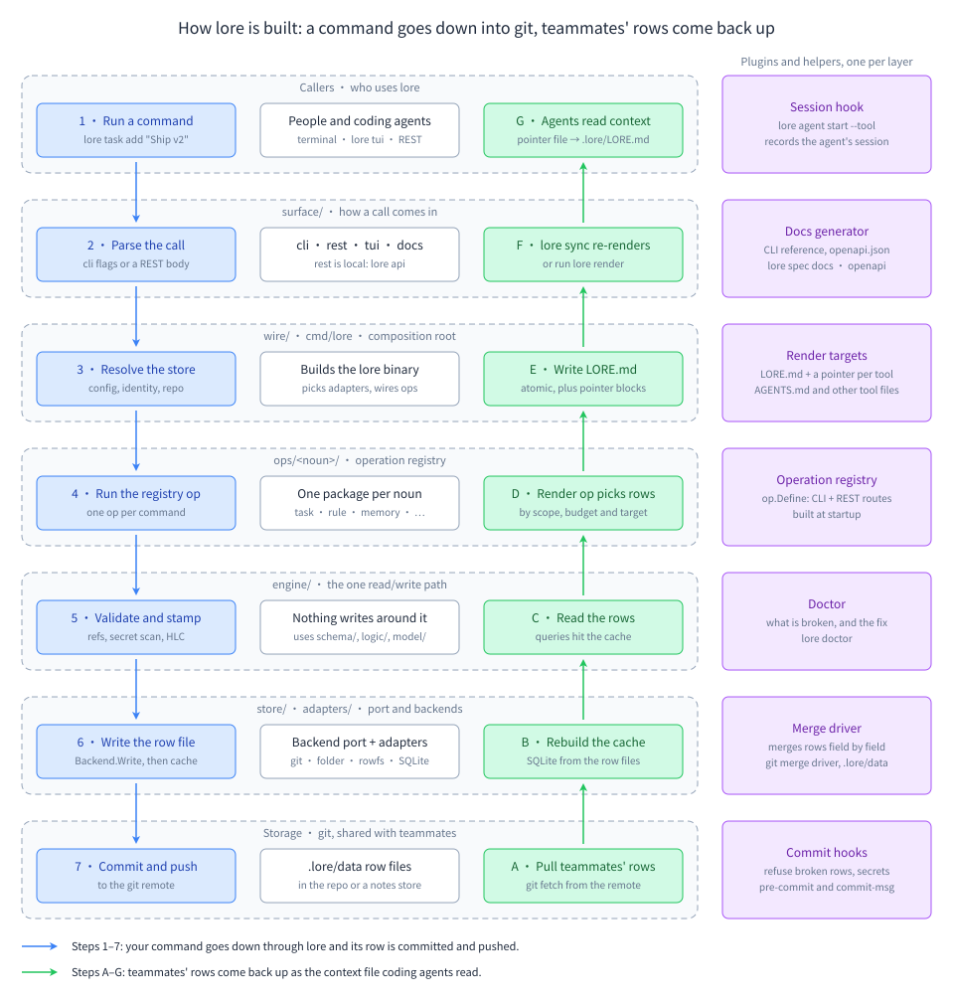

# lore documentation

**In short:** lore keeps what your project knows (rules, memories, decisions, tasks) as small files in your git repo, and hands the important ones to your coding tool every time it starts. You can use it alone in one repo in five minutes. The same tool grows to a team, private notes a client never sees, and several agents sharing one plan. Follow the learning path below, or jump to your goal.

The picture, from top to bottom: you or an agent run a lore command; lore decides who sees the note (`--to`) and when (`--live`); it saves it in git, either in the `.lore/data` folder or on a hidden list on GitHub that is not a branch (git calls it a ref), and keeps a fast local database in step. Going back up, lore fetches your teammates' notes and merges their edits one field at a time, so two people can change different parts of the same note. It keeps private notes out of the client's files and writes the context file your agents read. The helpers on the side keep it safe: git hooks (small scripts git runs before a commit or push), the merge driver (a small helper git calls to combine two edits of the same note), the CI job (a check that runs on every push) and the health check (`lore doctor`). Read [How it works](team/how-it-works.md) for the full story.

## Learning path

Each step builds on the one before. Every example is a script that runs the real lore binary in a throwaway folder; the link opens the script, and "output" opens what it printed.

| Step | What you learn | Guide | Example |
|---|---|---|---|
| 1 | Set up lore in one repo, write a first rule, and give it to your coding tool | [Your first project](knowledge/first-project.md) | [`start`](../tests/docs/sections/start.sh) ([output](../tests/docs/transcripts/start.txt)) |
| 2 | The three kinds of note you use most: rules, memories and decisions; change, replace and retire them | [Rules, memories and decisions](knowledge/rules-memories-decisions.md) | [`knowledge`](../tests/docs/sections/knowledge.sh) ([output](../tests/docs/transcripts/knowledge.txt)) |
| 3 | Find any note again, and choose what your tool reads when it starts | [Search](knowledge/search.md), [Render and agent files](knowledge/render-and-agent-files.md) | [`search`](../tests/docs/sections/search.sh) ([output](../tests/docs/transcripts/search.txt)), [`render`](../tests/docs/sections/render.sh) ([output](../tests/docs/transcripts/render.txt)) |
| 4 | Keep your to-do list next to the code: tasks, snooze, reminders, commit links | [Tasks](tasks/tasks.md) | [`tasks`](../tests/docs/sections/tasks.sh) ([output](../tests/docs/transcripts/tasks.txt)) |
| 5 | Bigger goals: missions, plans, plan files and handoffs | [Missions and plans](tasks/missions-and-plans.md) | [`missions`](../tests/docs/sections/missions.sh) ([output](../tests/docs/transcripts/missions.txt)) |
| 6 | How notes travel with your commits, branches and pull requests | [How notes travel with git](sync/how-notes-travel-with-git.md), [Branches: peek and promote](sync/branches-peek-promote.md) | [`sync`](../tests/docs/sections/sync.sh) ([output](../tests/docs/transcripts/sync.txt)) |
| 7 | When two people change the same note, and how to clean up duplicates | [Conflicts and duplicates](sync/conflicts-and-duplicates.md) | [`sync`](../tests/docs/sections/sync.sh) ([output](../tests/docs/transcripts/sync.txt)) |
| 8 | Keep lore healthy: the doctor, backups, the audit log, secrets | [Doctor](operations/doctor.md), [Back up, restore and repair](operations/backup-restore-repair.md) | [`ops`](../tests/docs/sections/ops.sh) ([output](../tests/docs/transcripts/ops.txt)) |
| 9 | A small team: tasks that reach a teammate at once, on any branch | [Getting started with teams](team/getting-started.md), [Small team in one repo](team/use-cases/small-team.md) | [`getting-started`](../tests/team/docs/transcripts/getting-started.txt), [`small-team`](../tests/team/docs/transcripts/small-team.txt) |
| 10 | An agency and a client: an org, a private store, and notes the client never sees | [Agency with a client repo](team/use-cases/agency-client-repo.md), [How to lay out your stores](choosing/store-layout.md) | [`agency`](../tests/team/docs/transcripts/agency.txt) |
| 11 | Several repos as one product, contractors, and two companies on one laptop | [Several repos as one product](team/use-cases/group-project.md), [Contractor](team/use-cases/contractor.md), [Two companies](team/use-cases/two-companies.md) | [`group`](../tests/team/docs/transcripts/group.txt), [`contractor`](../tests/team/docs/transcripts/contractor.txt), [`two-orgs`](../tests/team/docs/transcripts/two-orgs.txt) |
| 12 | Agents on one mission: claims, leases, a crash and a reclaim, a gate a person approves | [Agents](team/agents.md), [Agents on one mission](team/use-cases/agents-mission.md) | [`agents`](../tests/team/docs/transcripts/agents.txt) |
| 13 | The full production setup: CI in read-only mode, the GitHub workflow, leak guards, and what to do after a leak | [Use lore in CI](operations/ci.md), [The GitHub workflow](sync/github-workflow.md), [Cleaning up after a leak](team/use-cases/leak-cleanup.md) | [`ops`](../tests/docs/sections/ops.sh) ([output](../tests/docs/transcripts/ops.txt)), [`leak-cleanup`](../tests/team/docs/transcripts/leak-cleanup.txt) |

## Start from your goal

| I want to… | Read | Example |
|---|---|---|
| try lore in five minutes | [Your first project](knowledge/first-project.md) | [`start`](../tests/docs/sections/start.sh) |
| bring in the notes I already have in markdown | [Bring in notes you already have](knowledge/import-existing-notes.md) | [`knowledge`](../tests/docs/sections/knowledge.sh) |
| move an existing repo onto lore with a coding tool's help | [Migration prompt](MIGRATE_TO_LORE.md) | — |
| make my coding tool read my rules | [Render and agent files](knowledge/render-and-agent-files.md), [Which file your coding tool reads](choosing/render-targets.md) | [`render`](../tests/docs/sections/render.sh) |
| keep a to-do list in the repo | [Tasks](tasks/tasks.md) | [`tasks`](../tests/docs/sections/tasks.sh) |
| give a teammate a task they see at once | [Small team in one repo](team/use-cases/small-team.md), [Keep a note with the code, or share it at once](choosing/with-code-or-live.md) | [`small-team`](../tests/team/docs/transcripts/small-team.txt) |
| keep private notes about a client out of the client's repo | [Agency with a client repo](team/use-cases/agency-client-repo.md) | [`agency`](../tests/team/docs/transcripts/agency.txt) |
| share one private note with the client on purpose | [Sharing an internal note with the client](team/use-cases/sharing-a-note.md) | [`agency`](../tests/team/docs/transcripts/agency.txt) |
| keep notes only I can see | [Personal notes](team/use-cases/personal-notes.md) | [`personal`](../tests/team/docs/transcripts/personal.txt) |
| work across several repos of one product | [Where your notes live](choosing/database-mode.md), [Several repos as one product](team/use-cases/group-project.md) | [`group`](../tests/team/docs/transcripts/group.txt), [`projects`](../tests/docs/sections/projects.sh) |
| let a contractor see one client only | [Contractor limited to one client](team/use-cases/contractor.md) | [`contractor`](../tests/team/docs/transcripts/contractor.txt) |
| run several agents on one plan | [When to use agents, claims and gates](choosing/agents-claims-gates.md), [Agents on one mission](team/use-cases/agents-mission.md) | [`agents`](../tests/team/docs/transcripts/agents.txt) |
| fix a merge conflict in a note | [Conflicts and duplicates](sync/conflicts-and-duplicates.md) | [`sync`](../tests/docs/sections/sync.sh) |
| get a note back that I deleted | [Trash, restore from git and purge](sync/trash-and-purge.md) | [`sync`](../tests/docs/sections/sync.sh) |
| recover from a broken database | [Back up, restore and repair](operations/backup-restore-repair.md) | [`ops`](../tests/docs/sections/ops.sh) |
| run lore in CI | [Use lore in CI](operations/ci.md) | [`ops`](../tests/docs/sections/ops.sh) |
| find out what an error means | [Error codes and exit statuses](reference/errors.md), [Troubleshooting](team/troubleshooting.md) | [`reference`](../tests/docs/sections/reference.sh), [`errors`](../tests/team/docs/transcripts/errors.txt) |
| look up one command, flag or setting | [Reference](reference/README.md), [Feature index](reference/features.md) | — |

## Every page

### Knowledge: write it down, find it, hand it to your tool

- [Knowledge guides](knowledge/README.md): the overview of this section.
- [Your first project](knowledge/first-project.md): `lore init`, a first rule, `lore render`; also setup, doctor, tables and shell completion.
- [Rules, memories and decisions](knowledge/rules-memories-decisions.md): add, list, change, replace, retire and delete the three kinds you use most, and why a password is refused.
- [Other kinds of notes](knowledge/other-row-kinds.md): hotfixes, patterns, playbooks, prompts, snapshots and ten more.
- [Comments and tags](knowledge/comments-and-tags.md): reply to a note, and label notes so they can be found together.
- [Bring in notes you already have](knowledge/import-existing-notes.md): `lore learn-from`, the review tray and outside sources.
- [Search](knowledge/search.md): one search over every kind of note, and keeping the index healthy.
- [Render and agent files](knowledge/render-and-agent-files.md): `lore render`, other agent files, the directive block, what the tool read, and skill files.
- [Browse your notes in the terminal](knowledge/tui.md): `lore tui`.

### Tasks, missions and plans

- [Tasks, missions and plans](tasks/README.md): the overview of this section.
- [Tasks](tasks/tasks.md): add, list, start, finish, search and group tasks; one task waiting for another; saved filters.
- [Commitment and snooze](tasks/commitment-and-snooze.md): ideas, suggestions and tasks for later, kept out of your normal list.
- [Reminders](tasks/reminders.md): notes with a date, including ones that repeat.
- [Link commits to tasks](tasks/link-commits.md): which commit finished which task, and when it reached `main`.
- [Missions and plans](tasks/missions-and-plans.md): bigger goals, written plans, plan files and handoffs.
- [Run log](tasks/run-log.md): one timed try at a piece of work.

### Notes that travel with git

- [Notes that travel with git](sync/README.md): the overview of this section.
- [How notes travel with git](sync/how-notes-travel-with-git.md): `.lore/data`, commits, clones, and turning sync off for one command.
- [Branches: peek and promote](sync/branches-peek-promote.md): read another branch's notes, and copy one to `main` now.
- [Conflicts and duplicates](sync/conflicts-and-duplicates.md): field-by-field merges, real conflicts, the same fact written twice, and two separate setups in one repo.
- [Trash, restore from git and purge](sync/trash-and-purge.md): get a lost note back, write `.lore/data` again, delete old notes for good.
- [Hooks and the merge driver](sync/hooks-and-merge-driver.md): the git set-up lore adds and why.
- [The GitHub workflow](sync/github-workflow.md): let GitHub merge note files with lore.
- [Projects and repos](sync/multi-repo-projects.md): projects, repos inside a project, and renamed repos.
- [One store for several repos](sync/shared-database-mode-b.md): one folder store attached in each repo; converting an old shared-database (Mode B) repo with `lore migrate run`.

### Keep lore healthy and safe

- [Keep lore healthy and safe](operations/README.md): the overview of this section.
- [Doctor](operations/doctor.md): the health check, its exit codes, and a support bundle for bug reports.
- [The audit log](operations/audit-log.md): who changed what, and a check that nobody changed it behind lore's back.
- [Back up, restore and repair](operations/backup-restore-repair.md): copies of the database, putting one back, and fixing a damaged file.
- [Secrets and personal data](operations/secrets-and-pii.md): why passwords are refused, your own patterns, and the safety switches.
- [Use lore in CI](operations/ci.md): read-only mode, quiet hints, and failing a job on a bad health check.
- [Plugin allow-list and database settings](operations/plugins-and-db-config.md): trusted plugin files and small per-machine settings.

### Lore for teams

- [Lore for teams](team/README.md): who should read what, and the reading order.
- [Overview](team/overview.md): what lore adds for a team.
- [Concepts](team/concepts.md): rows, live rows, signals, landing, stores, orgs and identity, one idea at a time.
- [Getting started](team/getting-started.md): a first live task, a first landing, a first org.
- [How it works](team/how-it-works.md): what lore does in git behind each command.
- [Your identity, joining an org, and store housekeeping](team/identity-and-stores.md): your email as your identity, `lore org import`, moving a note, tidying caches.
- [Agents](team/agents.md): the loop an agent follows, and how a person takes work back.
- [Commands reference](team/commands.md): every team command, setting and error.
- [Troubleshooting](team/troubleshooting.md): each error message, its cause and its fix.
- Use cases: [Solo developer](team/use-cases/solo.md), [Small team in one repo](team/use-cases/small-team.md), [Agency with a client repo](team/use-cases/agency-client-repo.md), [Several repos as one product](team/use-cases/group-project.md), [Same store, separate staging](team/use-cases/staging.md), [Contractor limited to one client](team/use-cases/contractor.md), [One person in two companies](team/use-cases/two-companies.md), [Personal notes](team/use-cases/personal-notes.md), [Agents on one mission](team/use-cases/agents-mission.md), [Sharing an internal note with the client](team/use-cases/sharing-a-note.md), [Cleaning up after a leak](team/use-cases/leak-cleanup.md).

### Decision guides

- [Decision guides](choosing/README.md): the overview, and a good default for most people.
- [Where your notes live](choosing/database-mode.md): in each repo (Mode A), a folder store on your machine, or a store.
- [Keep a note with the code, or share it at once](choosing/with-code-or-live.md): `--no-live` or `--live`.
- [How to lay out your stores](choosing/store-layout.md): one store, one per client, or a mix.
- [Which org and identity setup](choosing/org-and-identity.md): no config, one org, joining, two companies.
- [Which file your coding tool reads](choosing/render-targets.md): `CLAUDE.md`, `AGENTS.md`, private context outside the repo.
- [When to use agents, claims and gates](choosing/agents-claims-gates.md): from one agent alone to many agents on one plan.

### Reference

- [Reference](reference/README.md): every command, flag, config key, environment variable and error code, in tables.
- [Feature index](reference/features.md): every feature with its code, guide and runnable example.
- [Command index](reference/commands.md): every command with its one-line help.
- [Flags](reference/flags.md): flags shared by many commands.
- [Config files](reference/config.md): `~/.lore/config.yaml` and the other settings files, every key.
- [Environment variables](reference/environment.md): settings for one shell or one command.
- [Error codes and exit statuses](reference/errors.md): every code, its hint and its exit status.

### For contributors and agent tools

- [Development](DEVELOPMENT.md): build, test and release lore.
- [Migration prompt](MIGRATE_TO_LORE.md): a prompt that moves an existing repo onto lore.
- [The lore skill](../skills/README.md): the instructions a coding tool loads to use lore, with its [command list](../skills/COMMANDS.md), [error list](../skills/ERRORS.md) and [walkthroughs](../skills/examples/01-bootstrap.md).
- [Docs examples](../tests/docs/README.md): how the examples on these pages are run and pasted.
- Design specs: [LORE_TEAM_SPEC.md](../LORE_TEAM_SPEC.md) (teams, stores, live rows, agents) and [LORE_SYNC_SPEC.md](../LORE_SYNC_SPEC.md) (notes in git).
