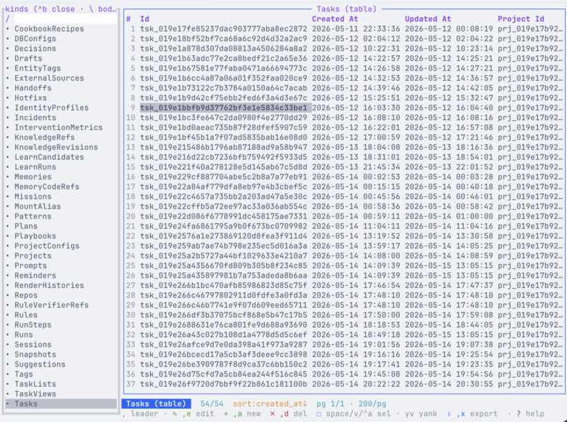
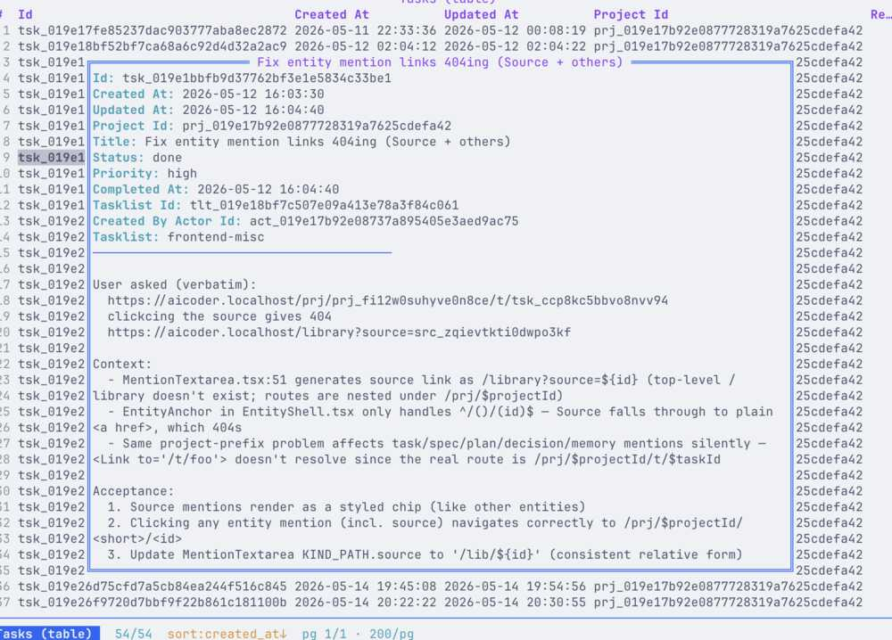
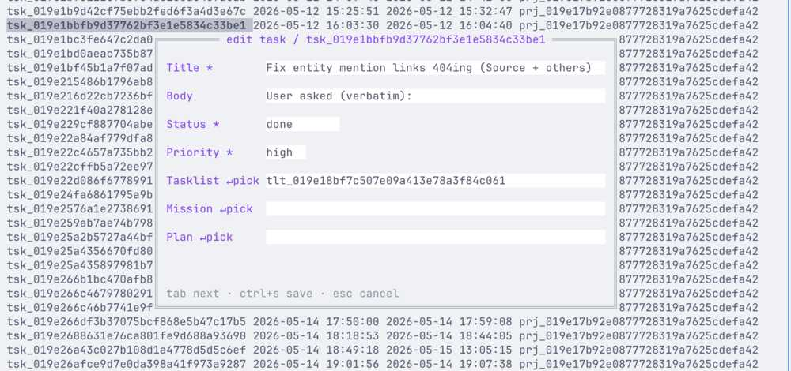
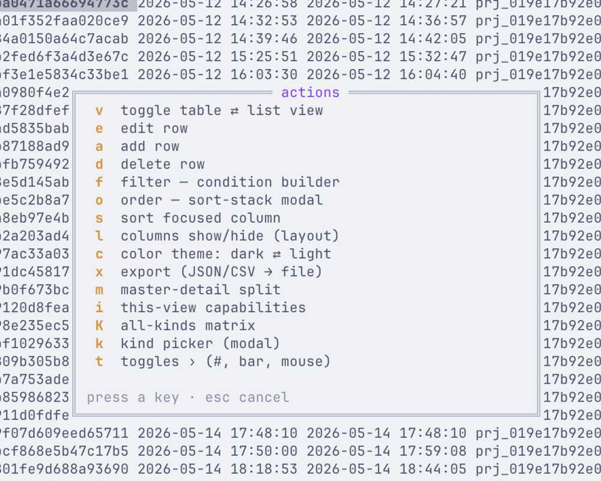
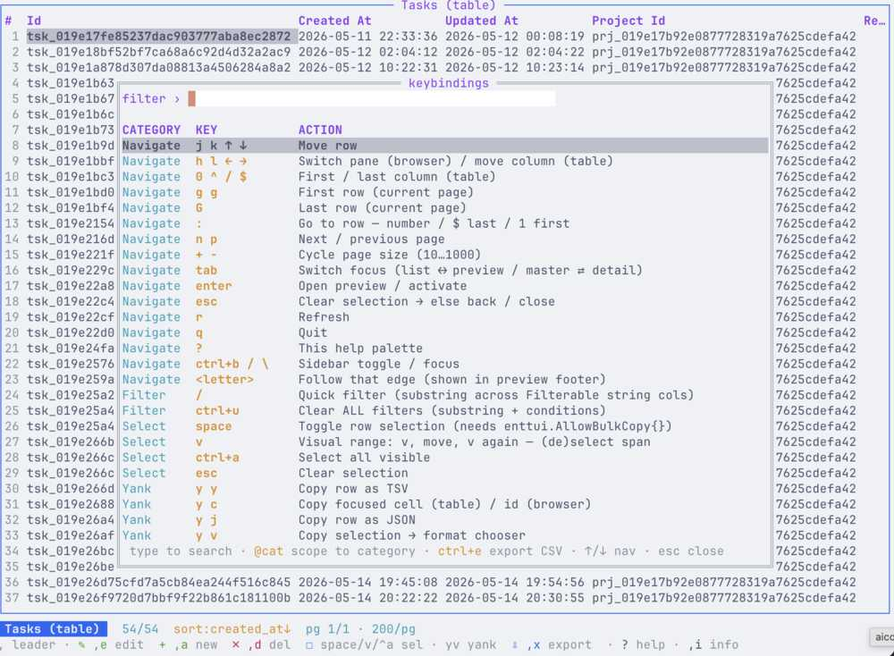

# Browse your notes in the terminal

**In short:** `lore tui` opens a full-screen browser for every note in the repo, right in your terminal. You move with the keyboard, open a row to read it, filter a long list, and edit a row in a form. Press `?` at any time to see the keys.

## What it is and when you want it

A *TUI* (terminal user interface) is an app that runs inside the terminal window, like a text-only spreadsheet. `lore tui` shows the same database every other lore command uses, one table per kind of row: memories, rules, decisions, tasks and the rest.

Use it when you want to look around rather than type exact commands: to read through all your decisions, to find a memory you half remember, or to fix a few typos one after another.



## Before you start

- A repo with lore set up: see [Your first project](first-project.md).
- A real terminal window. The TUI does not run inside a script, a pipe or a CI job.

## Step 1 — Open it

Run it in the top folder of the repo. It opens on memories, in a table.

```console
$ lore tui
```

`--kind` picks the table it opens on, and `--view list` shows rows as a list instead of a table:

```console
$ lore tui --kind decision --view list
```

## Step 2 — Move around

The keys follow the vim editor (for example `j` moves down and `k` moves up). `?` shows every key, and `,` opens the menu of actions for the row you are on.

| Open a row | Edit it in a form |
|---|---|
|  |  |
| **The actions menu (`,`)** | **The key list (`?`)** |
|  |  |

## Try it

Open the TUI on your decisions, press `?` to read the keys, then open a decision to read it in full. These are all the flags:

<!-- help: tui -->
tui opens the current project's .lore/lore.db in an interactive, schema-driven terminal UI (powered by enttui)

```text
Usage:
  lore tui

Flags:
      --db string        override DB path (default: cwd's .lore/lore.db)
      --kind string      kind to open first (e.g. memory, task, decision) (default "memory")
      --project string   override project (id or name)
      --read-only        skip lock acquisition; refuse writes
      --repo string      scope to a specific repo (mount_name or rep_id)
      --view string      initial view mode: table | list (default "table")
```
<!-- /help -->

## Pitfalls

- **It needs a terminal.** Run from a script or with input from a pipe, it stops with `open /dev/tty: no such device or address`. Use `lore <kind> list` or `lore search` there instead.
- **Commit afterwards.** A change made in the TUI is a change to a row like any other. Run `lore sync` so `.lore/data` gets it, then commit.
- **One project at a time.** The TUI shows the project of the folder you start it in. Pass `--project` to open another one.

## Related

- [Rules, memories and decisions](rules-memories-decisions.md)
- [Search](search.md): the fast way to find one row by its words.
- [Knowledge guides index](README.md)
